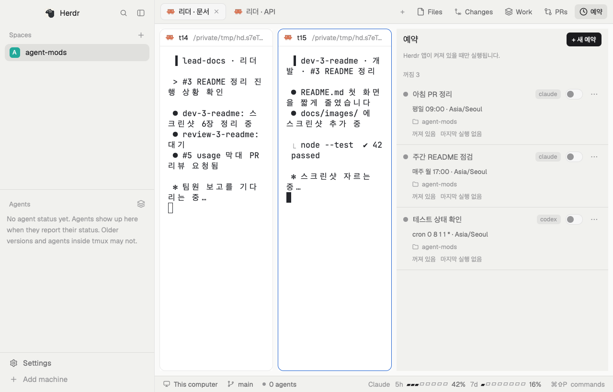

# agent-mods

AI 에이전트(Claude Code, Codex 등)를 여러 개 동시에 돌릴 때 쓰는 [Herdr](https://github.com/herdrdev/herdr) 모드(mod) 모음입니다.

- **한눈에 보기**: 누가 무엇을 하고 있는지, 손봐야 할 PR이 무엇인지 Herdr 화면 안에서 바로 봅니다.
- **예약 실행**: 정해진 시각에 에이전트를 띄워 프롬프트를 보냅니다.
- **골라 설치**: 한 줄로 모두 설치하거나, 필요한 모드만 골라 넣고 뺄 수 있습니다.

Herdr는 터미널 작업 공간 앱이고, 모드는 그 화면에 패널과 버튼을 더합니다.



---

## 모드

모드마다 문서 한 장에 사용법, 필요한 것, 설치 방법을 정리했습니다. 문서 칸을 누르면 바로 갑니다.

| 모드 | 한 줄 | 기본/추가 | 문서 |
| --- | --- | --- | --- |
| 패널 버튼 (`tabs-mine`) | 탭 줄에 Work·PRs·예약 버튼을 붙이고, 손봐야 할 PR 수를 띄웁니다 | 기본 | [tabs-mine](docs/mods/tabs-mine.md) |
| Work (`work`) | 세션마다 맡은 이슈, 워크트리, PR, CI를 한 트리로 봅니다 | 기본 | [work](docs/mods/work.md) |
| PRs (`prs`) | 저장소별 열린 PR과 리뷰 상태, 정리할 워크트리를 봅니다 | 기본 | [prs](docs/mods/prs.md) |
| 예약 (`schedules`) | 정해진 시각에 Claude나 Codex 세션을 띄워 프롬프트를 보냅니다 | 기본 | [schedules](docs/mods/schedules.md) |
| 워크트리 메뉴 (`wt-menu`) | 워크트리를 IDE, Herdr 공간, Finder·탐색기, GitHub로 바로 엽니다 | 기본 | [wt-menu](docs/mods/wt-menu.md) |
| Claude 사용률 (`usage-status`) | 아래 상태 줄에 Claude 5시간·7일 사용률을 막대로 보여 줍니다 | 추가 | [usage-status](docs/mods/usage-status.md) |
| 작업별 묶음 (`agent-groups`) | 사이드바에서 터미널을 리더별로 묶고 리더 아래에 팀원을 둡니다 | 추가 | [agent-groups](docs/mods/agent-groups.md) |
| 리더 탭 (`leader-tabs`) | 리더 세션이 둘 이상이면 칸 머리줄에 리더 탭을 띄웁니다 | 추가 | [leader-tabs](docs/mods/leader-tabs.md) |
| 경로 메뉴 (`path-menu`) | 터미널의 파일 경로를 Cmd·Ctrl+클릭하면 폴더 열기·파일 열기·경로 복사 메뉴를 띄웁니다 | 추가 | [path-menu](docs/mods/path-menu.md) |
| 계정 (`gh-accounts`) | 스페이스·저장소마다 쓸 GitHub 계정을 보고 고릅니다([gh-account](docs/gh-account.md) 도구 필요) | 추가 | [gh-accounts](docs/mods/gh-accounts.md) |
| PO 데스크 (`inbox`) | 리더 결과 보고를 채팅처럼 보여 주고, 결정이 필요한 보고에 답하거나 채팅칸에서 `@리더`로 말하면 PO 터미널에 입력으로 전해 줍니다 | 추가 | [inbox](docs/mods/inbox.md), [인박스 계약](docs/inbox-contract.md) |

<!-- 새 모드: docs/mods/<모드>.md를 만들고 이 표와 herdr/README.md 모드 표에 한 줄씩 더합니다. -->

- **기본**은 옵션 없이 설치하면 들어가고, **추가**는 [모드 골라 설치](#모드-골라-설치)로 넣습니다.

지금은 Herdr용 모드만 있습니다([`herdr/`](herdr/)).
Claude Code(`claude/`)와 Orca(`orca/`)용은 계획 중입니다.

---

## 빠른 설치

1. **준비**
   - [Herdr](https://github.com/herdrdev/herdr) 앱을 한 번 실행해 두고 켜 둡니다.
   - [Node.js](https://nodejs.org/)가 필요합니다.
   - [GitHub CLI](https://cli.github.com/)를 설치하고 `gh auth login`으로 로그인합니다.
2. **설치 명령 한 줄**로 기본 모드 5개를 설치합니다.

   macOS·Linux:

   ```sh
   curl -fsSL https://raw.githubusercontent.com/xowjd913/agent-mods/main/herdr/install.sh | sh
   ```

   Windows(PowerShell):

   ```powershell
   & ([scriptblock]::Create((irm https://raw.githubusercontent.com/xowjd913/agent-mods/main/herdr/install.ps1)))
   ```

   추가 모드까지 모두 넣으려면 [설치 안내](herdr/README.md#설치-명령)의 `--extras` 명령을 씁니다.

3. **Herdr 확인**: 탭 줄에 `Work`·`PRs`·`예약` 버튼이 보이면 끝입니다.
   - 안 보이면 `ctrl-shift-l`로 레이아웃을 바꿨다 돌아옵니다.
   - 앱이 꺼져 있었다면 앱을 켜고 같은 명령을 한 번 더 실행합니다.

macOS에서 확인했습니다.
Windows는 설치기가 있지만 실제 PC에서는 아직 확인하지 않았습니다.

---

## 모드 골라 설치

필요한 모드만 따로 넣거나 뺄 수 있습니다.
위 설치 명령 뒤에 옵션을 붙입니다.

```sh
# Claude 사용률(usage-status)만 설치
curl -fsSL https://raw.githubusercontent.com/xowjd913/agent-mods/main/herdr/install.sh | sh -s -- --only usage-status

# 설치된 모드에 작업별 묶음(agent-groups) 더하기
curl -fsSL https://raw.githubusercontent.com/xowjd913/agent-mods/main/herdr/install.sh | sh -s -- --add agent-groups

# 리더 탭(leader-tabs) 빼기
curl -fsSL https://raw.githubusercontent.com/xowjd913/agent-mods/main/herdr/install.sh | sh -s -- --remove leader-tabs

# 모드별 설치 상태 보기
curl -fsSL https://raw.githubusercontent.com/xowjd913/agent-mods/main/herdr/install.sh | sh -s -- --list
```

- Windows는 `-Only`, `-Add`, `-Remove`, `-List`를 붙입니다.
- 필요한 모드는 함께 설치됩니다. 예를 들어 `prs`를 고르면 `work`, `tabs-mine`, `wt-menu`도 들어갑니다.
- 옵션은 한 번에 하나만 씁니다.
- 자세한 동작과 Windows 예시는 [모드 골라 설치](herdr/README.md#모드-골라-설치)에 있습니다.

---

## 업데이트와 제거

- **업데이트**: 설치 명령을 옵션 없이 다시 실행합니다.
  - 설치돼 있는 모드만 갱신합니다.
  - 직접 고친 레이아웃은 덮어쓰지 않습니다.
- **모드 하나 빼기**: 위의 `--remove`를 씁니다.
  - 모드 폴더를 지우고, 그 모드가 바꾼 레이아웃 블록을 되돌립니다.
- **모두 지우기**: [제거 안내](herdr/README.md#제거)대로 `dashboard` 레이아웃과 설치기가 표시한 모드 폴더를 지웁니다.

자세한 요구 사항, 동작 방식, 데이터 저장 위치는 [herdr/README.md](herdr/README.md)에 있습니다.

---

## 기여

버그 제보, 개선 제안, PR 모두 환영합니다.

1. 이 저장소를 fork하고 `develop`에서 브랜치를 만들어 고칩니다.
2. 저장소 최상위에서 `node --test`를 돌립니다.
   - 모드를 고쳤다면 설치한 뒤 `herdr-app check <설정 폴더>/mods/<모드>`로 앱에서 확인해 주세요.
3. `develop`으로 PR을 엽니다. 무엇을 왜 바꿨는지, 어떻게 확인했는지 적어 주세요.

PR이 들어가는 과정:

- `develop`: 기여 PR이 들어가는 곳입니다. 리뷰 승인이 없어도 합칠 수 있습니다.
- `main`: 배포할 때 develop→main PR과 버전 태그로만 바뀝니다. 이 PR은 코드 소유자(CODEOWNERS)의 승인이 있어야 합칩니다.
- 처음 기여하는 분의 PR은 GitHub Actions가 돌기 전에 관리자 승인을 한 번 거칩니다.
- CI는 macOS·Linux·Windows에서 `node --test`와 설치 스크립트 문법 검사를 돌립니다.

---

## 라이선스

[Apache License 2.0](LICENSE).

일부 모드는 Herdr 기본 모드를 복제해 고친 것입니다. 자세한 내용은 [NOTICE](NOTICE)를 보세요.
