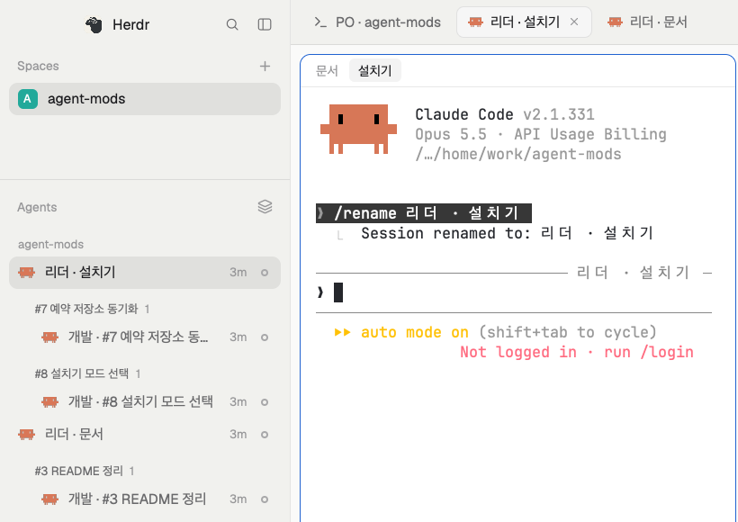

# 작업별 묶음 (agent-groups)

왼쪽 사이드바에서 터미널을 리더별로 묶고, 리더 아래에 그 팀원(개발·리뷰·통합)을 둡니다.



## 사용법

- **위치**: 왼쪽 사이드바
- **맞는 사람**: 에이전트를 역할별로 나눠 여러 이슈를 동시에 돌리는 사람

### 보기 고르기

- 사이드바 에이전트 목록에 `작업별 묶음` 보기가 생깁니다.
- Herdr 기본 보기(우선순위순, 공간별)도 그대로 고를 수 있습니다.
- 목록 위의 `+ 새 스페이스` 버튼(macOS만)을 누르면 폴더 선택창이 뜨고, 고른 폴더 이름으로 새 스페이스를 열어 그 폴더에서 `claude`를 띄운 뒤 `/po`를 보냅니다. 선택창을 닫으면 아무 일도 하지 않습니다.

### 묶는 방법

- 리더마다 머리줄 하나를 두고, 그 아래에 리더 행과 팀원 행을 차례로 둡니다. 팀원은 `hc` 부모 사슬(최대 8단계)에 있는 리더 아래로 들어가므로, 이름의 이슈 번호가 서로 달라도(개발 `dev-28-...`, 리뷰 `review-29-...`) 같은 리더 아래에 모입니다.
- 머리줄 제목은 리더 탭 이름, 없으면 그 리더의 세션 이름입니다. 세션 이름은 리더 터미널의 현재 제목(`리더 · ` 머리말은 뗌), 없으면 `session` 라벨, 없으면 마지막으로 본 이름, 마지막으로 `hc` 이름(`lead-` 뗌, `-`는 띄어쓰기)입니다. UI 모드가 쓰는 규칙과 같습니다. 리더를 닫은 뒤에도 마지막 이름은 남습니다(모드 공유 상태 `leader.names`, 최대 60명).
- 리더 판정은 터미널 라벨 `role=leader`, 없으면 `lead-` 이름 순입니다. PO(`role=po`) 아래에 리더 섹션이 모두 같은 모양으로 놓입니다.
- 부모를 알 수 없는 팀원만 `hc` 이름의 이슈 번호(`dev-<이슈>`, `review-<이슈>`, `integration-<이슈>`)로 묶고, 그것도 안 되면 `기타`에 둡니다.
### 기본 이름

위의 `lead-`, `role=po`, `role=leader`, `session`, `리더 · `는 **UI 모드와 같이 쓰는 기본 이름**이고 필수 규칙이 아닙니다. 이 이름이 없으면 묶음 없이 기본 목록과 거의 같게 보입니다. 이름을 바꿔 쓰는 프로필([인박스 계약 §9](../inbox-contract.md))은 지금은 UI 모드의 쓰기 도구만 따르고, 이 모드는 아직 기본 이름만 읽습니다([이름 규칙과 프로필](inbox.md#이름-규칙과-프로필)).

### 기본 목록과의 차이

- Herdr 기본 에이전트 목록 모드를 복제해 보기를 더한 것입니다.
- 기본 이름이 없으면 기본 모드와 거의 같게 보입니다.

## 필요한 것

- 함께 설치되는 모드: 없음

## 설치

추가 모드라 기본 설치에는 들어가지 않습니다.

```sh
curl -fsSL https://raw.githubusercontent.com/xowjd913/agent-mods/main/herdr/install.sh | sh -s -- --add agent-groups
```

```powershell
& ([scriptblock]::Create((irm https://raw.githubusercontent.com/xowjd913/agent-mods/main/herdr/install.ps1))) -Add agent-groups
```

빼는 방법과 다른 옵션은 [모드 골라 설치](../../herdr/README.md#모드-골라-설치)에 있습니다.

---

[← 모드 목록으로](../../herdr/README.md#모드)
