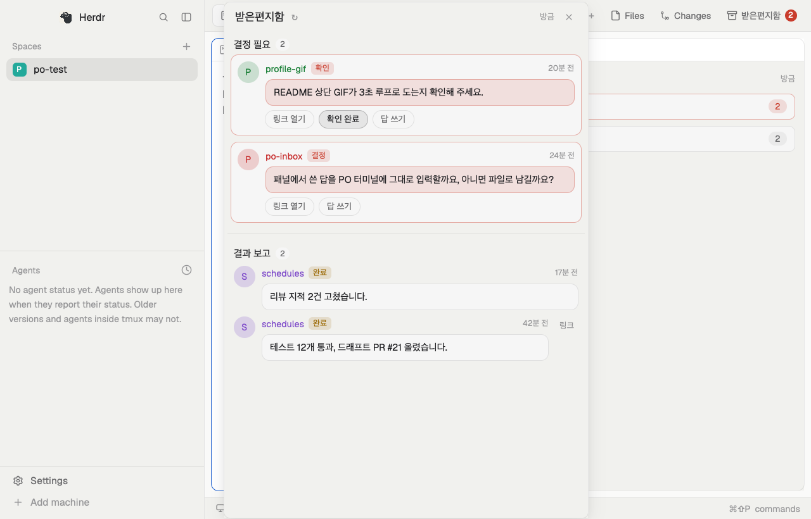
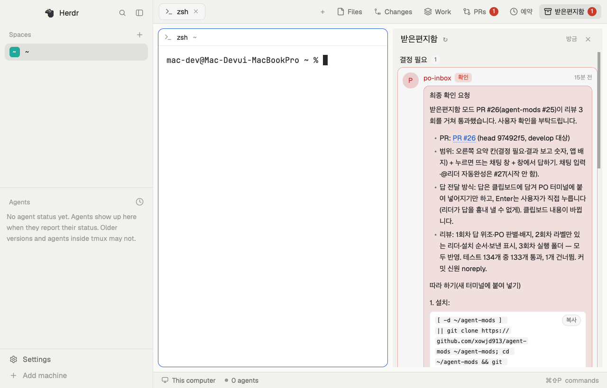

# PO 데스크 (inbox)

PO 한 명을 골라, 그 PO 아래 리더들이 남긴 결과 보고를 채팅처럼 한 곳에 모아 보여 주고, 결정이 필요한 보고에는 패널에서 바로 답합니다. 답 버튼의 답은 클립보드를 거쳐 PO 터미널에 붙여 넣어지고 Enter는 내가 직접 누릅니다. 채팅 입력칸은 Enter까지 눌러 바로 보냅니다.




```text
  PO 데스크                                   ⟳
  [PO · DevNotes 2] [mascoz]
  ── 결정 필요 (2) ──────────────────────────
  (L) lead-po-inbox   결정
      ┌──────────────────────────────────┐
      │ A안으로 갈까요, B안으로 갈까요?  │
      └──────────────────────────────────┘
      [링크 열기] [답 쓰기]
  (L) lead-docs       확인
      ┌──────────────────────────────────┐
      │ PR #21 확인 부탁드립니다         │
      └──────────────────────────────────┘
      [링크 열기] [확인 완료] [답 쓰기]
  ── 결과 보고 ──────────────────────────────
  (L) lead-fix        끝났습니다. PR #18 …
  (L) lead-docs       시작합니다. …
```

*패널 모양을 글자로 그린 스케치입니다. 실제 화면은 Herdr 테마 색을 따릅니다.*

## 사용법

- **위치**: 오른쪽 패널의 작은 요약 칸(`PO 데스크` 버튼으로 열기). 요약 칸을 누르면 채팅 전체가 떠 있는 창으로 열립니다.
- **맞는 사람**: 여러 리더에게 일을 맡기고, 결정과 결과만 한 번에 받아 보고 싶은 사람

### PO 고르기

창과 요약 칸 머리 아래의 줄에서 PO를 고릅니다. 카드, 보고, 기다리는 개수, `@` 목록, 채팅이 가는 곳, 보이는 PO의 답이 모두 **고른 PO 하나**의 것입니다. 글을 `@` 없이 쓰면 고른 PO에게 갑니다.

- PO 터미널에는 라벨 `role=po`와 `po=<id>`가 둘 다 있어야 합니다(`hc label <터미널> role=po po=devnotes`). id는 소문자·숫자·`-` 1~40자입니다. 터미널 주소는 다시 켜면 바뀌므로 어디에도 열쇠로 쓰지 않습니다.
- 고르는 칩에는 PO 터미널의 제목(예: `PO · DevNotes`, 제목이 없으면 id)과, 그 PO 아래에서 결정·확인을 기다리는 리더 수가 붉게 붙습니다. PO가 하나뿐이면 요약 칸에서는 줄을 숨깁니다.
- 처음 열 때 고른 PO: 마지막에 고른 PO(공유 상태에 저장, 아직 살아 있을 때), 없으면 살아 있는 리더가 가장 많은 PO(같으면 앞쪽)입니다.
- 리더가 어느 PO 것인가: **살아 있는 리더는 터미널의 부모 PO**입니다(터미널이 진실). 이미 닫힌 리더는 그 보고 줄에 적힌 `po`(없으면 건너뛰고 가장 최근에 적힌 것)가 살아 있는 PO일 때만 그 PO 것입니다. PO가 닫혀 있으면 아무것도 갖지 못합니다.
- **PO를 알 수 없는 리더와 보고는 `기타` 칩 아래에만 나옵니다**(그런 것이 있을 때만 칩이 생깁니다). 어느 PO 화면에도 섞이지 않고, `기타`에서는 채팅을 보낼 수 없습니다(받을 PO가 없음).
- 앱 아이콘(Dock) 숫자와 탭 줄 버튼 숫자는 PO와 상관없이 기다리는 리더 전부입니다.
- `po=<id>` 라벨이 달린 PO 터미널이 하나도 없으면 칩 줄 자리에 `role=po, po=<id> 라벨을 달면 PO별로 나뉩니다`라는 안내가 뜨고 채팅은 보낼 수 없습니다.
- 같은 `po=<id>`를 단 PO 터미널이 둘 이상이면 먼저 나온 터미널 하나만 그 id로 칩이 됩니다. id는 하나에만 다세요.

### 요약 칸과 채팅 창

- 목록 칸: 한 목록으로 한눈에 봅니다. 기다리는 결정·확인이 맨 위에 붉게 고정되고, 그 아래로 보고가 새 것부터 이어집니다. 한 줄이 한 건이고, 리더 이름, 종류 배지, 첫 줄(길면 `…`)이 보입니다. 기다리는 줄 아래의 보고는 최대 20줄이며, 넘으면 맨 아래에 `나머지 n개는 창에서 열 수 있습니다`가 적힙니다(누르면 창이 열립니다).
  - 머리줄의 `결정 n`·`보고 n`은 개수만 보여 주는 표시이고 누르는 버튼이 아닙니다. 결정 건이 있으면 앱 아이콘(Dock)에도 그 숫자가 뜹니다(30초마다 갱신).
  - 줄을 누르면 채팅 창이 그 건을 맨 위에 펼친 채로 열립니다(그 카드를 목록 맨 앞으로 가져옵니다). 창이 이미 열려 있으면 다음 새로고침(최대 5초)에 따라옵니다. 창에서 `모두 보기`를 누르면 선택이 풀립니다.
  - `창 열기`는 선택 없이 창만 엽니다.
  - 창에서 `자세히`·`접기`·섹션 접기/펼치기·`답 쓰기`를 눌러도 목록이 맨 위로 돌아가지 않고 누른 카드가 제자리에 보입니다.
- 목록 줄이나 `창 열기`를 누르면 채팅 전체(아래 두 칸)가 떠 있는 `PO 데스크` 창으로 열립니다.
  - 창은 끌어서 옮길 수 있고, 놓은 자리를 기억해 다음에 그 자리에서 열립니다.
  - 창 오른쪽 위 `×`로 닫습니다. 창을 연 채로 두면 다음에 Herdr를 켤 때 다시 열립니다.
  - 창 안의 버튼·입력 칸·이름은 눌러도 창이 끌려가지 않습니다. 끌려면 머리줄(제목이 있는 줄)을 잡습니다.

### 두 칸

두 칸의 머리줄(`▾ 결정 필요 n`, `▾ 결과 보고 n`)을 누르면 칸이 접히고 펴집니다(`▸`는 접힌 모양). 접어도 개수는 머리줄에 남고, 접은 상태는 공유 상태에 저장돼 창을 닫았다 열어도 유지됩니다.

- 기본값: `결정 필요`는 펴져 있고, 비어 있으면 저절로 접힙니다. 직접 누른 선택이 이기며, `결정 필요`는 그 건수가 바뀌면 다시 기본값(펴짐, 비면 접힘)으로 돌아갑니다. `결과 보고`는 직접 정한 대로 계속 유지됩니다.
- 목록 줄로 `결정 필요`의 카드를 골라 열면 그 칸은 접혀 있어도 펴집니다.

- `결정 필요`: 터미널에 `wait` 표시(`decision` 또는 `verify`)가 붙은 리더의 마지막 결정·확인 보고입니다.
  - PO 터미널에서 답을 Enter로 보내 리더가 받으면 그 리더의 보고 기록에 답 표시가 남아, 다음 결정이 오기 전까지 이 칸에서 빠집니다.
- `결과 보고`: 나머지 보고를 리더별 말풍선으로 보여 줍니다. 가장 새 것이 위, 리더마다 최근 40개까지입니다.
  - 이미 답한 결정·확인은 여기에 중립색 `결정 · 답함`, `확인 · 답함` 표시로 남습니다. 붉은 표시는 아직 기다리는 건에만 붙습니다(`결정 필요` 칸과 목록 칸의 맨 위 줄).
  - 짝짓기: `answered` 줄은 같은 리더의 그 앞에서 아직 답 없는 가장 최근 결정·확인 하나를 닫습니다. `answered` 본문이 종류(`decision`/`verify`)를 담고 있으면 그 종류의 가장 최근 건을 먼저 찾고, 없으면 종류에 관계없이 가장 최근 건을 닫습니다.
- 리더 이름을 누르면 그 리더의 터미널을 들여다봅니다.
- 카드와 목록 줄의 리더 이름은 `po-inbox` 같은 내부 이름이 아니라 Herdr에서 보이는 세션 이름(예: `받은편지함 패널`)입니다. 순서는 리더 터미널의 현재 제목(`리더 · ` 머리말은 뗌) → `session` 라벨 → 마지막으로 본 이름 → 내부 이름(`lead-` 뗌, `-`는 띄어쓰기)입니다. 이미 닫힌 리더의 옛 카드도 마지막으로 본 이름으로 읽히며, 이름은 에이전트 목록(`agent-groups`)과 같은 규칙·같은 기억(`leader.names`)을 씁니다.

### 카드 읽기

카드는 접힌 채 시작합니다. 접힌 카드는 종류 배지, 리더 이름, 제목, 첫 문장, 짧은 링크(`PR #26`)만 보여 줍니다.

- `자세히`/`접기`: 카드 오른쪽 아래 버튼으로 본문 전체를 펼치고 접습니다. 펼침은 카드마다 공유 상태에 저장돼 창을 닫았다 열어도 유지됩니다. 카드 아무 데나 눌러서는 펼쳐지지 않으므로 글자를 드래그해도 카드가 접히거나 펴지지 않습니다.
- 제목과 소제목은 본문보다 큰 글자로 보입니다. 글꼴 때문에 굵기 차이는 작아서 크기로 구별합니다.
- 펼친 본문: 줄바꿈을 지키고, `- ` 목록과 `1. ` 번호 목록은 들여쓴 줄로, `따라 하기:`·`되돌리기:`·`아직 못 해 본 것:`·`## 제목`은 작은 소제목으로 보여 줍니다. 모르는 문법은 글자 그대로 둡니다.
- 명령 상자는 보수적으로 만듭니다. 백틱(`` ` ``)으로 감싼 코드, `$ `로 시작하는 줄, 코드 펜스, 그리고 `되돌리기:` 같은 이름표 뒤에 줄 전체가 명령 하나인 것만 고정폭 상자에 담고 `복사` 버튼을 둡니다. 설명 문장 속의 명령 비슷한 글자는 상자로 만들지 않습니다. 본문이 명령 하나뿐인 보고도 상자로 나오며 `자세히`가 붙습니다. `복사`는 원문 명령 그대로만 클립보드에 담고, 붙여 넣거나 보내지 않습니다. 긴 명령은 줄이 바뀝니다.
- 링크는 짧은 이름으로 보입니다: `PR #26`, `issue #25`, `comment`, 그 밖에는 `호스트/경로`. 누르면 앱 안 `open_url`로 기본 브라우저에서 열리고(http·https만), 안 되면 운영체제 열기 명령(`open`·PowerShell·`xdg-open`)으로 엽니다.
- 글자 선택: 제목, 첫 문장, 펼친 본문, 링크 이름, 명령 상자 안 글자까지 모두 마우스로 드래그해 고를 수 있고 `Cmd+C`(Windows·Linux는 `Ctrl+C`)로 복사됩니다. 명령 하나를 통째로 복사하려면 `복사` 버튼이 더 쉽습니다.




### 결정 필요 카드의 버튼

- `링크 열기`: 보고에 붙은 링크(PR, 이슈 등)를 엽니다.
- `확인 완료`: 확인(`verify`) 보고에만 있습니다. 글 없이 `확인 완료`를 답으로 붙여 넣습니다.
- `답 쓰기`: 입력 칸을 열고, `보내기`(또는 Enter)로 답을 PO 터미널에 붙여 넣습니다.

### 답이 가는 곳

답 버튼(`확인 완료`, `보내기`)을 누르면 패널이 아래 한 줄을 만들어 PO 터미널에 **붙여 넣습니다**. Enter는 누르지 않습니다.

```text
Panel answer (decision) for lead-po-inbox: "A안으로 가자". Target: https://github.com/…/issues/25
```

1. 그 줄을 **클립보드에 담습니다.** 클립보드에 있던 내용은 바뀝니다(버튼에 마우스를 올리면 알려 줍니다).
2. PO 터미널 칸으로 포커스를 옮기고 붙여 넣습니다. 채팅 창이 열려 있었다면 키보드가 PO 칸으로 가도록 창은 닫힙니다.
3. PO 터미널에서 내용을 확인하고 **Enter를 눌러 보냅니다.** 마지막 확인도 내 손으로 하는 셈입니다.

- 붙여 넣은 글은 내가 직접 친 입력과 같아서, PO가 받는 쪽에서 `<hc from=…>` 같은 보낸 이 표시가 붙지 않습니다.
- 여러 줄로 쓴 답은 한 줄로 이어 붙입니다.
- PO 터미널이 칸 없이 돌고 있으면 칸을 열어 주고, 글은 클립보드에 둡니다. 칸이 열리면 붙여넣고 Enter를 누르세요.
- 붙여넣기 명령이 실패해도 글은 클립보드에 있습니다. 패널이 "붙여넣고 Enter" 안내를 보여 줍니다.

### PO에게 말하기 (채팅 입력칸)

채팅 창 맨 아래 입력칸에 글을 쓰고 **Enter**(또는 `PO에 보내기` 버튼)를 누르면, 글이 PO 터미널에 붙여 넣어지고 **Enter까지 눌려 바로 제출됩니다.** PO는 내가 직접 친 입력처럼 받습니다. 리더에게 곧바로 보내지는 일은 없습니다.

- **줄바꿈은 Shift+Enter**입니다. 입력칸은 여러 줄이고(최대 6줄까지 커집니다) Enter는 보내기입니다. 긴 글도 줄바꿈이 그대로 PO 입력창에 들어가고, 여러 번 제출로 쪼개지지 않습니다. 줄 끝 공백과 3줄 이상 이어진 빈 줄만 정리됩니다.
- **한글(IME) 조합 중 Enter**: 이 창의 키 이벤트에는 조합 중인지 알려 주는 값이 없습니다. 그래서 글을 친 지 0.5초 안이거나 글이 한글·가나·한자로 끝나 있으면 **첫 Enter는 한 번 붙잡아 아무것도 보내지 않고**(조합을 확정하는 Enter일 수 있기 때문), 그 뒤 글을 더 고치지 않고 누른 **두 번째 Enter가 보냅니다**. 붙잡은 동안 입력칸 위에 `한 번 더 Enter로 보냅니다`가 뜨고, 글을 고치거나 PO를 바꾸거나 보내면 사라집니다. 그래서 한글로 끝나는 글은 늘 Enter를 두 번 눌러야 하고, 마침표나 영문·숫자로 끝나는 글은 한 번에 갑니다. 한계: 이 규칙은 시간과 마지막 글자로 짐작할 뿐이라 조합 상태를 알 수는 없습니다. 그리고 `PO에 보내기` 버튼은 이 규칙을 타지 않습니다.
- **붙여 넣기와 Enter의 간격**: 글을 붙여 넣고 350ms 뒤에 Enter를 누르는데, PO가 일하느라 바쁘면 붙여 넣기가 끝나기 전에 Enter가 먼저 처리될 수 있습니다(이때는 PO 입력창에 글이 남고 보내지지 않거나 일부만 갑니다). 이 모드는 그것을 알아챌 수 없으니, 바쁜 PO에게는 보낸 뒤 PO 화면을 확인하세요.
- 넣는 길: 클립보드 → PO 칸 포커스 → `terminal.paste`(위의 답 버튼과 같은 길, 줄바꿈은 붙여넣기 한 번으로 갑니다) → 0.35초 뒤 `hc keys <PO터미널> enter`(`hc keys --help`: "Press named keys", herdr.d.ts의 `hc(args)`)로 Enter. `hc send`는 `<hc from=...>` 꼬리표가 붙어 PO가 사용자 답으로 보지 않으므로 쓰지 않습니다.
- PO가 확인 질문 등으로 막혀 있으면(`blocked`) 붙여 넣기만 하고 Enter는 누르지 않습니다. 그 Enter가 질문에 대한 답이 되어 버리기 때문입니다. PO 터미널에서 직접 확인하고 Enter를 누르세요.
- PO 터미널이 칸 없이 돌고 있으면 칸을 열어 주고 글은 클립보드에 둡니다(Enter는 누르지 않습니다). Enter를 누르지 못하면 이유를 알려 주고 PO 터미널에서 직접 누르라고 안내합니다.

- 그냥 쓰면 PO에게 하는 말입니다. `@here`를 달아도 같습니다. `@here`는 글 어디에 있든 보낼 때 빠지고, 남은 공백과 앞쪽 문장부호도 정리됩니다(`hi @here, ok` → `hi, ok`). 줄 맨 앞의 `@here,`는 줄바꿈을 먹지 않고 그 줄에서만 빠집니다.
- 목록에 없는 `@lead-x`처럼 모르는 이름은 호출로 보지 않습니다. 글에 그대로 남고, PO에게 가는 일반 메시지로 붙여 넣어집니다.
- `@`를 치면 지금 떠 있는 리더 목록이 입력칸 위에 나옵니다. 세션 이름으로 보이고, 고르면(클릭, ↑↓ 뒤 Enter 또는 Tab) 강조된 `@이름` 칩이 들어갑니다. PO에는 `@lead-이름 글` 꼴로 붙여 넣어집니다. 목록에는 고른 PO 아래의 살아 있는 리더만 나오고, 맨 위는 `@here`입니다.
- 서로 다른 PO에 속한 리더를 한 글에서 함께 부르면 보내지 않고 이유를 알려 줍니다. 아무도 부르지 않았다면 **고른 PO**로 갑니다(입력칸 위에 `받는 PO: …`가 보입니다). 고른 PO가 없거나 `기타`면 보내지 않고 PO를 먼저 고르라고 알려 줍니다.
- 칩을 만들지 못하면 `@lead-이름 ` 글자가 그대로 들어갑니다. 보내는 글은 같습니다.
- 대화 칸은 새 글이 오거나 창을 열면 맨 아래(가장 새 말풍선)로 갑니다. 위로 스크롤해 읽는 중이면 새 글이 와도 보던 자리를 지키고, 다시 맨 아래로 내리면 따라갑니다.
- `@` 목록이 열려 있을 때 ↑↓·Tab·Enter·Esc는 목록만 움직이고 창 닫기·포커스 이동·커서 이동으로 새지 않습니다.
- 보낸 뒤에는 키보드가 PO 칸으로 가도록 창이 닫힙니다(Enter를 누른 다음에 닫습니다). 보낸 글은 다시 열면 대화에 남아 있습니다.

PO의 답은 `~/.herdr-inbox/po/<po id>.jsonl`(고른 PO의 id 파일)에서 읽어, 그 PO에게 내가 보낸 글과 함께 최근 6줄을 대화처럼 보여 줍니다. 다른 PO의 글은 섞이지 않습니다. PO 화면을 긁어 오지 않습니다. 파일이 없거나 비어 있으면 답이 없는 것으로 보고 오류도 없습니다. 옛 전역 파일 `~/.herdr-inbox/po.jsonl`은 더 읽지 않으며 리더로도 보이지 않습니다.

```jsonl
{"ts":"2026-11-24T09:12:03.000Z","kind":"say","text":"A안으로 진행합니다.","to":"lead-po-inbox"}
```

- 한 줄에 JSON 하나입니다. `ts`(ISO 8601 시각), `kind`(`"say"`만 보여 줍니다), `text`(빈 글 제외, 2000자까지)가 필수이고 `to`(누구에게 한 말인지, 리더 이름)는 없어도 됩니다.
- 깨진 줄, 모르는 `kind`, 시각이 잘못된 줄은 건너뜁니다. 최근 100줄만 읽습니다. 쓰는 쪽은 이 저장소가 아니며, 이 모드는 읽기만 합니다.

### PO를 찾는 규칙

- 답 버튼의 PO는 **그 리더 터미널의 부모**이고, 그 부모에 `role=po` 라벨이 있을 때만 PO로 인정합니다(카드의 답 버튼은 고른 PO와 상관없이 그대로 이 규칙을 따릅니다). 채팅 칸이 고르는 PO는 위 `PO 고르기`의 `role=po`+`po=<id>` 터미널입니다.
  - 이웃 리더들이 달린 터미널을 짐작해서 고르지 않습니다. 잘못 고르면 다른 에이전트의 입력창에 답이 들어가기 때문입니다.
- 찾지 못하면 `확인 완료`·`답 쓰기`·`보내기`가 비활성이 되고, 카드에 이유가 적힙니다. 라벨은 PO 터미널에서 `hc label <터미널> role=po`로 붙입니다.


### 숫자 표시

- 탭 줄 버튼, 목록 칸 머리줄, 앱 아이콘(Dock) 숫자는 모두 같은 규칙으로 셉니다: **이름이 `lead-`로 시작하고 `wait` 표시가 `decision` 또는 `verify`인 살아 있는 터미널**이 대기 중인 리더입니다. 오른쪽 패널이 닫혀 있어도 맞게 바뀝니다.
  - 보고 기록(`~/.herdr-inbox/<리더>.jsonl`)이 없어도 `wait`(와 `wait-link`) 표시만 있으면 카드가 생깁니다. 보고 내용은 없고 종류와 링크만 보이며, 답은 똑같이 할 수 있습니다.
- 답을 PO에 붙여 넣은 카드에는 `PO에 넣음 — PO에서 Enter로 보내면 사라집니다`가 남습니다. 창을 닫았다 다시 열어도 그대로이고, 리더가 더는 대기하지 않으면 사라집니다. 붙여 넣은 뒤 Enter를 누르기 전에는 다른 것을 복사하지 마세요(클립보드에서 답이 사라집니다).
- 앱 아이콘(Dock) 숫자와 목록 칸은 30초마다 보고 기록을 다시 읽습니다. 채팅 창은 열려 있는 동안 5초마다 읽습니다.

## 필요한 것

- 함께 설치되는 모드: `tabs-mine`(패널 버튼)
- 리더가 `~/.herdr-inbox/<리더>.jsonl`에 보고를 남기고 터미널에 `wait` 표시를 붙여 줘야 합니다. 이 모드는 읽기만 합니다.
  - 한 줄이 한 보고입니다: `{v, ts, leader, terminal, kind, title, body, link, po?}`. `po`(PO의 id)는 있으면 닫힌 리더를 PO에 묶는 데 쓰고, 없으면 없는 대로 읽습니다(쓰는 쪽은 agent-playbook).
  - `kind`: `start`, `done`, `decision`, `verify`, `stop`, `resume`, `answered`, `other`. 모르는 종류와 필드, 쓰다 만 마지막 줄은 건너뜁니다.
- 답을 넣으려면 리더 터미널의 부모(PO)에 `role=po` 라벨이, PO 데스크에 나오려면 거기에 `po=<id>` 라벨도 있어야 합니다.
- Node.js (`inbox.cjs`가 기록을 읽습니다)

## 설치

추가 모드라 기본 설치에는 들어가지 않습니다.

```sh
curl -fsSL https://raw.githubusercontent.com/xowjd913/agent-mods/main/herdr/install.sh | sh -s -- --add inbox
```

```powershell
& ([scriptblock]::Create((irm https://raw.githubusercontent.com/xowjd913/agent-mods/main/herdr/install.ps1))) -Add inbox
```

- 설치하면 오른쪽 패널에 `inbox-board`를 더하고, `tabs-mine`도 함께 설치합니다.
- `--remove inbox`는 모드 폴더를 지우고 오른쪽 패널의 `inbox-board`를 뺍니다. `~/.herdr-inbox`의 기록은 남습니다.

빼는 방법과 다른 옵션은 [모드 골라 설치](../../herdr/README.md#모드-골라-설치)에 있습니다.

---

[← 모드 목록으로](../../herdr/README.md#모드)
