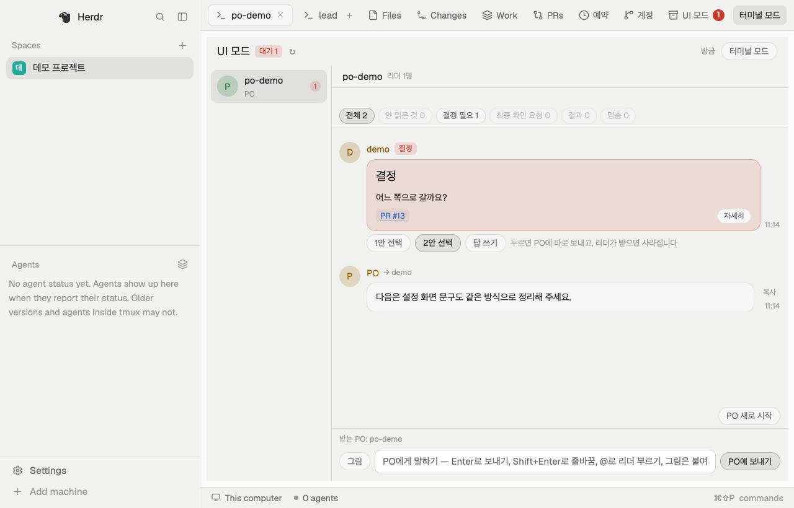

# UI 모드 (inbox)

여러 AI 리더에게 일을 맡기고, **결정이 필요한 것과 결과만 한 화면에서** 받아 보는 메신저형 패널입니다. PO(리더들의 윗사람 역할을 하는 터미널)마다 채팅방이 하나 있고, 방에는 그 PO 아래 리더들의 보고와 PO의 말과 내가 보낸 글이 시간순으로 나옵니다. 결정이 필요한 보고에는 말풍선 아래 버튼으로 바로 답하고, 그 답은 PO 터미널에 **붙여 넣고 Enter까지 눌러** 보내집니다.



*전체 화면 모양의 UI 모드입니다(연습용 가짜 데이터로 찍은 화면). 실제 화면은 Herdr 테마 색을 따릅니다. 이 화면은 아래 "UI 모드와 터미널 모드"에서 설명합니다.*

- **이런 사람에게**: 리더 여러 명을 동시에 굴리면서 터미널을 일일이 열지 않고 결정만 내리고 싶은 사람.
- **어떻게 연결되나**: 리더가 보고를 **파일 한 줄**(`~/.herdr-inbox/<리더>.jsonl`)로 남기면 UI 모드가 읽어 보여 줍니다. 파일 규칙은 [인박스 계약](../inbox-contract.md) 하나이고, 어떤 AI·도구든 그 규칙대로만 쓰면 붙습니다. 계약과 쓰기 도구를 쓰는 방법은 아래 "처음 쓰기"에 있습니다.
- **같은 화면 세 곳**: 오른쪽 패널(Dock), 떠 있는 창(머리줄 `창 열기`), 터미널 옆 페인(머리줄 `옆에 열기`). 고른 방·보낸 글·읽음·카드 펼침은 공유되어 어디서 해도 같게 보입니다.

## 설치

추가 모드라 기본 설치에는 들어가지 않습니다.

```sh
curl -fsSL https://raw.githubusercontent.com/xowjd913/agent-mods/main/herdr/install.sh | sh -s -- --add inbox
```

```powershell
& ([scriptblock]::Create((irm https://raw.githubusercontent.com/xowjd913/agent-mods/main/herdr/install.ps1))) -Add inbox
```

- 오른쪽 패널에 `inbox-board`가 더해지고, 패널 버튼용 `tabs-mine`도 함께 설치됩니다.
- 쓰던 레이아웃 옆에 **UI 모드용 레이아웃**(`<이름>-ui.json`)도 하나 더 만듭니다([UI 모드와 터미널 모드](#ui-모드와-터미널-모드)).
- **PO 답 훅**(`po-hook.cjs`)도 같이 들어갑니다. Claude Code 설정(`~/.claude/settings.json`)에 훅 한 줄을 더하는 것이고, 규칙은 [PO 답 훅](#po-답-훅)에 있습니다. 이미 켜져 있는 PO 세션은 다시 시작해야 훅이 적용됩니다.
- `--remove inbox`는 모드 폴더를 지우고 패널의 `inbox-board`와 훅 줄을 뺍니다. `~/.herdr-inbox`의 기록은 남습니다.
- 다른 옵션은 [모드 골라 설치](../../herdr/README.md#모드-골라-설치)에 있습니다. Node.js가 필요합니다.

## 처음 쓰기 (5분)

UI 모드는 **이름표(라벨)와 파일 위치**만 보고 움직입니다. 아래 이름이 기본값입니다(바꾸는 길은 "이름 규칙과 프로필").

**1. PO 터미널에 라벨을 붙입니다.** 답을 받을 터미널입니다. 리더 터미널은 이 PO 터미널의 **자식**(`parent`)으로 떠 있어야 합니다.

```sh
hc label <PO 터미널> role=po po=devnotes
```

`po=<id>`는 소문자·숫자·`-` 1~40자이고 방마다 하나씩, 다른 PO와 겹치지 않게 붙입니다. 방 이름은 PO 터미널이 든 탭 이름 `PO · <프로젝트>`의 `<프로젝트>`이고, 그런 모양이 아니면 `po` id를 씁니다.

**2. 리더 이름은 `lead-`로 시작합니다**(예: `lead-po-inbox`). 이 이름의 터미널만 리더로 읽습니다. 터미널을 띄울 때 `hc run --name lead-po-inbox …`로 붙입니다(이름은 살아 있는 터미널 중 유일해야 합니다).

**3. 리더가 보고를 남깁니다.** 저장소의 쓰기 도구 [`herdr/tools/inbox-write.cjs`](../../herdr/tools/inbox-write.cjs)가 한 줄을 쓰고 터미널 라벨까지 붙여 줍니다(설치기는 이 도구를 복사하지 않으니 저장소를 내려받아 경로로 부릅니다).

```sh
# 결과 보고
node inbox-write.cjs report --kind done --title "받은편지함 패널 완료" --body "PR #12 병합 가능" --link https://github.com/…/pull/12

# 결정 요청 — 선택지는 `N안: …` 줄, 추천은 `추천: N안`
node inbox-write.cjs report --kind decision --title "병합 시점" --link https://github.com/…/pull/12 --file - <<'EOF'
1안: 지금 합친다
2안: 다음 주에 합친다
추천: 1안
EOF
```

`decision`·`verify`는 터미널에 `wait=decision|verify`(와 `wait-link`) 라벨을 붙여 "답을 기다리는 중"으로 만들고, 답이 오면 리더가 `answered`로 닫습니다. 이름은 `--agent`, 없으면 환경변수 `HERDR_INBOX_AGENT`, 그래도 없으면 이 터미널의 이름을 씁니다. 전체 옵션·종료 코드는 [계약 §8](../inbox-contract.md)에 있습니다.

**4. UI 모드를 엽니다.** 패널 버튼 `UI 모드`(또는 Dock 머리줄의 `창 열기`/`옆에 열기`)를 누르면 방 목록에 PO가 보이고, 위 결정 보고가 붉은 말풍선으로 올라옵니다.

**5. 답합니다.** 말풍선 아래의 `1안 선택`·`확인 완료`·`답 쓰기`, 또는 맨 아래 입력칸에 쓰고 Enter. PO 터미널에 들어가 제출됩니다. 리더가 받으면 `node inbox-write.cjs answered`로 닫고, 말풍선은 `결정 · 답함`으로 바뀌며 버튼이 사라집니다.

**6. (선택) PO의 답도 보려면** 설치된 PO 답 훅이 PO의 마지막 답을 왼쪽 말풍선으로 올립니다. 훅을 안 쓰면 PO가 직접 쓸 수도 있습니다.

```sh
node inbox-write.cjs say --hub devnotes --text "1안으로 진행합니다." --to lead-po-inbox
```

잘 안 되면 [문제 해결](#문제-해결)을 보세요.

## 사용법

### 방 고르기

왼쪽 방 목록에서 PO를 고릅니다. 타임라인, 기다리는 개수, `@` 목록, 채팅이 가는 곳이 모두 **고른 방 하나**의 것이고, `@` 없이 쓴 글은 그 방의 PO에게 갑니다.

- 방 옆 숫자: 초록은 **안 읽은 글**(내가 방을 마지막으로 연 뒤 온 리더 보고·PO 말, 내 글은 제외), 붉은색은 그 PO 아래에서 결정·확인을 기다리는 리더 수입니다. PO가 질문 중이면 방 줄에 붉은 `질문` 칩이 붙습니다. 앱 아이콘 숫자와 탭 줄 버튼 숫자는 PO와 상관없이 기다리는 리더 전부입니다.
- 방 이름 옆 **작은 점**(테마 강조색)은 그 방의 PO·리더·팀원 중 누군가 지금 `working`이라는 뜻입니다. 모두 멈추면 바로 사라지고, 승인·결정을 기다리는 상태(`blocked`)는 점이 아니라 위의 `질문` 칩·붉은 숫자로 따로 보입니다. 점 자리는 늘 잡혀 있어 이름이 흔들리지 않으며, 1.5초마다 읽는 터미널 상태만 쓰므로 새로 감시하는 것은 없습니다.
- 원격 연결이 켜진 PO의 방에는 이름 밑 작은 글씨가 `PO`에서 `PO · 원격`(테마 강조색)으로 바뀌고, 마우스를 올리면 `원격 연결 켜짐`이 뜹니다. 점이 아니라 글자인 것은 위 `작업 중` 점과 헷갈리지 않게 하려는 것입니다. 좁은 목록(58px 칸)과 위쪽 띠에서는 같은 표시가 `원격` 글자로 보입니다. 상태는 `원격 연결 켜기` 버튼과 같은 것을 쓰므로(화면 확인·재시작 복원), 아직 확인하지 못했거나 알 수 없는 상태는 꺼짐으로 보고 표시하지 않습니다. 터미널에서 직접 끊은 것은 다음 확인(버튼 누름·새로고침) 때 반영됩니다. 이 상태가 바뀌면 터미널이 그대로여도 방 목록을 다시 그립니다.
- 처음 열 때는 마지막에 고른 PO, 없으면 살아 있는 리더가 가장 많은 PO입니다. **고른 방은 내가 바꿀 때까지 그대로입니다.** 조회에서 PO가 잠깐 빠져도 30초는 그 방을 붙들고(`PO 터미널을 다시 찾는 중입니다`, 쓰던 글은 그대로) 다른 PO로 보내지 않습니다.
- 리더가 어느 PO 것인가: **살아 있는 리더는 터미널의 부모 PO**입니다. 이미 닫힌 리더는 그 보고 줄의 `po`가 살아 있는 PO일 때만 그 PO 것입니다. PO를 알 수 없는 리더와 보고는 `PO 모름` 방에만 나오고 그 방에는 채팅 상자가 없습니다.
- 같은 `po=<id>` PO가 둘 이상이면 먼저 나온 하나만 방이 됩니다. PO 터미널이 하나도 없으면 방 목록 자리에 라벨 안내가 뜨고 채팅은 보낼 수 없습니다.

### 방의 타임라인

가운데 칸은 **한 줄기 타임라인**입니다. 가장 오래된 것이 위, 가장 새 것이 아래이고, 방을 열면 맨 아래로 갑니다. 최근 80건을 그리고, 기다리는 건은 더 오래돼도 그립니다.

- **말하는 사람은 셋**입니다. **리더**(이름 첫 글자 동그라미 + 이름 + 시각, 이름을 누르면 그 터미널을 들여다봄), **PO**(초록 `P`, 누구에게 한 말이면 `→ 리더`), 오른쪽의 **나**. 같은 사람이 5분 안에 이어 보낸 글은 이름 줄을 줄입니다. 리더 이름은 터미널 제목(`리더 · ` 머리말은 뗌) → `session` 라벨 → 마지막으로 본 이름 → 내부 이름 순이고, 에이전트 목록(`agent-groups`)과 같은 규칙·기억을 씁니다.
- 말풍선 글은 안전한 마크다운(기울임·제목·목록·`코드`·링크)으로 그립니다. **내 말풍선과 PO 말풍선은 같은 길로 그려** 모양이 같습니다. 목록(`-`·`*`·`•`·`1.`·`1)`)은 항목 사이 빈 줄이 있어도 촘촘히 붙고, `[이름] 종류`처럼 `[태그] 짧은 제목`으로 시작하고 아래에 글이 더 있는 첫 줄은 굵은 머리줄로(체크박스 줄 `[ ] 할 일`·`[x] 끝`은 머리줄이 아닙니다), `【…】`만 있는 줄과 `**…**`만 있는 줄도 굵은 줄로 그립니다. 글 가운데의 `**굵게**`는 `TextView`에 글 일부만 굵게 하는 API가 없어 표시(`**`)만 지우고 보통 굵기로 그립니다. 글 가운데의 `~` 한 개는 글자 그대로 보이고(`3~4.5일`), 취소선은 `~~글~~`처럼 두 개로 감쌀 때만 그립니다. 날 HTML은 그리지 않고 링크는 `http(s)`만 열립니다. `<hc from="…">`·`<pasted_content …>` 감싸개는 태그만 빼고 글은 남깁니다.
- **알림 줄**: 리더의 `완료`·`재개`·`중단` 보고(`시작`은 원래 타임라인에 나오지 않음)는 말풍선이 아니라 **가운데 붉은 한 줄**(`리더 · 종류 · 한 줄 요약`)로 나옵니다. 줄을 누르면 전체 보고가 그 아래에 열리고 다시 누르면 접힙니다. 결정·확인·기타 카드와 대기 표시는 그대로 말풍선입니다. 같은 보고가 PO 훅에 `<hc from="… 리더">` 줄로도 남는데, 보고가 이미 화면에 있으므로 **같은 리더 보고의 앞뒤 5분 안에 있고 글이 그 보고의 제목·머리줄·요약과 겹치는 그 줄은 내 말풍선으로 만들지 않습니다**(보고 하나는 줄 하나만 덮고, 겹치지 않는 리더의 다른 글(질문 등)과 사람이 터미널에 직접 친 글은 그대로 남습니다. 3글자 미만은 겹침으로 치지 않아 짧은 제목은 복사본이 남을 수 있습니다). 줄이 옆에서 미끄러져 들어오는 움직임은 넣지 않았고(이미 그려진 줄은 움직이지 않음), 실제 앱에서 보이는 모습은 확인하지 못했습니다. PO 전달 말풍선은 바꾸지 않았습니다.
- **결정·확인이 열려 있는 말풍선**은 붉게 표시되고 `링크 열기`·`확인 완료`(확인만)·`답 쓰기`·`N안 선택` 버튼이 붙습니다. 보고 기록 없이 `wait` 라벨만 있는 리더는 맨 아래에 `보고 기록 없이 대기 표시만 있습니다` 말풍선과 같은 버튼이 나옵니다. `answered` 줄이 오면 그 리더의 가장 최근 열린 결정·확인이 `답함`(중립색)으로 닫힙니다. `answered` 본문이 종류를 담고 있으면 그 종류를 먼저 찾습니다.
- **`···` 말풍선**: PO나 리더가 일하는 중이면 맨 아래에 `···`이 뜨고 끝나면 사라집니다. 어느 필터에서나 보이며 `hc` 상태만 봅니다(PO는 자기 터미널이 `working`, 리더는 자기나 그 아래 팀원 터미널이 `working`·`blocked`). 마지막으로 일하는 게 보인 뒤 30초는 그대로 두어 깜빡이지 않게 하고, 옆의 작은 글자는 `승인 대기`·`작업중`·`팀원 작업`·`잠시 대기` 중 하나입니다.
- **바로 반영**: 인박스 폴더를 지켜보다가 파일이 바뀌면 0.25초 모아 다시 읽습니다(화면이 안 그려지면 거둡니다).
- **스크롤**: 맨 아래 40px 안에 있으면 새 글을 따라가고, 위로 올려 읽는 중이면 보던 자리를 지킵니다. 내가 보낸 직후에는 한 번 맨 아래로 내려갑니다. 맨 아래로 갈 때는 목록 끝의 8px 막대를 기준으로 가서, 새 말풍선이 화면보다 길어도(긴 번호 목록 등) 그 마지막 줄까지 보입니다. 입력칸이 늘어 목록이 짧아질 때도 끝을 다시 보여 줍니다.
- **멈추기(#133)**: 고른 방의 PO가 일하는 중(`working`)이면 입력칸 위 오른쪽에 `멈추기` 버튼이 보이고, **입력칸이 비어 있고 `@` 메뉴가 닫혀 있을 때 `Esc`** 를 눌러도 같습니다. 누르면 PO 상태를 다시 읽어 지금도 `working`일 때만 그 PO 터미널에 `Esc`를 **한 번** 보냅니다(터미널에서 Esc를 누르는 것과 같음). 상태를 읽지 못했거나, 실행 중이 아니거나, 일하는 중이 아니거나, 질문 중이면 아무것도 보내지 않고 짧은 안내만 띄웁니다(질문 중이면 질문 카드의 `Esc`를 씁니다). `Esc`를 두 번 연달아 누르면 Claude Code의 되돌리기 메뉴가 열릴 수 있어, 한 번 보낸 뒤 2.5초는 키와 버튼을 잠급니다. 입력칸에 글이 있으면 `Esc`는 아무것도 하지 않아 쓰던 글을 건드리지 않습니다.
- **복사**: 모든 말풍선·카드 글자는 드래그로 골라 `Cmd+C`(Windows·Linux `Ctrl+C`)로 복사할 수 있고, 내 말풍선과 PO 말풍선 옆에는 `복사` 칩도 있습니다.

### 거르기: 채팅 필터와 1:1 보기

타임라인 위 칩 줄로 말풍선을 골라 봅니다. 칩마다 개수가 붙고 0이면 흐리게 보이지만 눌러 볼 수 있습니다.

| 칩 | 보이는 것 |
| --- | --- |
| `전체` | 모두(내 글·PO 말·리더 보고 전부) |
| `안 읽은 것` | 방을 열 때의 읽음 기준보다 새로 온 리더·PO의 글 |
| `결정 필요` | 종류가 `decision`인 보고(기다리는 결정 포함) |
| `최종 확인 요청` | 종류가 `verify`인 보고(기다리는 확인 포함) |
| `결과` | 종류가 `done`인 보고 |
| `멈춤` | 종류가 `stop`인 보고(리더 터미널 자체의 `blocked`는 아님) |

- `start`·`resume`·`other`는 `전체`에서만 보입니다. 종류 칩과 `안 읽은 것`에서는 **내가 보낸 글이 숨겨집니다.** 필터를 걸어도 기다리는 건의 버튼은 그대로 붙습니다.
- `안 읽은 것`의 기준은 방을 열 때 한 번 잡고 그 방에 머무는 동안 유지합니다(다른 방에 갔다 오면 새로 잡음).
- 열려 있는 리더가 **둘 이상일 때만** 칩 줄 아래에 `리더` 줄(`전체` | `<리더 이름>` …)이 나와 **한 리더와 주고받은 글만** 봅니다. 칩은 그 방 타임라인에 글이 있고 지금 터미널이 열려 있는 리더만 나옵니다. 닫힌 리더의 기록은 `전체`에 남고, 고른 리더가 닫히거나 줄이 숨겨지면 `전체`로 처리합니다(고른 값은 지우지 않아 리더가 둘 이상으로 돌아오면 다시 걸립니다).
- 1:1에 남는 글은 기록에 적힌 필드로만 가리고 글 내용으로 짐작하지 않습니다.
  - 그 리더의 보고.
  - **내가 그 리더에게 보낸 글**: 그 리더 카드에서 누른 답·`N안 선택`·`확인 완료`, `@리더`로 부른 글(여러 리더를 불렀으면 모두의 1:1에 듭니다).
  - **PO의 말**: 그 리더 앞으로 쓴 줄(`to`)과, UI 모드에서 그 리더에게 보낸 글에 대한 PO의 답(PO 훅이 프롬프트와 답에 같은 `pid`를 적어 짝을 지음).
  - 묶을 수 없는 글(`@` 없이 보낸 글과 그 답, PO 터미널에 직접 친 줄, `to`·`pid` 연결이 없는 PO 말)은 `전체`에서만 보입니다.
- 칩과 리더는 겹쳐 씁니다: 먼저 리더로 좁히고 그 안에서 칩이 거르며 개수도 좁힌 글 기준입니다. 다른 리더가 답을 기다리면 이름 옆에 `●`이 붙습니다. 읽음·안 읽은 개수는 좁히지 않은 방 전체 기준입니다.
- 걸린 결과가 없으면 `해당 메시지 없음 —` 옆의 `전체 보기`로 칩과 리더를 둘 다 되돌립니다.
- **필터는 방마다 따로 기억하지만 저장하지 않습니다**: 화면이 살아 있는 동안만 유지되고 Dock·창·페인이 각자 따로입니다.

### 카드 읽기

보고 말풍선(카드)은 접힌 채 시작합니다. 접힌 카드는 종류 배지, 리더 이름, 제목, 첫 문장, 짧은 링크만 보여 줍니다. GitHub PR·이슈 링크가 있으면 리더 이름 옆에 `agent-mods#39`처럼 작은 참조가 붙고, 링크는 `PR #26`·`issue #25`처럼 짧게 보이며 누르면 기본 브라우저로 엽니다(http·https만).

- `자세히`/`접기` 버튼으로 본문 전체를 펼치고 접습니다(카드마다 저장). 카드 아무 데나 눌러서는 펼쳐지지 않아 글자를 드래그해도 안전합니다.
- 펼친 본문은 줄바꿈을 지키고, 목록은 들여쓴 줄, `따라 하기:`·`되돌리기:`·`## 제목`은 작은 소제목으로 보입니다. 모르는 문법은 글자 그대로 둡니다.
- 명령 상자는 보수적으로 만듭니다: 백틱 코드, `$ `로 시작하는 줄, 코드 펜스, 이름표 뒤에 줄 전체가 명령 하나인 것만 고정폭 상자에 담고 `복사` 버튼을 둡니다. `복사`는 클립보드에만 담고 아무것도 보내지 않습니다.


### 결정에 답하기

열린 결정·확인 말풍선 아래 버튼입니다.

- `링크 열기`: 보고에 붙은 링크(PR, 이슈 등)를 엽니다.
- `N안 선택`: 결정 보고에 선택지가 있을 때. `N안 선택`을 답으로 보냅니다.
- 따옴표 답 버튼: 선택지가 `N안` 줄이 아니라 `답: "…" / "…"`로 적힌 결정일 때(아래).
- `확인 완료`: 확인(`verify`) 보고에만 있고, 글 없이 `확인 완료`를 보냅니다.
- `답 쓰기`: 입력 칸을 열어 직접 쓴 답을 `보내기`(또는 Enter)로 보냅니다. 그림도 붙일 수 있습니다("PO에게 말하기").

**N안 칩 형식**은 하나만 읽고 그 밖은 짐작하지 않습니다(리더가 이 형식으로 써야 칩이 나옵니다).

```text
1안: 지금 합친다
2안: 다음 주에 합친다
추천: 1안
```

- 선택지: 줄 처음(앞 공백, `-`·`*` 글머리는 허용)에 `1안:`·`2안)`·`3안：`처럼 **1~3** 번호 + `안` + `:`(또는 `：`, `)`) + 글. 번호와 `:` 사이에 `(추천)`·`（권장）`·`[추천]` 같은 짧은 괄호 표시가 있어도 선택지로 읽습니다(`1안(추천): …`, `1안 (추천): …`). **서로 다른 번호가 둘 이상**일 때만 칩이 나옵니다.
- `추천: 2안` 줄, 또는 선택지의 괄호 표시·줄 끝 `(추천)`·`★`이 가리키는 칩만 강조색이고(먼저 나온 쪽), 칩 글자는 `2안 선택 (추천)`으로 보이지만 누르면 그대로 `2안 선택`을 보냅니다. 선택지에 없는 번호는 무시합니다. `(비추천)`·`(비권장)`·`추천하지 않음`·`not recommended`처럼 **부정한 표시는 추천으로 세지 않습니다**(그 칩은 `(추천)`이 붙지 않고, 다른 선택지의 추천이 있으면 그쪽이 강조됩니다).
- **질문이 여러 개인 카드**: `①`~`⑩` 중 하나로 시작하는 줄(`① 병합 시점`, `**② 순서**`, `- ③ …`)이 질문 머리줄이고, 그 아래 다음 머리줄까지의 `N안:` 줄이 그 질문의 선택지입니다. 질문마다 버튼 한 줄이 따로 나오고, 질문마다 하나씩 고르면 마지막 선택에서 답 `①1안, ②2안`(질문 순서)을 한 번에 보냅니다(마지막 질문을 고르기 전까지는 고른 안이 강조색으로 보이고, 같은 줄의 다른 안을 누르면 바꿀 수 있습니다). 질문이 둘 이상이고 질문마다 선택지가 2개 이상일 때만 이렇게 읽으며, 머리줄 위에 선택지 줄이 있거나 같은 머리 기호가 두 번 나오거나 `① 병합 1안: 가 / 2안: 나`처럼 머리줄에 선택지가 붙어 있으면 위의 한 질문 카드로 읽습니다. 질문 안 선택지도 1~3안까지이고, 본문 맨 끝 `추천: 1안` 줄은 마지막 질문의 추천으로만 읽습니다. 실제 PO가 이 답을 어떻게 읽는지는 실제 앱에서 확인하지 못했습니다.
- 읽지 않는 것: `A:`·`B:`, `1)`, 머리줄이 아닌 자리의 `①`, `1. 단계` 목록, 문장 중간의 `1안:`, 4안 이상. 확인(`verify`)·이미 답한 보고에는 칩이 없습니다.

**N안 줄이 없는 결정**은 카드가 접혀 있어도 `추천:`·`답:` 줄을 바로 보여 줍니다(각 160자까지). 선택지가 그 줄에만 있으면 접힌 카드에서 보이지 않기 때문입니다.

```text
추천: 둘 다 진행. 답: "둘 다 진행" / "1번만" / "2번만" / "보류"
```

`답:` 뒤에 **따옴표(`"…"`, `“…”`, `「…」`)로 묶인 짧은 답이 2~6개**면 `답 쓰기` 옆에 그 답의 버튼이 나옵니다. 누르면 그 글자를 `N안 선택`과 같은 길로 보내고, 추천 줄에 들어 있는 답만 강조색입니다. 따옴표가 하나이거나 7개 이상이면 줄만 보이고, `정답:`·`답변:`은 읽지 않습니다.

### 보내는 길과 상태

답 버튼과 채팅 입력칸은 같은 길로 PO 터미널에 들어갑니다. 답 버튼은 아래 한 줄을 만듭니다.

```text
Panel answer (decision) for lead-po-inbox: "1안 선택". Target: https://github.com/…/pull/12
```

1. 그 줄을 **클립보드에 담습니다**(원래 내용은 바뀝니다. 버튼에 마우스를 올리면 알려 줍니다).
2. PO 터미널 칸에 포커스를 옮기고 붙여 넣습니다(붙여 넣는 동안만 그 칸이 포커스를 가집니다).
3. 0.35초(글이 길면 최대 0.95초) 뒤 `hc keys <PO> enter`로 Enter를 누르고, 보내기 전 키보드가 있던 칸에 포커스를 돌려줍니다. UI 모드는 닫히지 않습니다.

- 한 줄이고 끝에 줄바꿈이 없어 Enter 한 번이 한 번의 제출입니다. 여러 줄로 쓴 답은 한 줄로 이어 붙이고, 제어·폭 없는 문자·글자 방향 문자는 지웁니다. 붙여 넣은 글은 내가 직접 친 입력과 같아서 `<hc from=…>` 같은 보낸 이 표시가 붙지 않습니다.
- **PO가 질문 중(`blocked`)이면 붙여 넣기만** 하고 Enter는 누르지 않습니다(그 Enter가 질문의 답이 되기 때문). `PO가 질문 중이라 붙여 넣기만 했습니다`가 붙고 [질문 패널](#막힌-po의-질문에-답하기)이 뜹니다.
- **PO 터미널에 칸이 없으면** 칸을 열고 6초까지 기다렸다가 생기면 **한 번만** 자동으로 보냅니다. 안 열리면 `보내지 못함 — PO 칸이 열리지 않았습니다`와 `다시 보내기`가 남습니다.
- 답을 보낸 카드에는 `PO에 보냄 — 리더가 받으면 사라집니다`가 남고, 리더가 더는 기다리지 않으면 사라집니다.
- **답 버튼의 PO는 그 리더 터미널의 부모**이고, 그 부모에 `role=po` 라벨이 있을 때만 PO로 인정합니다. 이웃 터미널을 짐작해서 고르지 않습니다(잘못 고르면 다른 에이전트의 입력창에 답이 들어가기 때문). 찾지 못하면 `확인 완료`·`답 쓰기`·`보내기`가 비활성이 되고 카드에 이유가 적힙니다.


UI 모드에서 보낸 모든 글(답 버튼·`N안 선택`·답 상자·채팅)은 한 곳에서 한 번만 기록되어 내 말풍선(오른쪽)으로 나옵니다. 말풍선에는 내가 쓴 글 그대로가 보이고(`Panel answer …` 감싸개는 안 보임), 상태는 **Enter의 실제 결과**를 따라갑니다.

| 상태 | 뜻 | 말풍선 | 버튼 |
| --- | --- | --- | --- |
| `sending` | 붙여 넣었고 Enter가 가는 중 | `보내는 중…` | 없음 |
| `sent` | Enter까지 지나감 | 안내 없음 | 없음 |
| `gone` | `Enter 누르기` 때 입력창에 글이 없었음 | `보낸 글이 입력창에 없습니다 — 다시 보내세요` | `다시 보내기` · `삭제` |
| `noenter` | 붙여 넣었지만 Enter 명령이 실패 | `붙여 넣었지만 Enter가 눌리지 않았습니다` | `Enter 누르기` |
| `opening` | PO 칸을 여는 중 | `PO 칸을 여는 중 …` | 없음 |
| `nopane` | 칸이 열리지 않음 | `보내지 못함 — PO 칸이 열리지 않았습니다` | `다시 보내기` · `삭제` |
| `failed` | 붙여넣기 실패 | `보내지 못함 — 붙여 넣기 실패` | `다시 보내기` · `삭제` |
| `held` | PO가 질문 중이라 붙여 넣기만 함 | `PO가 질문 중이라 붙여 넣기만 했습니다 …` | 없음(질문 패널에서) |

- `다시 보내기`는 같은 기록·같은 줄을 다시 보냅니다(말풍선이 늘지 않음).
- `삭제`는 `gone`·`nopane`·`failed`(PO에 아무것도 가지 못했거나 붙인 줄이 사라진 것)에만 `다시 보내기` 옆에 나옵니다. 누르면 그 말풍선의 기록을 지워 채팅을 다시 열어도 나오지 않고 되돌릴 수 없습니다. 입력창에 글이 남았을 수 있는 `noenter`·`held`와 보냈거나 보내는 중인 말풍선에는 없습니다. 실제 앱에서의 동작은 미검증입니다.
- `Enter 누르기`는 누르기 전에 `hc read`로 PO 화면 끝에 붙여 넣은 글이 아직 있는지 보고, 있을 때만 누릅니다. 화면을 못 읽거나 그 사이 PO가 질문 중이 되었으면 누르지 않습니다.
- `noenter`·`held`가 **10분**을 넘으면 `Enter 누르기`는 사라지고 `다시 보내기`만 남습니다(한참 전 글에 뒤늦게 Enter가 눌리지 않게).
- 20초 넘게 `sending`·`opening`에 머문 기록(보내던 화면이 사라진 경우)은 `noenter`·`nopane`으로 보입니다.

### PO에게 말하기

맨 아래 입력칸에 쓰고 **Enter**(또는 `PO에 보내기`)를 누르면 위와 같은 길로 고른 방의 PO에게 갑니다. 리더에게 곧바로 가지는 않습니다. 보낸 글은 타임라인에 `나`로 남습니다(최근 100건).

- **Enter는 커서가 글 처음·가운데·끝 어디에 있어도 보냅니다.** 글 가운데에서 Enter를 쳐도 줄바꿈이 끼지 않고, 위젯이 가운데에 넣은 줄바꿈 한 글자는 걷어 글과 커서가 그대로 남습니다. 글 일부를 **선택한 채** Enter를 쳐도 위젯이 선택한 글을 줄바꿈으로 바꿔 버리지 않고, 선택했던 글을 되살려 전체를 보냅니다(`@` 칩이 선택 구간에 있었다면 그 칩은 글자로 바뀝니다).
- **쓰던 글은 방마다 따로 남습니다.** A방에 쓰다가 B방으로 갔다 와도 A의 글·커서·`@` 칩·붙여 둔 그림이 그대로 돌아오고, B는 B에서 쓰던 글(없으면 빈 칸)을 보여 줍니다. 보내면 지금 방의 글만 비워집니다. 그림을 읽는 중에 다른 방으로 가도 그림은 읽기를 시작한 방의 글에 붙고, 지금 방의 보내기는 막히지 않습니다. 방은 24개까지 기억하고(더 오래된 것부터 잊음), 앱을 다시 켜면 사라집니다.
- **줄바꿈은 Shift+Enter**입니다. 입력칸은 최대 6줄까지 커지고, 긴 글도 한 번의 제출로 갑니다.
- **한글(IME) 조합 중 Enter**: 이 앱의 키 이벤트에는 조합 상태가 없어서, 글을 친 지 0.5초 안이거나 **커서가 글 끝에 있고** 한글·가나·한자로 끝난 글은 **첫 Enter를 한 번 붙잡고**(입력칸 위에 `한 번 더 Enter로 보냅니다`) 글을 더 고치지 않고 누른 **두 번째 Enter가 보냅니다**. 마침표나 영문·숫자로 끝나는 글, 커서가 글 안쪽에 있는 글(0.5초가 지난 뒤)은 한 번에 갑니다. 시간과 마지막 글자로 짐작하는 규칙이라 `PO에 보내기` 버튼에는 적용되지 않습니다.
- **`@`로 리더 부르기**: `@`를 치면 지금 떠 있는 리더 목록(고른 PO 아래, 맨 위는 `@here`)이 나오고, 고르면 `@이름` 칩이 들어갑니다. PO에는 `@lead-이름 글` 꼴로 갑니다. `@here`는 보낼 때 빠지고, 목록에 없는 이름은 호출로 보지 않고 글에 그대로 남습니다. 서로 다른 PO의 리더를 한 글에서 함께 부르면 보내지 않고 이유를 알려 줍니다. 고른 PO가 없거나 `PO 모름`이면 PO를 먼저 고르라고 알립니다.
- **그림**: 입력칸에서 `Cmd+V`(Windows·Linux `Ctrl+V`)로 클립보드 그림을 붙이거나 `그림` 버튼·파일 끌어놓기로 넣습니다. 한 글에 4장, 한 장 5MB까지(png·jpg·gif·webp)이고, 앱 폴더 안 `data/inbox/img/`(`0600`)에 저장되어 14일 지나거나 폴더가 200MB를 넘으면 오래된 것부터 지워집니다. 보낼 때 글 뒤에 `[image: <경로> — open it with the Read tool]` 줄이 붙어 PO(Claude)가 `Read`로 열 수 있고, 말풍선에는 작은 썸네일로 보입니다. 결정 카드의 `답 쓰기` 칸도 같고, `N안 선택`·`확인 완료`는 고정된 말만 보냅니다. 그림 붙이기는 macOS는 `osascript`, Windows는 PowerShell, Linux는 `wl-paste`·`xclip`이 있어야 합니다.
- **`!`로 시작하는 한 줄은 PO의 입력창에 내가 직접 친 글처럼 들어갑니다**(Claude Code의 셸 명령 모드). `hc send`는 글을 `<hc from=…>`로 감싸고 `hc keys`에는 `!` 키가 없어서, 감싸지 않는 붙여 넣기 길(클립보드 → 붙여 넣기 → Enter → 키보드 되돌리기)로만 보냅니다. 아래를 **모두** 만족할 때만 보내고, 하나라도 아니면 보내지 않고 이유를 알리며 글은 입력칸에 그대로 둡니다.
  - 터미널 모드이고(UI 모드는 칸이 없어 감싸는 길뿐이라 거절), PO 터미널 칸이 화면에 열려 있습니다.
  - PO가 일하는 중도 질문 중도 아니고, 화면을 읽어 보니 **입력창이 비어 있습니다**(글이 있거나 입력창을 못 찾으면 거절. 처음 세션의 흐린 안내 문구도 글로 읽혀 거절됩니다).
  - `@멘션`·그림이 없고, `!` 뒤에 명령이 있는 한 줄입니다. `!!`는 명령으로 보지 않습니다. 맨 앞 `!`는 보내기 전 다듬기에서 지워지지 않고(`@here`를 뺀 자리의 문장부호만 지움) 그대로 `!` 줄로 판정되며, 다시 보내기도 같습니다.
  - 화면 읽기는 **6초 안에** 끝나야 합니다. 그 안에 답이 없으면 보내지 않고 이유를 알리며 '확인 중' 상태를 풉니다(늦게 온 답은 무시).
  - 말풍선의 **다시 보내기**도 첫 보내기와 같은 확인(PO가 쉬는 중·칸이 열림·입력창이 빔)을 거칩니다. 하나라도 아니면 말풍선은 원래 상태로 두고 이유를 알립니다.
  - 붙여 넣기가 끝나면 **붙여 넣기 전 클립보드의 글을 되돌려 놓습니다**. 그림처럼 글이 아닌 클립보드와 20만 자를 넘는 글은 잘린 채 돌아오지 않도록 되돌리지 않고, 칸이 열리길 기다리는 중이거나 실패한 보내기는 되돌리지 않습니다.
  - **미검증**: 붙여 넣은 맨 앞 `!`가 실제 Claude Code에서 셸 명령 모드로 들어가는지는 실제 앱에서 확인하지 못했습니다(시험은 가짜 화면·가짜 터미널로만 했습니다).
- 붙여 넣기와 Enter 사이는 350ms라, PO가 아주 바쁘면 붙여 넣기가 끝나기 전에 Enter가 먼저 처리될 수 있습니다. UI 모드는 그것을 알아챌 수 없으니 바쁜 PO에게는 보낸 뒤 화면을 확인하세요.

### 막힌 PO의 질문에 답하기

PO가 질문(권한 허용 등)에 답을 기다리는 중(`blocked`)이면 그 방의 입력칸 위에 **질문 패널**이 뜹니다. 터미널을 열지 않고 답하려는 길입니다.

- 패널은 `hc read <PO> --lines 40`으로 PO 화면 끝을 3초마다 읽어 마지막 줄들을 보여 줍니다(최대 높이 340px, 안에서 스크롤). 머리에 `(n초 전 화면)`이 나와 오래된 화면을 새것처럼 보이지 않게 합니다.
- `1. …`·`2. …`처럼 **1부터 끊김 없는 번호 선택지**가 있으면 `N. 이름` 버튼으로, 그리고 `Enter`·`Esc` 버튼으로 보여 줍니다. 번호 목록이 아니면(예: `y/n`) 화면 줄만 보입니다.
- **선택지 아래 설명 줄과 탭 줄(#92)**: 선택지 아래에 들여쓴 설명 줄이 붙어 있어도(최대 4줄) 그 선택지의 일부로 보고 1..N 선택지를 읽습니다. 여러 질문이 탭(`← ☒ 범위 ☐ 우선순위 ✔ Submit →`)으로 나뉜 질문(AskUserQuestion)은 **지금 보이는 탭**의 선택지만 읽고, 탭 줄을 패널 머리에 보여 주며 `← 이전 질문`·`다음 질문 →` 버튼(`left`·`right` 키)을 둡니다. 탭 줄은 질문 위 5줄 안에서 `←`와 `→`와 체크 글자가 함께 있는 줄만 인정하고(멀리 있는 화살표 출력은 탭 줄이 아님), 선택지 사이에 글자·숫자 없는 구분선이 끼어도 선택지를 잇습니다. 화면을 한 번도 읽지 못한 상태에서는 `Enter`·`Esc`·`←`·`→`·번호 키를 보내지 않고 다시 읽기를 안내합니다. 마지막 `Submit` 탭의 `1. Submit answers`·`2. Cancel`도 같은 방식으로 읽습니다.
- **막다른 길이 없습니다(#92)**: 화면을 못 읽거나(`hc` 실패·빈 화면·5초 안에 답이 없음) 선택지를 찾지 못해도 패널은 `화면을 읽지 못했습니다` 또는 `선택지를 찾지 못했습니다`로 바뀌고, 늘 **`터미널 열기`**(그 PO 터미널로 이동)·**`다시 읽기`**·`Enter`·`Esc`와 화면 원본 줄을 보여 줍니다. 못 읽은 상태는 2초 뒤 스스로 다시 읽습니다. 패널을 그리는 것만으로는 키를 보내지 않습니다.
- 버튼은 `hc keys <PO> <키>`로 키를 누릅니다. 누르기 직전에 화면을 **다시 읽어** 처음 본 질문과 같은지 확인하고, 달라졌거나 PO가 더는 질문 중이 아니면 누르지 않고 알립니다(`질문이 바뀌었습니다, 다시 확인하세요`). **내가 누를 때만** 누르고 UI 모드가 스스로 승인하는 일은 없습니다.
- 질문이 풀리면 패널이 사라지고, 붙여 넣기만 해 둔 글(`held`)은 PO 입력창에 남아 있으니 PO에서 Enter로 보냅니다.

### Dock · 창 · 페인

같은 화면을 세 곳에서 씁니다. 고른 방·보낸 글·읽음·카드 펼침은 공유되어 어디서 해도 같게 보입니다.

- **Dock**(오른쪽 패널): 머리줄에 `UI 모드`, 기다리는 리더가 있으면 붉은 `대기 n`(모든 방 합계), `↻`, `옆에 열기`, `창 열기`. 결정 건이 있으면 앱 아이콘에도 숫자가 뜹니다. 30초마다 읽습니다.
- **창**: `창 열기`로 같은 방을 넓은 창으로 엽니다. 머리줄을 끌어 옮기면 자리를 기억하고 `×`로 닫습니다. 열어 둔 채 종료하면 다음 실행 때 다시 열립니다. 5초마다 읽습니다.
- **페인**: `옆에 열기`는 지금 탭의 **리더 터미널 오른쪽**에 칸을 나눕니다(리더가 없으면 포커스한 터미널 옆). 탭에 이미 있으면 새로 만들지 않고 그 칸으로 포커스만 옮기고, 칸은 탭과 함께 저장되어 Herdr를 다시 켜도 다시 열립니다. 화면에 그려지는 동안만 5초마다 읽고 그려지지 않는 동안은 읽음으로 치지 않습니다. 직접 만들 때는 `pane.split {direction: "right", mod: "inbox", props: {mode: "pane"}}`입니다.
- 방 목록 모양은 모드가 아니라 **자기 폭**이 정합니다: 520px 이상이면 168px 목록, 좁으면 58px 칸(동그라미·숫자, 이름은 툴팁), 창만 아주 좁으면 위쪽 띠.
- **글자 크기**: UI 모드의 글자(말풍선·머리줄·버튼·입력칸)는 기본으로 Herdr의 글자 크기 설정(`font_size`)을 따릅니다. 13이면 기존 모양 그대로이고, 14나 16이면 글자와 글자가 든 줄 높이가 같은 비율로 커집니다(0.6배~2.5배로 제한). 설정이 없거나 숫자가 아니면 13으로 봅니다. **[설정 창](settings.md#글자-크기-칸)의 `UI 모드 글자 크기` 칸에서 10~24px로 따로 정하면 그 값이 우선합니다**(공유 상태 `settings.uiFontSize`, 다시 시작하지 않아도 바뀌고 Herdr가 저장해 둡니다). 숫자가 아니거나 범위 밖인 값은 무시하고 Herdr 값을 따릅니다. 앱 확대(zoom)는 Herdr가 따로 적용하므로 여기서 곱하지 않습니다. Herdr에는 설정이 바뀐 것을 알리는 신호가 없어 2초마다 읽어 바뀌었을 때만 다시 그립니다. 이미지 줄·간격처럼 글이 없는 칸은 그대로입니다.
- `자세히`·`접기`·`답 쓰기`를 눌러도 타임라인이 맨 아래로 튀지 않습니다. Dock에서 보내면 Dock에 `나`로 쌓이고 PO 터미널이 포커스를 가져갔다가 돌려줍니다.

### UI 모드와 터미널 모드

UI 모드는 두 가지 모양으로 씁니다. **패널 모양**은 터미널이 가운데에 그대로 있고 UI 모드는 오른쪽 패널·창·옆 칸에 붙어 있는 것입니다(이때 화면을 **터미널 모드**라고 부릅니다). **전체 화면 모양**은 가운데 터미널 자리를 UI 모드 채팅이 가득 채워서 터미널이 화면에 나오지 않는 것입니다. 리더에게 말을 걸고 결정만 내릴 때는 전체 화면, 터미널을 직접 만질 때는 터미널 모드로 오가면 됩니다. `전체 화면`/`터미널 모드` 버튼은 이 두 화면을 바꾸는 버튼입니다(탭 줄의 `UI 모드` 탭은 패널을 여는 것이라 화면을 바꾸지 않습니다).

화면 모양은 이 문서 맨 위 그림과 같습니다.

- **바꾸는 법**: 탭 줄의 `전체 화면` 버튼(전체 화면에서는 `터미널 모드`로 바뀜, [tabs-mine](tabs-mine.md#ui-모드터미널-모드-전환)), 전체 화면 머리줄의 `터미널 모드` 버튼, 또는 키 하나. 키는 `keys.json`의 `global`에 `"cmd-shift-u": "tabs-mine.mode"`를 직접 추가하세요(설치기는 `keys.json`을 건드리지 않습니다). 터미널은 UI 모드에서도 살아 있어 터미널 모드로 돌아오면 다시 보입니다.
- **어떻게 만들어지나**: 설치기(`install.cjs layout`)가 쓰던 레이아웃 `<이름>`(터미널 모드)을 바탕으로 `<이름>-ui.json`(UI 모드)을 만듭니다. 가운데 터미널 칸만 `{mod: "inbox", props: {mode: "main"}}`로 바뀌고 사이드바·탭 줄·상태 줄·오른쪽 패널은 그대로입니다. 바탕 레이아웃이 바뀌면 다음 설치 때 따라가고, 짝이 되는 `-ui` 레이아웃이 없으면 `UI 모드` 버튼은 보이지 않습니다.
- **내가 고친 `-ui` 파일은 지키고 다시 쓰지 않습니다**: 만든 파일의 해시를 `mods/inbox/.ui-layout-hash`에 적어 두고, 파일이 그것과 다르면(직접 고쳤거나 원래 있던 같은 이름 파일) 건드리지 않습니다. `inbox`를 `--remove`하면 우리가 만든 파일만 지웁니다. 지우기 전에 터미널 모드로 돌아와 두세요(보고 있던 `-ui` 레이아웃이 지워지면 화면이 바뀝니다).
- **화면**: 페인 모드와 같은 메신저 화면입니다. 칸 제목줄이 없어서 머리줄에 `UI 모드`, `대기 n`, `↻`, `터미널 모드`가 나오고 `옆에 열기`·`창 열기`는 숨깁니다.
- **보내는 길이 다릅니다**: 터미널 칸이 없어 포커스·클립보드·칸 열기를 쓸 수 없으므로, 이 화면은 PO **터미널 주소**로 `hc send <PO> <글> --json`을 보냅니다(붙여 넣기+Enter가 한 번에). 말풍선은 `보내는 중` → `보냄`(`hc send`가 시작됐다고 답할 때) 또는 `보내지 못함`(이유와 `다시 보내기`)이 됩니다. PO가 질문 중(`blocked`)이면 `--force` 없이 **보내지 않고**(붙여 넣기만 하는 `held`는 이 화면에 없음) 질문에 먼저 답한 뒤 `다시 보내기`를 누릅니다. `-`·`--`로 시작하는 글도 그대로 갑니다. `hc send`는 `<hc from=…>` 머리말을 붙이고, 사람이 쓰다 만 입력을 최대 60초 기다리며, PO가 일하는 중이어도 막지 않고 전달합니다.

### Claude 사용률과 세션 금액

방 제목 아래 한 줄에 `Claude 5h ▬ 54% · 7d ▬ 34% · 이 세션 약 4,300원`처럼 보입니다. 터미널을 안 보고 "더 돌려도 되나", "이 PO를 새로 시작할까"를 판단하는 용도입니다.

- **사용률**: `~/.claude/usage-limits.json`을 1분마다 읽기만 합니다(`usage-status` 모드와 같은 파일·형식). 80% 이상이면 경고 색, 마우스를 올리면 초기화까지 남은 시간이 나옵니다. 파일이 없거나 10분 넘게 갱신되지 않으면 `Claude Unknown`입니다. 이 파일은 Claude Code 상태 줄(statusline) 스크립트 등이 따로 써 줘야 합니다.
- **이 세션 계정**: 카드의 이름 줄 아래에 `이 세션 계정: 회사`처럼 그 세션이 쓰는 Claude 계정을 흐리게 보여 줍니다(기본 계정은 `기본`). 터미널의 실행 인자에서 `CLAUDE_CONFIG_DIR=` 토큰 하나만 읽고(다른 인자는 넘기지 않습니다), 없으면 `ps`로 그 변수 하나만 읽습니다(폴더 이름에 공백이 있어도 읽습니다). 등록되지 않은 폴더는 폴더 이름만 보여 주고, 읽지 못하면 줄을 숨깁니다. 계정을 더하고 고르는 곳은 [계정 패널](gh-accounts.md#claude-계정)입니다. 위 사용률 줄은 아직 기본 계정(`~/.claude`)만 읽습니다.
- **세션 금액**: 고른 PO가 **지금 세션에서 쓴 금액을 원화로** 붙입니다. PO 답 훅이 프롬프트마다 그 PO 세션의 transcript 경로를 `<inbox 폴더>/po-session/<po id>.json`에 적고, UI 모드가 그 transcript에서 `message.usage`·`message.model`·`message.id`만 읽어 더합니다(글 내용은 읽지 않음). 서브에이전트(`<세션>/subagents/*.jsonl`, 최대 59개)도 더하고 `/clear` 하면 0부터 다시 셉니다. 읽은 위치와 합계는 `<앱 폴더>/data/inbox/po-cost-cache.json`에 저장해 새 줄만 읽습니다(한 번에 파일마다 8 MiB, 전체 16 MiB까지).
- 가격은 `inbox.cjs`의 `COST_PRICES`(100만 토큰당 USD, 출처·확인일 2026-11-25가 주석에 있음), 환율은 `COST_KRW_RATE`(`1343.6`원/$ 고정값, 한국은행 ECOS 2026-11-25)이며 실시간 환율이 아닙니다. 가격표에 없는 모델이 있으면 추정하지 않고 `?원`과 모델 이름을 보입니다. 툴팁에 `API 기준 추정 금액, 구독 청구액 아님`이라고 밝히며, 빠른 모드·미국 데이터 거주 가격·웹 검색 도구 요금은 계산하지 않아 **실제보다 적을 수 있습니다.**
- 훅 기록이 없으면 금액이 안 보입니다(훅 설치 전에 시작한 세션은 다음 프롬프트·답이 한 번 있을 때까지). `PO 모름` 방은 금액이 없습니다.

### PO 새로 시작 (선택)

**이 기능은 PO가 `/clear`·`/PO` 명령과 인수인계 노트 규칙을 갖춘 작업 방식을 쓸 때만 맞습니다.** 그런 흐름이 아니면 쓰지 않아도 UI 모드의 나머지는 그대로 동작합니다.

방의 채팅 상자 바로 위 `PO 새로 시작` 버튼은 PO와 대화가 너무 길어졌을 때 **노트를 남기고 대화를 비운 뒤 다시 시작**합니다.

1. 누르면 무슨 일이 일어나는지(노트 → `/clear` → `/PO`)와 지금 결정·확인 대기 건수가 나오고 `새로 시작`/`취소`를 고릅니다. 리더 쪽 대기는 그대로입니다. PO가 작업 중이거나 질문에 막혀 있으면 버튼이 회색이고 이유가 옆에 나옵니다.
2. `새로 시작`은 `hc send <PO> … --json`으로 `[desk:handoff]` 요청을 보내고(채팅 말풍선은 안 만듦) 노트를 `~/.herdr-inbox/po/<id>.handoff.md`에 쓰라고 합니다. 화면을 읽거나 붙여 넣거나 키를 누르지 않아 칸 너비와 무관합니다. **PO 입력칸은 비어 있어야 합니다**(`hc send`는 남은 초안 뒤에 붙입니다). 요청이 초안과 섞여 갔으면 PO 훅 기록으로 알아채 `/clear` 전에 멈춥니다. 이 확인에는 PO 훅과 `role=po` 라벨이 필요하고 12초 안에 기록이 없으면 멈춥니다.
3. UI 모드가 2초마다 노트 파일을 봅니다. **요청 뒤에 만들어진 비어 있지 않은 파일**만 새 노트로 쳐서 방에 `인수인계 노트` 말풍선으로 보여 줍니다. 5분 안에 안 생기면 `다시`/`취소`가 나오고 **아무것도 비우지 않습니다.**
4. 노트가 있고 PO가 쉬는 상태이면 `/clear`를 보냅니다. PO가 쉬면서 `turn`이 `/clear` 때보다 커졌고 그 PO에 새 `me` 훅 기록이 없을 때만(=`/clear`가 명령으로 실행됐을 때만) `/PO`를 보냅니다. 20초 안에 확인되지 않으면 이유와 함께 멈춥니다.
5. 방에 `노트 요청 → 노트 작성됨 → 대화 비움 → PO 다시 시작` 단계가 표시됩니다. 취소는 기다리기만 멈추고, 이미 보낸 요청과 `/clear`는 되돌리지 않습니다.

### 원격 연결 켜기 (선택)

방 제목 줄(방 선택을 칩으로 고르는 배치에서는 그 아래 오른쪽 줄)의 `원격 연결 켜기` 버튼은 그 방의 PO 터미널에 `/remote-control` 한 줄을 보내 Claude의 원격 연결(Remote Control)을 켭니다.

- `PO 새로 시작`과 같은 보내기 길(`hc send --json`)을 쓰고, PO가 작업 중이거나 질문에 막혀 있거나 입력칸에 초안이 있으면 버튼이 회색이며 이유가 옆에 나옵니다.
- 보내기 전에 PO 화면을 읽어 **이미 켜져 있으면 보내지 않습니다.** 보낸 뒤에는 약 5초 동안 화면을 몇 번 다시 읽습니다.
- 이미 연결된 PO에 보내면 Claude Code가 `Disconnect this session / Show QR code / Continue` 메뉴를 엽니다. 번호가 붙은 세 선택지 줄이 모두 보일 때만 이 메뉴로 알아봅니다(문장 속 같은 단어는 아님). 메뉴가 보이면 **Esc를 딱 한 번만** 누르고(연달아 두 번 누르면 PO 대화가 되감길 수 있음) 닫혔는지 다시 읽어 확인합니다. 안 닫혔어도 더 누르지 않습니다. Enter나 방향키는 누르지 않으므로 Disconnect는 고르지 않습니다. PO가 그 사이 작업을 시작했으면 Esc도 누르지 않습니다. 못 닫으면 터미널에서 직접 Continue를 고르라고 알려 줍니다.
- Herdr를 다시 켜거나 데스크를 새로고침하면 PO 터미널마다 한 번 확인합니다(보내거나 누르지 않고 읽기만 합니다). 화면에 `/remote-control is active` 안내 줄이 보이면 켜짐으로 맞추고, 그 줄 뒤에 끊김 줄이 있으면 꺼짐으로 둡니다. Herdr 앱을 다시 켜도 PO의 claude 프로세스는 계속 돌고 있어 안내 줄이 화면 밖으로 밀려나는 일이 흔하므로, 데스크가 켜짐을 본 적이 있는 PO는 그 기록(`~/.herdr-inbox/po-remote/<PO id>.json`: 프로세스 번호·시작 시각·세션·세션 주소)을 보조로 씁니다. 기록은 **같은 프로세스가 아직 돌고 있고**(번호와 `ps`의 시작 시각이 같음) **같은 세션이며** PO 세션 기록(끝쪽 8MiB)에서 찾은 마지막 `bridge-session` 줄이 주소가 찬 줄일 때만(빈 줄이거나 줄이 아예 안 보이면 안 됨) 켜짐으로 인정하고, 하나라도 어긋나면 기록을 지워 `원격 연결 켜기`로 남깁니다. 화면에서 켜짐이 보이는 동안이 먼저이고 기록은 그 줄이 사라졌을 때만 이어 줍니다. 기록은 데스크가 켜짐을 확인한 순간(화면에서 보았거나 `원격 연결 켜기`가 켜짐·이미 켜져 있음을 확인한 때)에만 남기고, 확인한 적이 없으면 켜짐으로 이어 보여 주지 않습니다. 이미 켜져 있었다면 `/remote-control`이 연결 메뉴를 열고 데스크가 그 메뉴를 Esc로 닫은 뒤 `이미 켜져 있음`으로 바꿉니다(끊지 않습니다).
- 결과는 방 채팅 맨 아래에 한 줄 시스템 메모로 남습니다: `원격 연결 켜짐`(화면에 세션 주소가 있으면 함께), `이미 켜져 있음`, `켜지 못함: <이유>`, 또는 5초 안에 결과를 못 읽었을 때의 안내.
- 마지막으로 화면을 읽었을 때 켜져 있었다면 버튼 글자 자체가 `● 원격 연결 켜짐`으로 바뀝니다(마우스를 올리면 확인 시각). 이 버튼을 다시 누르면 화면을 다시 확인하고, 꺼져 있을 때만 `/remote-control`을 보냅니다. 켜짐의 점은 테마의 '작업 중' 초록색입니다. 결과 안내는 채팅 맨 아래 메모로 남고, 같은 안내가 방 위쪽에 **떠 있는 공지**로 5초 동안 보입니다. 공지는 채팅 위에 겹쳐 그려서(레이아웃 칸을 차지하지 않음) 뜨고 사라질 때 채팅이 움직이지 않으며, 누르면 바로 닫힙니다. 연결 상태를 계속 지켜보지는 않아서, 터미널에서 끊어도 다음에 누를 때까지 반영되지 않습니다.
- 버튼은 터미널 주소와 상태만 받으므로 PO 방이 아닌 방에도 그대로 쓸 수 있습니다.

### PO 답 훅

PO가 `say`를 따로 쓰지 않아도 **PO의 답이 UI 모드에 올라오도록**, Claude Code 훅 하나를 설치기가 `settings.json`에 넣습니다(`mods/inbox/po-hook.cjs`).

| 훅 이벤트 | UI 모드에 쓰는 줄 | 보이는 모습 |
| --- | --- | --- |
| `Stop` (PO가 한 턴을 끝냄) | `{kind:"say", text: PO의 마지막 답}` | 왼쪽 PO 말풍선 |
| `UserPromptSubmit` (터미널에 글을 침·붙여 넣음) | `{kind:"me", text: 친 글}` | 오른쪽 내 말풍선(`나`) |

- **PO 터미널에서만 씁니다.** `HC_TERMINAL_ID`가 없으면 아무것도 안 하고, 쓸 글이 있을 때만 `hc get`을 한 번 불러 `role=po`와 `po=<id>` 라벨을 확인합니다. 리더·워커·그냥 세션은 쓰지 않습니다.
- UI 모드가 보낸 글도 PO에 붙여 넣어져 `UserPromptSubmit`이 한 번 더 부르는데, **UI 모드가 보낸 글과 같고(공백 무시) 시각이 11분 전~1분 후 안인 훅 줄은 말풍선으로 만들지 않습니다.** 터미널에서 직접 친 글은 `나`로 그대로 남습니다.
- `<system-reminder>`·`<task-notification>`·`<command-name>` 같은 하네스 태그로 시작하는 프롬프트, Stop 훅이 이어 가는 턴, 하위 에이전트 종료는 쓰지 않습니다. 제어·방향 문자는 지우고 2000자를 넘으면 `…`로 줄입니다.
- 훅은 **항상 0으로 끝나고 아무것도 출력하지 않아** 세션을 막지 않습니다(`hc get`이 1.2초 안에 답하지 않으면 그 줄은 포기, 훅 `timeout`은 5초). PO가 `say`도 쓰면 같은 말이 두 번 보일 수 있습니다.
- PO 터미널에 붙인 그림은 프롬프트에 `[Image #30]` 자리표시만 오므로, 훅이 transcript에서 그림을 찾아 같은 `data/inbox/img/`에 저장하고(최대 25초 기다림) 같은 `pid`의 `나` 말풍선에 붙입니다. 못 찾으면 `사진 #30` 칩만 보입니다.
- 프롬프트 글이 그대로 들어가므로 파일은 `0600`이고, 1 MiB를 넘으면 가장 새 256 KiB만 남깁니다.
- **설치와 제거**: `--add inbox`(업데이트 때도)가 모드 복사 뒤에 훅을 넣고 `--remove inbox`가 우리 줄만 뺍니다. 저장소를 내려받아 직접 다룰 때는 `node herdr/install.cjs hook [--home <설정 폴더>] [--settings <파일>] [--remove]`이며, `--settings`로 임시 파일에 먼저 시험해 볼 수 있습니다.
- 설정 파일은 `$CLAUDE_CONFIG_DIR/settings.json`, 없으면 `~/.claude/settings.json`입니다. 훅 명령 하나(`node "<…>/mods/inbox/po-hook.cjs"`, `timeout` 5)를 두 이벤트에 한 묶음씩만 더하고 **다른 훅과 키는 그대로** 둡니다. 명령이 정확히 이 꼴인 줄만 우리 것으로 알아보며 여러 번 실행해도 한 번만 들어갑니다. 쓰기 전에 `settings.json.bak-herdr-<시각>`으로 백업하고 임시 파일에 쓴 뒤 바꿔치기하며, **파일이 올바른 JSON이 아니면 아무것도 쓰지 않고 1로 끝납니다**(설치 자체는 계속됩니다).
- **혼자 모드 기록**(준비 단계): `hook --solo`를 붙이면 PO도 리더도 없는 일반 Claude 터미널의 말(내 프롬프트, Claude의 답)을 `~/.herdr-inbox/solo/<터미널 id>.jsonl`에 저장하는 표시(`~/.herdr-inbox/solo.on`)를 켭니다(`--remove --solo`는 PO 훅은 그대로 두고 이 표시만 끔). **기본은 꺼짐**이며 켜면 모든 일반 Claude 터미널의 프롬프트가 이 컴퓨터에 저장됩니다. 줄 모양과 규칙(0600, 1 MiB 넘으면 최근 256 KiB만, 2000자 제한 등)은 PO 파일과 같고, 화면은 이 파일을 아래 **혼자 모드 화면**으로 보여 줍니다.
- **혼자 모드 화면**: 살아 있는 PO 터미널(`role=po`)도 `lead-*` 리더도 하나도 없을 때만 나타납니다. 하나라도 있으면 화면은 지금까지와 똑같습니다(혼자 모드 방은 숨겨집니다). 방은 **Claude 터미널 하나당 하나**이고, 방 이름은 터미널 이름, 없으면 제목, 그것도 없으면 터미널 주소입니다. 기록된 줄이 하나도 없는 터미널과 닫힌 터미널(파일은 남음)은 방이 없습니다. 방을 열면 그 터미널과의 1:1 대화(내 프롬프트, Claude의 답)가 보이고, 글을 쓰면 그 터미널에 붙여 넣고 Enter까지 보냅니다. 그 터미널이 일하는 동안에는 `작업중` 줄 하나만 보입니다. 리더 칩과 필터 줄, `@` 목록, 결정 카드(`N안 선택`·`확인 완료`), 리더 수 배지와 "PO 모름" 방, 다시 시작 줄, 원격 버튼, 권한 질문 패널은 이 화면에서 보이지 않고, 안내 문구의 "PO"는 "터미널"로 바뀝니다. 새로 시작·원격 연결·사용량 줄·권한 질문 버튼은 다음 단계에서 붙습니다.

## 이름 규칙과 프로필

UI 모드와 쓰기 도구가 쓰는 **기본 이름**입니다. "규칙"이 아니라 기본값이라 프로필로 바꿀 수 있습니다([인박스 계약 §9·§10](../inbox-contract.md)).

| 무엇 | 기본값 |
| --- | --- |
| 리더(보고하는 쪽) 터미널 이름 | `lead-…` |
| PO(답을 받는 쪽) 터미널 라벨 | `role=po`, `po=<id>`(소문자·숫자·`-` 1~40자) |
| 리더 터미널 라벨 | `role=leader`(쓰기 도구가 붙임) |
| 대기 표시 라벨 | `wait=decision\|verify`, `wait-link=<링크>` |
| 보고 파일 / PO 말 파일 | `~/.herdr-inbox/<리더>.jsonl` / `~/.herdr-inbox/po/<id>.jsonl` |
| 인박스 폴더 | 환경변수 `HERDR_INBOX_DIR`, 없으면 `~/.herdr-inbox` |
| 방 이름 | PO 터미널이 든 탭 이름 `PO · <프로젝트>`의 `<프로젝트>`, 아니면 `po` id |

- 앱 폴더 밑 `data/inbox/`에는 그림(`img/`), 금액 캐시, 진단 기록(`diag.log`)이 쌓입니다. 이 폴더는 다시 설치해도 지워지지 않습니다.
- **모든 모드가 프로필을 따릅니다.** `<inbox>/profile.json`(또는 `$HERDR_INBOX_PROFILE`)으로 리더 이름 패턴, 라벨 이름, 허브 폴더, 종류 별칭, 탭 이름 머리말을 바꿀 수 있습니다. 한 로더(`profile.cjs`)가 읽고, 프로필이 깨졌으면 쓰기 도구와 PO 훅은 아무것도 쓰지 않고 오류로 끝나며, UI 모드는 화면에 오류 문구를 보이고 기본 이름으로 보여 줍니다. UI 모드가 받은 이름은 공유 상태(`inbox.names`)로 올려 `leader-tabs`·`agent-groups`·`tabs-mine`·`work`·`prs`가 같은 이름을 따릅니다(모드는 `.cjs`를 불러올 수 없어 이름 블록을 각 모드에 같은 내용으로 두고 테스트가 같은지 지킵니다). 프로필의 `preset`(`po`·`none`)이 기본 이름 묶음을 정해, 내 규칙이 없는 사람은 `none`으로 규칙 없이 쓰고 규칙이 있는 사람은 키로 덮어씁니다(PO 스크립트가 이 PC에 있으면 자동으로 `po`). 자세한 규칙은 [인박스 계약](../inbox-contract.md) §9–§10.4.
- `tabs-mine`의 `UI 모드` 숫자·Dock `대기 n`·앱 아이콘 숫자는 같은 규칙으로 셉니다: **이름이 에이전트 이름 규칙(기본 `lead-*`)에 맞고 `wait`가 `decision`·`verify`인 살아 있는 터미널**입니다. 보고 기록이 없어도 `wait` 라벨만 있으면 카드가 생깁니다. 앱 아이콘 숫자는 한 번에 한 화면만 씁니다(임대 `badge`가 65초 넘게 갱신되지 않을 때만 다른 화면이 넘겨받음).
- 아직 고정된 것: `PO · <프로젝트>` 탭 이름에서 프로젝트를 떼는 모양과 화면 문구 `PO`·`리더`.

## 문제 해결

| 증상 | 확인할 것 |
| --- | --- |
| 방 목록에 `role=po, po=<id> 라벨을 달면 PO별로 나뉩니다`가 뜬다 | PO 터미널에 `hc label <터미널> role=po po=<id>`를 붙였는지. |
| 리더 보고가 `PO 모름` 방에 나온다 | 리더 터미널의 **부모**가 PO 터미널인지. 닫힌 리더면 그 보고 줄에 `po`가 있어야 합니다. |
| 답 버튼이 비활성이고 이유가 적혀 있다 | 리더 터미널의 부모에 `role=po`가 있는지. |
| 리더가 보였다가 사라진다 | 이름이 `lead-`로 시작하는지, 그 터미널이 열려 있는지. 닫힌 리더는 1:1 칩에서 빠집니다(기록은 `전체`에 남음). |
| 보고를 썼는데 UI 모드에 안 보인다 | `~/.herdr-inbox/<리더>.jsonl`(또는 `$HERDR_INBOX_DIR`)에 줄이 있는지, 한 줄이 JSON 하나인지. 쓰다 만 줄·모르는 필드는 건너뜁니다. 쓰기 도구는 `0` 외의 종료 코드로 이유를 알립니다(`2`는 내용 문제, `4`는 기록은 됐고 라벨만 실패). |
| 결정을 기다리는데 붉은 표시가 없다 | 터미널에 `wait=decision\|verify` 라벨이 있는지(쓰기 도구가 붙입니다. 직접 쓸 때는 `hc label`). 답이 온 뒤에는 `answered`로 닫습니다. |
| `N안 선택` 칩이 안 나온다 | 본문에 서로 다른 `1안:`·`2안:` 줄이 둘 이상 있는지("결정에 답하기"의 형식). |
| 답을 보냈는데 PO에 글만 들어가 있다 | PO가 질문 중이었을 수 있습니다(`held`). 질문 패널에서 답하고 PO에서 Enter를 누르세요. `noenter`면 말풍선의 `Enter 누르기`. |
| PO의 말풍선이 안 올라온다 | 훅 줄이 `settings.json`에 있는지, PO 세션을 훅 설치 뒤에 다시 시작했는지, PO 터미널 라벨이 `role=po`·`po=<id>`인지, `~/.herdr-inbox/po/<id>.jsonl`에 줄이 쌓이는지 순서로 보세요. 설치가 "올바른 JSON이 아니다"로 멈췄다면 `settings.json`을 고친 뒤 `node herdr/install.cjs hook`을 다시 실행하세요. |
| 세션 금액이 안 보인다 / `?원`이다 | 훅이 설치돼 있고 훅 설치 뒤 프롬프트가 한 번 있었는지. `?원`은 가격표에 없는 모델이 쓰였다는 뜻입니다. |

## 알려진 한계

실제 Herdr 화면에서 **직접 확인하지 못한 것**을 모았습니다. 시험은 헤드리스(소스 검사와 가짜 `this` 호출)로 규칙과 배선만 확인했습니다.

- **멈추기(#133)**: `hc keys <PO> esc`가 실제 Claude Code의 실행 중인 턴을 멈추는지, 멈춘 뒤 상태가 `working`에서 바뀌는 데 걸리는 시간은 확인하지 못했습니다(UNVERIFIED). 시험은 가짜 `hc`로 어떤 키가 어느 터미널로 가는지만 봅니다.
- **질문 패널의 번호·Enter 키**가 실제 Claude Code 화면의 의도한 선택지로 들어가는지(임시 터미널에서 `hc read`·`hc keys`가 동작하는 것까지만 확인). 실제 권한 질문은 번호 없는 메뉴가 많아 화면 줄과 `Enter`·`Esc`만 보일 수 있으니 첫 사용 때 눈으로 확인하세요.
- **탭이 있는 질문(#92)**: 설명 줄·탭 줄 읽기와 읽기 실패 처리는 가짜 화면으로만 시험했습니다. `left`·`right` 키가 실제 Claude Code 질문의 탭을 넘기는지, 번호 키가 현재 탭에서 선택으로 이어지는지는 실제 PO에 키를 보내 확인하지 않았습니다(실제 PO 터미널에는 시험 키를 보내지 않는다는 규칙). 막힌 PO의 "읽는 중"이 멈춘 실제 원인은 번호 선택지를 못 찾은 점(코드로 확인)과 읽기가 끝난 뒤 못 쓰는 `cx`를 쓴 점(가설)이며, 실제 앱에서 두 번째는 재현하지 못했습니다.
- **보내기**: 붙여 넣기 뒤 Enter까지의 대기(0.35초 + 글 길이)는 짐작한 값이라 아주 긴 글에서 Enter가 먼저 가면 `noenter`가 아니라 `sent`로 남을 수 있습니다. `pane.focus`의 키보드 돌려주기와 칸이 새로 열릴 때의 포커스, 페인에서 `pane.go`로 들어갈 수 없다는 점(`focusable`을 켜면 Herdr가 이 모드가 처리하지 않는 `focus` 명령을 보내서 켜지 않았음)도 직접 눌러 보지 못했습니다.
- **화면 모양**: 마크다운 말풍선·굵은 글 띠·말풍선 폭과 겹침·`···` 말풍선·바로 반영(`watchFolder`)·1.5초 상태 새로 읽기·한글 Enter 두 번 규칙·1:1 보기·N안/따옴표 답 버튼의 실제 모양과, `hc` 상태가 실제로 `working`으로 오는 값인지는 앱에서 보지 못했습니다. 사용률 줄·세션 금액(좁은 Dock에서 잘리는지, 툴팁)도 같고, 진짜 PO 세션 금액이 Claude Code가 보여 주는 값과 맞는지는 비교하지 못했습니다. 가격표는 문서 값을 옮긴 것이라 가격이 바뀌면 어긋납니다.
- **글자 크기**: 설정 창에서 직접 정한 크기가 실제 화면에 바로 반영되는지, 앱에서 `font_size`를 바꿔 실제로 따라 커지는지, `settings()`가 레이아웃의 값을 주는지, 앱 확대가 이미 글자에 곱해져 두 번 커지지 않는지(문서 `AGENTS.md`는 곱해진다고 적음), 크게 했을 때 글이 잘리는 줄이 없는지는 확인하지 못했습니다.
- **글자 드래그 선택**: 다시 그리기가 선택을 지우던 경로를 막았지만(드래그·선택 중에는 배경 다시 그리기를 미룸) 실제 앱에서 선택이 유지되는지는 확인하지 못했습니다. 앱의 창 단위 선택 상태가 같은 창의 다른 곳을 누르면 선택을 스스로 풀 가능성이 있고 이는 우리가 막을 수 없습니다. 설치 뒤 말풍선을 드래그해 `Cmd+C`가 되는지 확인해 주세요. 원인 추적용 기록은 `data/inbox/diag.log`(글 내용 없이 종류·해시·글자 수만, 0600)이고 지워도 됩니다.
- **UI 모드(전체 화면)**: 실제 앱에서 ① 터미널 칸이 숨겨진 동안 PO·리더 터미널이 살아 있고 크기가 정상인지, ② `hc send`가 칸 없는 PO 터미널에 실제로 들어가는지(안 들어가면 `보내지 못함`이 뜹니다), ③ 모드를 바꿀 때 키보드 포커스가 어디로 가는지, ④ Herdr를 껐다 켜도 마지막 모드가 유지되는지는 **미확인**입니다. 시험은 `-ui` 레이아웃 생성·갱신·보호·제거와 화면 코드 모양까지만 했습니다.
- **원격 연결 켜기**: 실제 Claude 터미널의 `/remote-control` 화면 문구(연결 메뉴 이름, 켜짐 표시, 세션 주소 형태)와 Esc가 메뉴를 닫는지는 확인하지 못했습니다(UNVERIFIED). 화면 글자 모양이 다르면 `이미 켜져 있음`이나 `켜짐`을 못 알아보고 `결과를 확인하지 못했습니다`로 끝납니다. 켜짐 여부는 계속 지켜보지 않으며, 끄는 버튼은 없습니다. **Herdr를 다시 켠 뒤 켜짐 보이기는 데스크가 켜짐을 본 적이 있는 PO에만 이어지고, Windows(`ps`가 없어 프로세스 시작 시각을 읽지 못함)와 기록이 없는 PO는 실제로 켜져 있어도 `원격 연결 켜기`로 보입니다.** 세션 기록의 `bridge-session` 줄에는 시각이 없고 연결 중 계속 갱신되지도 않아, 깔끔하게 끊은 경우(빈 줄)만 가려낼 수 있습니다. 네트워크가 끊겨 연결만 사라졌는데 프로세스는 그대로이고 기록에도 빈 줄이 남지 않은 경우에는 켜짐으로 잘못 보일 수 있고, 그때는 `원격 연결 켜기`를 한 번 누르면 화면을 먼저 확인합니다(이미 켜져 있으면 메뉴만 닫습니다). 프로세스를 다시 띄우거나 세션을 이어 받으면 시작 시각이 달라져 기록이 버려집니다.
- **PO 새로 시작**: 실제 앱·실제 PO에서의 동작, `/PO` 기록, `/clear` 뒤에도 `role=po`·`po=<id>` 라벨과 리더의 `parent`가 남는지는 확인하지 못했습니다(UNVERIFIED). 확인이 안 되면 멈추고 `/PO`를 보내지 않습니다. 이미 시작된 `hc send`는 UI 모드에서 끊을 수 없습니다.
- **PO 답 훅**은 가짜 `hc`·임시 폴더에서 진짜 `claude -p --settings <임시 파일>`로 한 번 끝까지 돌려 `me`·`say` 줄이 쓰이는 것까지만 확인했습니다. 진짜 PO 세션에서 실제 답이 올라오는지, UI 모드에서 보낸 글이 두 번 보이지 않는지는 확인하지 못했습니다.
- 화면이 사라질 때 타이머를 거두는 훅이 없어 그 정리는 시험할 수 없고, 앱 아이콘 숫자 임대는 65초 뒤 만료로만 넘어갑니다. 쓰기 도구의 Windows `hc.cmd` 찾기도 확인하지 못했습니다(`shell:true`는 주입 위험 때문에 쓰지 않음).

## 더 보기

- [인박스 계약](../inbox-contract.md): 파일 위치·보고 줄·PO 말 줄·라벨·결정 카드·답 줄·쓰기 도구·프로필의 전체 규칙.
- [모드 목록](../../herdr/README.md#모드)

---

[← 모드 목록으로](../../herdr/README.md#모드)
