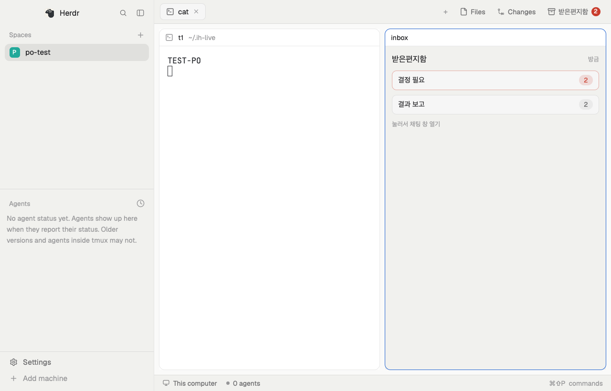

# 받은편지함 (inbox)

리더들이 남긴 결과 보고를 채팅처럼 한 곳에 모아 보여 주고, 결정이 필요한 보고에는 패널에서 바로 답합니다. 답은 클립보드를 거쳐 PO 터미널에 붙여 넣어지고, Enter는 내가 직접 누릅니다.




```text
  받은편지함                                  ⟳
  ── 결정 필요 (2) ──────────────────────────
  (L) lead-po-inbox   결정
      ┌──────────────────────────────────┐
      │ A안으로 갈까요, B안으로 갈까요?  │
      └──────────────────────────────────┘
      [링크 열기] [답 쓰기]
  (L) lead-docs       확인
      ┌──────────────────────────────────┐
      │ PR #21 확인 부탁드립니다         │
      └──────────────────────────────────┘
      [링크 열기] [확인 완료] [답 쓰기]
  ── 결과 보고 ──────────────────────────────
  (L) lead-fix        끝났습니다. PR #18 …
  (L) lead-docs       시작합니다. …
```

*패널 모양을 글자로 그린 스케치입니다. 실제 화면은 Herdr 테마 색을 따릅니다.*

## 사용법

- **위치**: 오른쪽 패널의 작은 요약 칸(`받은편지함` 버튼으로 열기). 요약 칸을 누르면 채팅 전체가 떠 있는 창으로 열립니다.
- **맞는 사람**: 여러 리더에게 일을 맡기고, 결정과 결과만 한 번에 받아 보고 싶은 사람

### 요약 칸과 채팅 창

- 요약 칸: `결정 필요 n`, `결과 보고 n` 두 줄만 보여 줍니다. 결정 건이 있으면 앱 아이콘(Dock)에도 그 숫자가 뜹니다(30초마다 갱신).
- 요약 칸을 누르면 채팅 전체(아래 두 칸)가 떠 있는 `받은편지함` 창으로 열립니다.
  - 창은 끌어서 옮길 수 있고, 놓은 자리를 기억해 다음에 그 자리에서 열립니다.
  - 창 오른쪽 위 `×`로 닫습니다. 창을 연 채로 두면 다음에 Herdr를 켤 때 다시 열립니다.
  - 창 안의 버튼·입력 칸·이름은 눌러도 창이 끌려가지 않습니다. 끌려면 머리줄(제목이 있는 줄)을 잡습니다.

### 두 칸

- `결정 필요`: 터미널에 `wait` 표시(`decision` 또는 `verify`)가 붙은 리더의 마지막 결정·확인 보고입니다.
  - PO 터미널에서 답을 Enter로 보내 리더가 받으면 그 리더의 보고 기록에 답 표시가 남아, 다음 결정이 오기 전까지 이 칸에서 빠집니다.
- `결과 보고`: 나머지 보고를 리더별 말풍선으로 보여 줍니다. 가장 새 것이 위, 리더마다 최근 40개까지입니다.
- 리더 이름을 누르면 그 리더의 터미널을 들여다봅니다.

### 결정 필요 카드의 버튼

- `링크 열기`: 보고에 붙은 링크(PR, 이슈 등)를 엽니다.
- `확인 완료`: 확인(`verify`) 보고에만 있습니다. 글 없이 `확인 완료`를 답으로 붙여 넣습니다.
- `답 쓰기`: 입력 칸을 열고, `보내기`(또는 Enter)로 답을 PO 터미널에 붙여 넣습니다.

### 답이 가는 곳

답 버튼(`확인 완료`, `보내기`)을 누르면 패널이 아래 한 줄을 만들어 PO 터미널에 **붙여 넣습니다**. Enter는 누르지 않습니다.

```text
Panel answer (decision) for lead-po-inbox: "A안으로 가자". Target: https://github.com/…/issues/25
```

1. 그 줄을 **클립보드에 담습니다.** 클립보드에 있던 내용은 바뀝니다(버튼에 마우스를 올리면 알려 줍니다).
2. PO 터미널 칸으로 포커스를 옮기고 붙여 넣습니다. 채팅 창이 열려 있었다면 키보드가 PO 칸으로 가도록 창은 닫힙니다.
3. PO 터미널에서 내용을 확인하고 **Enter를 눌러 보냅니다.** 마지막 확인도 내 손으로 하는 셈입니다.

- 붙여 넣은 글은 내가 직접 친 입력과 같아서, PO가 받는 쪽에서 `<hc from=…>` 같은 보낸 이 표시가 붙지 않습니다.
- 여러 줄로 쓴 답은 한 줄로 이어 붙입니다.
- PO 터미널이 칸 없이 돌고 있으면 칸을 열어 주고, 글은 클립보드에 둡니다. 칸이 열리면 붙여넣고 Enter를 누르세요.
- 붙여넣기 명령이 실패해도 글은 클립보드에 있습니다. 패널이 "붙여넣고 Enter" 안내를 보여 줍니다.

### PO를 찾는 규칙

- PO는 **그 리더 터미널의 부모**이고, 그 부모에 `role=po` 라벨이 있을 때만 PO로 인정합니다.
  - 이웃 리더들이 달린 터미널을 짐작해서 고르지 않습니다. 잘못 고르면 다른 에이전트의 입력창에 답이 들어가기 때문입니다.
- 찾지 못하면 `확인 완료`·`답 쓰기`·`보내기`가 비활성이 되고, 카드에 이유가 적힙니다. 라벨은 PO 터미널에서 `hc label <터미널> role=po`로 붙입니다.


### 숫자 표시

- 탭 줄의 `받은편지함` 버튼 숫자는 `wait` 표시(`decision`·`verify`)가 붙은 `lead-*` 터미널 수입니다. 오른쪽 패널이 닫혀 있어도 맞게 바뀝니다.
- 앱 아이콘(Dock) 숫자와 요약 칸은 30초마다 보고 기록을 다시 읽습니다. 채팅 창은 열려 있는 동안 5초마다 읽습니다.

## 필요한 것

- 함께 설치되는 모드: `tabs-mine`(패널 버튼)
- 리더가 `~/.herdr-inbox/<리더>.jsonl`에 보고를 남기고 터미널에 `wait` 표시를 붙여 줘야 합니다. 이 모드는 읽기만 합니다.
  - 한 줄이 한 보고입니다: `{v, ts, leader, terminal, kind, title, body, link}`
  - `kind`: `start`, `done`, `decision`, `verify`, `stop`, `resume`, `answered`, `other`. 모르는 종류와 필드, 쓰다 만 마지막 줄은 건너뜁니다.
- 답을 넣으려면 리더 터미널의 부모(PO)에 `role=po` 라벨이 있어야 합니다.
- Node.js (`inbox.cjs`가 기록을 읽습니다)

## 설치

추가 모드라 기본 설치에는 들어가지 않습니다.

```sh
curl -fsSL https://raw.githubusercontent.com/xowjd913/agent-mods/main/herdr/install.sh | sh -s -- --add inbox
```

```powershell
& ([scriptblock]::Create((irm https://raw.githubusercontent.com/xowjd913/agent-mods/main/herdr/install.ps1))) -Add inbox
```

- 설치하면 오른쪽 패널에 `inbox-board`를 더하고, `tabs-mine`도 함께 설치합니다.
- `--remove inbox`는 모드 폴더를 지우고 오른쪽 패널의 `inbox-board`를 뺍니다. `~/.herdr-inbox`의 기록은 남습니다.

빼는 방법과 다른 옵션은 [모드 골라 설치](../../herdr/README.md#모드-골라-설치)에 있습니다.

---

[← 모드 목록으로](../../herdr/README.md#모드)
