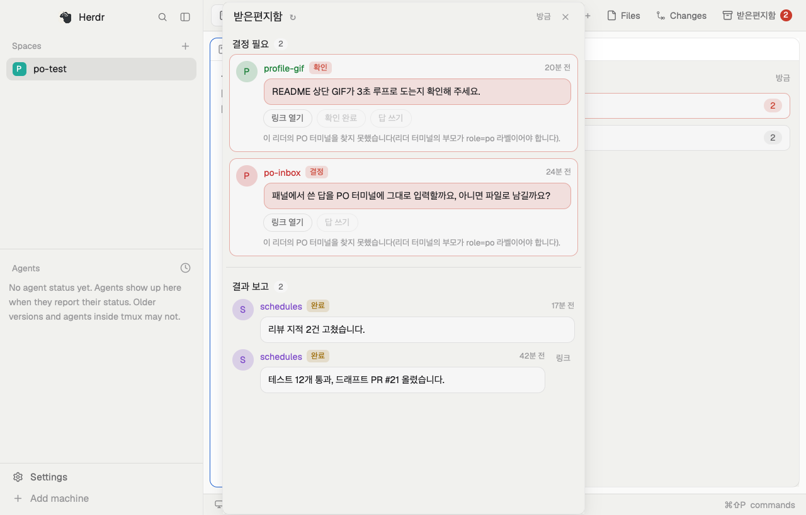

# PO 데스크 (inbox)

메신저처럼 **PO마다 채팅방이 하나** 있고, 방에 들어가면 그 PO 아래 리더들의 보고와 PO의 말과 내가 보낸 글이 한 타임라인에 시간순으로 나옵니다. 결정이 필요한 보고에는 그 말풍선 아래에서 바로 답합니다. 답 버튼·`N안 선택` 칩·채팅 입력칸은 모두 같은 길로 PO 터미널에 붙여 넣고 **Enter까지 눌러 바로 보냅니다**(PO가 질문 중일 때만 붙여 넣기만 합니다). 보내도 PO 데스크는 닫히지 않습니다.

```text
  PO 데스크                                         ⟳  ×
  ┌─ PO 방 ───────┬─ DevNotes ─────────────── 리더 2명 ─┐
  │ (D) DevNotes 2│ (L) 받은편지함 패널  결정      09:12 │
  │ (M) mascoz  1 │     ┌────────────────────────────┐   │
  │ (?) PO 모름   │     │ A안으로 갈까요, B안으로?   │   │
  │               │     └────────────────────────────┘   │
  │               │     [링크 열기] [답 쓰기]            │
  │               │ (P) PO  → 받은편지함 패널    09:14   │
  │               │     A안으로 진행합니다.              │
  │               │                          나   09:15 │
  │               │            ┌─────────────────────┐   │
  │               │            │ 확인했습니다        │   │
  │               │            └─────────────────────┘   │
  │               ├──────────────────────────────────────┤
  │               │ 받는 PO: DevNotes                    │
  │               │ [PO에게 말하기 — Enter로 보내기   ]  │
  └───────────────┴──────────────────────────────────────┘
```

오른쪽 패널(Dock)도 같은 화면입니다. 폭이 좁아서 방 목록만 58px 좁은 칸(동그라미 + 숫자)이 됩니다.

```text
  PO 데스크  [대기 2]      ⟳   [옆에 열기] [창 열기]
  ┌────┬─ DevNotes ─────────── 리더 2명 ┐
  │ (D)│ (L) 받은편지함 패널  결정 09:12 │
  │ 2 2│   ┌───────────────────────┐    │
  │(M) │   │ A안으로 갈까요?       │    │
  │ 1  │   └───────────────────────┘    │
  │(?) │   [링크 열기] [답 쓰기]        │
  │    ├────────────────────────────────┤
  │    │ [PO에게 말하기 …]  [PO에 보내기]│
  └────┴────────────────────────────────┘
```

*창과 Dock 모양을 글자로 그린 스케치입니다(숫자는 안 읽은 글과 기다리는 리더). 실제 화면은 Herdr 테마 색을 따릅니다.*

## 사용법

- **위치**: 같은 화면을 세 곳에 둘 수 있습니다. ① 오른쪽 패널(`PO 데스크` 버튼으로 열기). ② 떠 있는 창(머리줄 `창 열기`). ③ 터미널 옆 **페인**(머리줄 `옆에 열기`, 아래 "페인으로 열기"). 셋은 같은 방·같은 타임라인·같은 채팅 상자이고, 고른 방·보낸 글·안 읽은 시각·펼침·"PO에 넣음" 표시는 모두 공유 상태라 어디서 해도 나머지에 똑같이 보입니다.
- **맞는 사람**: 여러 리더에게 일을 맡기고, 결정과 결과만 한 번에 받아 보고 싶은 사람

### 방 고르기

왼쪽의 방 목록에서 PO(방)를 고릅니다. 창은 168px 방 목록(동그라미·프로젝트 이름·숫자)이고, 오른쪽 패널(Dock)은 58px 좁은 칸입니다(동그라미, 아래에 작은 이름과 숫자, 프로젝트·`po=<id>`·세션은 툴팁). 창이 좁으면(520px 미만) 방 목록이 위쪽 띠가 됩니다. 타임라인, 기다리는 개수, `@` 목록, 채팅이 가는 곳이 모두 **고른 방 하나**의 것입니다. 글을 `@` 없이 쓰면 그 방의 PO에게 갑니다.

- PO 터미널에는 라벨 `role=po`와 `po=<id>`가 둘 다 있어야 합니다(`hc label <터미널> role=po po=devnotes`). id는 소문자·숫자·`-` 1~40자입니다. 터미널 주소는 다시 켜면 바뀌므로 어디에도 열쇠로 쓰지 않습니다.
- 방 이름은 **프로젝트 이름**입니다: PO 터미널이 든 탭의 이름 `PO · <프로젝트>`에서 `<프로젝트>`(예: `DevNotes`)를 읽고, 탭 이름이 그 모양이 아니면 `po` id를 씁니다. 에이전트의 세션 제목은 방에 올려 두면 보이는 툴팁에만 나옵니다. `받는 PO: …`도 같은 이름입니다.
- 방 옆의 숫자: 초록은 **안 읽은 글**(내가 그 방을 마지막으로 열어 본 뒤 온 리더 보고·PO 말, 내가 보낸 글은 세지 않음), 붉은색은 그 PO 아래에서 결정·확인을 기다리는 리더 수입니다. 방을 고르거나 열어 두고 보는 동안 지워집니다(창과 Dock 모두. 그려지지 않고 숨어 있는 동안은 읽은 것으로 치지 않습니다). "마지막으로 연 시각"은 공유 상태(`inbox.seen`)에 저장돼 창을 닫았다 열어도 유지됩니다.
- 처음 열 때 고른 PO: 마지막에 고른 PO(공유 상태에 저장, 아직 살아 있을 때), 없으면 살아 있는 리더가 가장 많은 PO(같으면 앞쪽)입니다.
- 리더가 어느 PO 것인가: **살아 있는 리더는 터미널의 부모 PO**입니다(터미널이 진실). 이미 닫힌 리더는 그 보고 줄에 적힌 `po`(없으면 건너뛰고 가장 최근에 적힌 것)가 살아 있는 PO일 때만 그 PO 것입니다. PO가 닫혀 있으면 아무것도 갖지 못합니다.
- **PO를 알 수 없는 리더와 보고는 `PO 모름` 방에만 나옵니다**(그런 것이 있을 때만 방이 생깁니다). 이미 닫힌 리더인데 보고 줄에 `po`가 없고 그 PO도 지금 없는 경우(이 변경 전에 쓴 보고 줄 등)가 여기에 들어옵니다. 어느 PO 방에도 섞이지 않고, `PO 모름` 방에는 채팅 상자가 없습니다(받을 PO가 없음). 방의 PO 말도 없습니다.
- 앱 아이콘(Dock) 숫자와 탭 줄 버튼 숫자는 PO와 상관없이 기다리는 리더 전부입니다.
- `po=<id>` 라벨이 달린 PO 터미널이 하나도 없으면 방 목록 자리에 `role=po, po=<id> 라벨을 달면 PO별로 나뉩니다`라는 안내가 뜨고 채팅은 보낼 수 없습니다.
- 같은 `po=<id>`를 단 PO 터미널이 둘 이상이면 먼저 나온 터미널 하나만 그 id로 방이 됩니다. id는 하나에만 다세요.

### Claude 사용률 줄

방 제목 바로 아래 한 줄에 `Claude 5h ▬ 54% · 7d ▬ 34%`처럼 Claude 5시간·7일 사용률을 보여 줍니다. 터미널을 안 보고 "더 돌려도 되나"를 판단하는 용도입니다. 창·오른쪽 패널(Dock)·페인 모두 같은 줄이 나옵니다.

- 80% 이상이면 그 숫자와 막대가 경고 색으로 바뀝니다.
- 줄 위에 마우스를 올리면 초기화까지 남은 시간이 툴팁으로 나옵니다(`5h 초기화까지 2시간 15분 · 7d 초기화까지 5일 4시간 41분`, 0인 단위는 빼고 1분 안쪽은 `1분 미만`). 초기화 시각이 이미 지났으면 `초기화 시각이 지났습니다`, 시각 정보가 없으면 `초기화 시각 정보가 없습니다`가 나옵니다.
- `~/.claude/usage-limits.json`을 1분마다 읽기만 합니다. 네트워크 호출과 명령 실행은 없고, 읽는 규칙은 `usage-status` 모드와 같습니다.
- 파일이 없거나 10분 넘게 갱신되지 않으면 `Claude Unknown`을 보여 줍니다.
- 사용률이나 툴팁의 남은 시간 글이 바뀔 때만(1분 읽기 때 분이 바뀌면) 다시 그리므로 드래그로 글을 고르는 중에는 영향이 없습니다.
- 이 파일은 Claude Code 상태 줄(statusline) 스크립트 등이 따로 써 줘야 합니다(`usage-status`와 같은 파일·형식).

### PO별 현재 세션 금액 (#53)

고른 PO의 사용률 줄 끝에 `· 이 세션 약 4,300원`처럼 그 PO가 **지금 세션에서 쓴 금액을 한화로** 붙입니다(원 미만 반올림, 천 단위 쉼표). 계산은 USD로 하고 고정 환율로 원으로 바꿉니다. "이 PO를 새로 시작하는 게 낫겠다"를 판단하는 근거로 쓰는 값입니다. 사용률 파일이 없거나 오래돼 읽을 수 없으면 `Claude Unknown · 이 세션 약 4,300원`처럼 금액은 그대로 붙습니다. 금액만 있는 줄은 사용률을 처음 읽기 전(아직 읽는 중)에만 잠깐 나옵니다. `PO 모름` 방은 PO가 없어 금액도 없습니다.

- **어디서 읽나**: PO 답 훅(`po-hook.cjs`)이 프롬프트·답마다 그 PO 세션의 transcript 경로를 `<inbox 폴더>/po-session/<po id>.json`에 적고(`0600`, 같은 세션이면 다시 쓰지 않음), 데스크가 그 transcript(`.jsonl`)에서 `message.usage`·`message.model`·`message.id`만 읽어 더합니다(글 내용은 읽지 않음). `/clear` 하면 다음 프롬프트가 새 세션 경로를 적으므로 금액이 0부터 다시 시작합니다.
- **서브에이전트**: 메인 transcript 경로에서 `<경로에서 .jsonl 뺀 것>/subagents/*.jsonl`을 알 수 있으면 함께 더합니다(최대 59개). 폴더가 없으면 메인 세션만 더하고, 툴팁에 `메인 세션만`이라고 밝힙니다.
- **중복**: 스트리밍으로 같은 `message.id`가 여러 줄 나오면 한 번만 세고 필드마다 가장 큰 값을 씁니다(transcript마다 최근 400개 id만 기억). id가 없는 줄은 줄마다 따로 셉니다.
- **가격**: `inbox.cjs`의 `COST_PRICES` 한 곳에만 있습니다(모델별 입력·5분 캐시 쓰기·1시간 캐시 쓰기·캐시 읽기·출력, 100만 토큰당 USD). 출처 주소와 확인한 날짜(2026-11-25)가 그 주석에 있고, Haiku 5.5의 10만 토큰 초과 구간 단가도 거기서 처리합니다. 모델 id의 날짜·`[1m]` 꼬리는 떼고 찾습니다. 가격표를 고칠 때는 이 주석의 날짜도 같이 고칩니다.
- **환율**: 가격표 바로 옆 `inbox.cjs`의 `COST_KRW_RATE`(`1343.6`원/$)와 `COST_KRW_NOTE` 한 곳에만 있는 **고정값**입니다. 데스크는 환율을 실시간으로 가져오지 않습니다. 출처는 한국은행 ECOS 통계 `731Y001` 원/미국달러(매매기준율)의 2026-11-25 값이고(`https://ecos.bok.or.kr/api/StatisticSearch/sample/json/kr/1/10/731Y001/D/20261115/20261125/0000001`), 서울외국환중개(smbs.biz)는 그날 읽히지 않아 쓰지 못했습니다. `poCosts`가 금액마다 `rate`·`rateNote`를 실어 보내므로 복사해 둔 `costLine` 블록에는 환율 숫자가 따로 없습니다. 환율을 바꿀 때는 값·메모의 날짜·주석을 함께 고칩니다.
- **모르는 모델**: 가격표에 없는 모델이 한 번이라도 있으면 추정하지 않고 금액 자리에 `?원`을 보여 주고, 툴팁에 그 모델 이름을 적습니다.
- **훅 기록이 없으면 아무것도 안 보입니다**: 훅을 설치하기 전에 시작한 PO 세션은 다음 프롬프트·답이 한 번 있을 때까지 금액이 나오지 않습니다(그 전의 사용분을 따로 거슬러 읽지는 않습니다). 새로 시작한 세션은 그 전 사용분 없이 처음부터 셉니다.
- **툴팁**: 줄 위에 마우스를 올리면 `API 기준 추정 금액, 구독 청구액 아님`과 함께 달러 금액(`달러로는 $3.20`), `환율 1,343.6원/$ (한국은행 ECOS 매매기준율, 2026-11-25 기준 고정값)`, 서브에이전트 포함 여부, 읽는 양 제한에 걸려 더 늘 수 있는지가 나옵니다. 빠른 모드(×2)·미국 데이터 거주 가격(×1.1)·웹 검색 같은 서버 도구 요금(1000회당 $10)은 계산하지 않으므로 **실제보다 적을 수 있다**는 말도 툴팁에 있습니다. 환율은 고정값이라 그날그날의 환율과 다를 수 있습니다.
- **읽는 양**: 읽은 바이트 위치와 합계·최근 id를 `<앱 폴더>/data/inbox/po-cost-cache.json`(`0600`, 쓰는 중에 깨지지 않게 임시 파일로 쓴 뒤 바꿈)에 저장해 새로 붙은 줄만 읽습니다(헬퍼가 `load()`마다 새 프로세스라 디스크에 둡니다). 데스크가 inbox 폴더를 감시하므로, 캐시를 그 안에 두면 쓸 때마다 다시 불러오는 일이 반복돼 감시 밖인 앱 폴더에 둡니다. 한 번에 파일마다 8 MiB, 전체 16 MiB까지만 읽고 남으면 다음 읽기에서 이어 가며, 줄 하나가 8 MiB보다 길면 그 줄은 건너뜁니다. 지금 안 쓰는 transcript는 캐시에서 지웁니다.
- 다시 그리기 판단에는 금액의 원시 숫자가 아니라 **화면에 나가는 글(라벨·툴팁)**만 넣습니다. 그래서 표시되는 원 단위(툴팁의 달러 센트)가 안 바뀌는 사용량 증가로는 다시 그리지 않고, 그 글이 바뀔 때만 그립니다(#54 깜빡임 이후 그리기 압력을 늘리지 않으려는 것). 원 단위는 센트보다 잘게 바뀌지만, 금액은 PO가 답을 쓸 때만 늘어 그 빈도는 그대로입니다.
- `costLine` 블록(`costLabel`·`costTip`)은 `main.js`와 `inbox.cjs`에 똑같이 복사돼 있고 시험이 같은지 확인합니다. 가격 계산은 헬퍼에만 있고 `main.js`는 읽은 결과를 그리기만 합니다.

### Dock과 채팅 창

- 오른쪽 패널(Dock)과 창은 **같은 화면**(방 + 타임라인 + 채팅 상자)입니다. 예전의 카드 목록·`결정 n`/`보고 n` 칩은 없어졌습니다. 기다리는 건은 타임라인에서 붉은 말풍선과 인라인 버튼으로 보입니다.
- Dock 머리줄: `PO 데스크`, 기다리는 리더가 있으면 붉은 `대기 n`(모든 방 합계), 새로고침 `↻`, `옆에 열기`, `창 열기`. 결정 건이 있으면 앱 아이콘(Dock)에도 그 숫자가 뜹니다(30초마다 갱신).
- `창 열기`는 같은 방을 넓은 창(168px 방 목록)으로 엽니다. 어느 방을 골랐는지는 공유되므로 창에서 고른 방이 Dock에서도 열려 있습니다.
- 창은 끌어서 옮길 수 있고, 놓은 자리를 기억해 다음에 그 자리에서 열립니다.
- 창 오른쪽 위 `×`로 닫습니다. 창을 연 채로 두면 다음에 Herdr를 켤 때 다시 열립니다.
- 창 안의 버튼·입력 칸·이름은 눌러도 창이 끌려가지 않습니다. 끌려면 머리줄(제목이 있는 줄)을 잡습니다.
- `자세히`·`접기`·`답 쓰기`를 눌러도 타임라인이 맨 아래로 튀지 않고 누른 말풍선이 제자리에 보입니다.
- Dock에서 글을 보내면 창과 달리 닫을 것이 없어 그대로 남고 Dock에 보낸 글이 `나`로 쌓입니다. Dock에서 보낸 뒤 PO 터미널이 포커스를 가져갑니다.

### 페인으로 열기

Herdr의 다른 칸처럼 나누고, 키우고(zoom), 옮기고, 닫을 수 있는 칸으로 PO 데스크를 둡니다.

- **여는 법**: Dock이나 창의 머리줄 `옆에 열기`. 지금 탭의 **리더 터미널 오른쪽**에 칸을 나눕니다(포커스가 리더면 그 리더, 아니면 탭에서 가장 새 리더). 리더가 없으면 포커스한 터미널 옆에 열립니다. 이 탭에 PO 데스크 페인이 이미 있으면 새로 만들지 않고 그 페인으로 포커스만 옮깁니다(탭마다 하나). 창에서 누르면 창은 닫힙니다(페인이 가려지지 않도록).
- **어떤 화면인가**: `pane.split {direction: "right", mod: "inbox", props: {mode: "pane"}}`로 만든 mod 칸입니다. 칸 머리줄이 제목과 닫기를 맡으므로 이 칸 안에는 `PO 데스크` 제목, `옆에 열기`, `×`가 없고 `대기 n`, `↻`, `창 열기`만 있습니다. 칸은 탭과 함께 저장되어 Herdr를 다시 켜도 같은 모드(`props`)로 다시 열립니다.
- **방 목록**: 모드가 아니라 **자기 폭**으로 고릅니다. 520px 이상이면 168px 두 칸 방 목록, 그보다 좁으면 58px 좁은 칸(Dock과 같은 방식)입니다. 창만 좁으면 위쪽 띠가 됩니다.
- **갱신과 숫자**: 페인은 읽는 화면이라 창처럼 5초마다 읽되, **그려지고 있는 동안만** 읽습니다(아무도 안 보는 탭의 페인은 읽지 않습니다). 오른쪽 패널(Dock)은 늘 켜 두는 쪽이라 30초마다 읽고 앱 아이콘 숫자를 맡습니다. 페인도 숫자를 쓰지만 같은 파일에서 같은 규칙으로 센 같은 값이고 바뀔 때만 보내므로 둘이 어긋나지 않습니다. 창은 숫자를 쓰지 않습니다.
- **읽음**: 페인이 방을 보여 주는 동안(그려진 지 최근일 때만)만 읽은 것으로 칩니다. 그려지지 않는 페인은 읽은 것으로 치지 않습니다.
- **한계**: 칸을 클릭하면 키보드가 이 칸으로 오지만, `pane.go`(키보드로 칸 이동)로는 이 칸으로 들어갈 수 없습니다. `mod.json`의 `"focusable": true`를 켜면 가능해지지만 그러면 Herdr가 이 칸(과 Dock 복사본)에 `focus` 명령을 보내는데 이 모드는 그 명령을 처리하지 않아서 켜지 않았습니다. 칸 머리줄의 이름은 `mod.json`의 제목(`Inbox`)을 따를 수 있고 이 화면이 바꾸지 않습니다. 실제 Herdr 화면에서는 아직 확인하지 못했습니다.

### 방의 타임라인

방 하나의 가운데 칸은 **한 줄기 타임라인**입니다. 가장 오래된 것이 위, 가장 새 것이 아래이고, 방을 열면 맨 아래로 갑니다.

- 말하는 사람은 셋입니다. **리더**는 리더마다 한 사람으로, 이름 첫 글자를 담은 동그라미(리더마다 정해진 색)와 세션 이름(없으면 `lead-…` 이름), 시각이 붙습니다. 이름을 누르면 그 리더의 터미널을 들여다봅니다. **PO**는 `PO`라는 한 사람(초록 동그라미 `P`, 누구에게 한 말이면 `→ 리더`)이고, 내가 PO에게 보낸 글은 오른쪽의 `나`입니다.
- 같은 사람이 5분 안에 이어서 보낸 글은 이름 줄을 줄이고 종류 태그와 시각만 붙입니다.
- 한 방의 타임라인에는 그 방 PO 아래 리더의 보고(`완료`·`결정`·`확인`·`중단`·`재개`·`알림`, 리더마다 최근 40개), 그 PO의 `po/<id>.jsonl` 말, 그 방으로 보낸 내 글이 섞여 시간순으로 놓입니다. `시작`·`답함 표시용` 줄은 말풍선이 아니라 `답함` 태그로 합쳐집니다. 타임라인은 최근 80건까지 그리고, 기다리는 건은 그보다 오래돼도 그립니다.
- 글이 길면 줄이 바뀌고, 글 안의 `http(s)` 주소는 눌러 열 수 있습니다.
- **결정·확인이 아직 열려 있는 말풍선**(터미널에 `wait` 표시가 붙은 리더의 마지막 결정·확인)은 붉게 표시되고 그 아래에 `링크 열기`·`확인 완료`(확인만)·`답 쓰기` 버튼이 붙습니다. 동작은 예전 카드 버튼과 같습니다. 보고 기록이 없이 `wait` 표시만 있는 리더는 타임라인 맨 아래에 `보고 기록 없이 대기 표시만 있습니다` 말풍선과 같은 버튼이 나옵니다.
  - PO 터미널에서 답을 Enter로 보내 리더가 받으면 그 리더의 보고 기록에 답 표시가 남아, 말풍선은 `결정 · 답함`·`확인 · 답함`의 중립색 태그로 바뀌고 버튼이 사라집니다. 붉은 표시는 아직 기다리는 건에만 붙습니다.
  - 짝짓기: `answered` 줄은 같은 리더의 그 앞에서 아직 답 없는 가장 최근 결정·확인 하나를 닫습니다. `answered` 본문이 종류(`decision`/`verify`)를 담고 있으면 그 종류의 가장 최근 건을 먼저 찾고, 없으면 종류에 관계없이 가장 최근 건을 닫습니다.
- **쓰는 중 말풍선(`···`)**: 이 방의 PO나 리더가 `working`(일하는 중)이면 타임라인 맨 아래, 왼쪽에 이름이 붙은 `···` 말풍선이 뜨고 일이 끝나면 사라집니다. **어느 필터에서나** 보입니다(칩은 글을 거를 뿐 지금 일어나는 일을 숨기지 않습니다). 판단은 `hc` 상태만 쓰고 화면 글은 읽지 않습니다. PO는 자기 터미널이 `working`일 때만 나옵니다. **리더는** 자기 터미널이나 그 아래(`parent` 사슬로 이어진 팀원·리뷰어) 터미널 중 하나가 `working` 또는 `blocked`(권한 기다림)이면 일하는 중으로 칩니다 — 리더 상태는 자기 차례 동안만 `working`이라, 팀원을 기다리는 사이에는 `done`·`idle`로 보이기 때문입니다. 마지막으로 일하는 게 보인 뒤 **30초 동안은 말풍선을 그대로 두어**(짧은 틈에 깜빡이지 않게) 그 뒤에 지우고, 그 사이에 리더가 보고 글을 올리면(그 말풍선이 점을 대신합니다) 또는 그 터미널이 사라지면 바로 지웁니다. 일하는 중에 올린 보고 뒤로는 일이 멈추는 즉시 지웁니다(유예 없음). 유예가 끝나는 것도 1.5초 상태 확인이 보고 다시 그립니다. 리더는 그 터미널의 부모 PO가 이 방의 PO일 때만 이 방에 나옵니다(예: 부모가 `t28`인 `lead-po-inbox`는 `t28`의 방). 실제 글이 아니라 안 읽은 개수·읽음 표시·필터 개수에 들어가지 않고, 이 말풍선만 나타나거나 사라질 때는 스크롤을 끌어당기지 않습니다. 상태는 1.5초마다 새로 읽어 Dock·창·페인이 함께 바뀝니다.
- **감싸개 숨김**: 리더 보고에 붙는 `<hc from="…">…</hc>`와 PO 훅이 올리는 `<pasted_content id="…">…</pasted_content id="…">`는 말풍선에서 태그만 빼고 글은 남깁니다(보낸이 표시는 말풍선의 이름 줄이 대신합니다). 훅이 올린 내 글 사본은 감싸개를 뺀 글과 그림으로 데스크에서 보낸 기록과 맞춰 한 번만 보입니다.
- **말풍선 마크다운**: 말풍선 글은 안전한 마크다운 부분집합으로 그립니다(`TextView.markdown(...).raw_html(false)`): `**굵게**`·`*기울임*`·제목·목록·`코드`·링크. 날 HTML은 그리지 않고, 링크는 `http(s)`만 열립니다. `【…】`만 있는 줄은 굵게 보입니다. 선택·드래그(`selectable`, `on_selection_change`)와 진단 줄은 그대로입니다.
- **굵은 글씨가 눈에 띄게(#39 R17, R20에서 더 진하게)**: 글을 그리는 `TextView`는 `**굵게**`를 보통 굵기로 그리고, 글자 일부만 굵게 하는 API가 없습니다(`font_weight()`는 칸 전체에만 먹습니다). 그래서 굵은 글 `**…**` 구간(원문의 UTF-16 위치, 코드와 코드 블록 안·`\*` 이스케이프는 건너뜀)에 `highlight_range`로 배경 띠를 깔아 눈에 띄게 합니다. 굵기 자체가 바뀌는 것은 아닙니다. R17의 글자색 20% 띠는 너무 옅어서, R20부터 **테마의 `accent` 색 약 45%**(`#rrggbb` 뒤 알파 `73`)를 씁니다(없으면 `ansi4`, 그것도 없으면 글자색). 글자색과의 대비가 3.5 아래로 떨어지면(밝은 강조색 등) 알파를 한 단계(8)씩 낮춰 최소 25%까지 내립니다(`Math.max(바닥, 알파-8)`로 바닥 밑으로는 내려가지 않음). 테마 토큰을 하나도 못 쓰면 진단에 한 줄 남기고, `#rgb`·`#rrggbbaa`는 `#rrggbb`로 맞춰 읽습니다. 계산은 `tintHex`(테마의 `background`·`foreground`로 섞어 본 색), 고정 색은 없습니다. 선택·드래그·복사와 진단은 그대로이고, 아주 긴 줄·구간이 100개를 넘는 글은 띠 없이 그립니다.
- **드래그 선택이 풀리는 원인 추적과 카드의 짧은 참조(#39 R23)**: 실제 로그에서 선택이 확정된 지 258ms·372ms 뒤에 풀렸습니다. 코드 쪽 원인은 하나 찾아 막았습니다: 엔터 보류 타이머(`heldAt`)가 선택 보류(`quietNow`)를 거치지 않고 `cx.notify()`를 직접 불러, 선택 중에도 다시 그렸습니다(이제 `softNotify`). **확정된 원인은 아닙니다**: 앱 바이너리에 `gpui_base::text_selection::WindowSelectionState`(창 단위 선택)가 있어 같은 창의 다른 곳을 한 번 더 누르면 앱이 선택을 스스로 푸는 것으로 보이지만, 실제 앱에서 확인하지 못했습니다. 그래서 진단을 늘렸습니다: `selection cleared …` 줄 끝에 `since the settle: N redraws, M mouse ups, K list presses[, last click C]`가 붙고, 창 마우스 놓음·목록 눌림은 `release (window mouse up)`·`press (list mouse down)` 줄에 `click N`과 마지막 확정 뒤 경과 ms를, 선택이 확정된 동안의 다시 그리기는 `redraw #N while a selection is settled (Xms after the settle)`를 `diag.log`에 남깁니다(글 내용 없음). 읽는 법: 다시 그리기 0·눌림 1 이상이면 사용자가 누른 것이라 앱 기본 동작이고 우리가 막을 수 없으며, 다시 그리기가 있으면 그 코드 경로를 고칩니다. **선택 색(`colors.selection`)**: 레이아웃의 `colors` 덮어쓰기에 `selection` 키는 문서에 있으나 `TextView`의 기본 선택이 그 색을 읽는지는 문서에 없고 앱을 돌려 볼 수 없어 **미확인**이라 `install.sh`는 바꾸지 않았습니다(앱 전체 테마·`set_theme`·`settings.json`은 건드리지 않음). **카드 이름 옆 참조**: 보고에 GitHub PR·이슈 링크가 있으면 리더 이름 옆에 `agent-mods#39`처럼 저장소 이름과 번호(`linkRef`, 소유자는 뺌)를 작게 붙입니다. 링크가 없거나 GitHub PR·이슈가 아니면 아무것도 붙이지 않고, 이름(`leaderName`)과 제목은 그대로입니다. **R24 보정**: 목록을 누르거나 목록 밖을 눌러 모드가 스스로 선택을 지울 때도 진단 표식(`selMark`)이 남아 이미 사라진 선택에 "redraw while a selection is settled"가 찍히던 것을 `dropSel()`(선택 맵·`ui.sel`·`selMark`를 함께 지움)로 묶었고, 카드 참조 글씨는 최대 150px에서 말줄임으로 잘라 좁은 머리줄에서 종류 태그·시간을 밀어내지 않습니다. **미확인**: 실제 앱에서의 모양·선택 동작.
- **드래그 선택 덮개는 없앴습니다(#39 R22)**: R20·R21에서 `on_selection_change`의 범위에 `highlight_range` 덮개를 한 번 더 칠했지만, 선택 중엔 다시 그리기를 `SEL_HOLD_MS`(2분) 동안 보류하므로 덮개가 그 안에는 보이지 않고, 더 일찍 칠하면 앱의 기본 선택이 풀릴 위험이 있어 덮개 전체(선택 색 `sel`, `ui.hl`/`hlSkip`, `md()`의 덮개 그리기와 시험)를 지웠습니다. 드래그 영역이 잘 보이게 하는 것은 앱 테마의 `selection` 색으로 따로 다룹니다(이 PR 밖). **남긴 것**: 굵은 글 띠(위 항목, 강해진 accent 색과 대비 검사)와 진단 줄 `selection settled in <m~해시> id=…: N chars, range a-b|missing (#n)` / `selection cleared in … , Nms after the last settle (#n)`(`diag.log`, 글 내용은 길이만 남김)입니다. 선택이 확정되면 `ui.sels`/`ui.sel`만 갱신하고 `cx.notify()`는 부르지 않으며, 보류된 다시 그리기가 있으면 풀린 뒤 `softNotify`로 내보냅니다. **미확인**: 앱이 `range`를 실제로 보내는 필드 이름(진단 줄의 `range missing`으로 확인), 실제 앱에서의 동작.
- **말풍선 오른쪽 정렬과 폭 제한(#39 R21, R22에서 좁은 칸 보정)**: 내 말풍선은 오른쪽 끝에 붙고 그 왼쪽에 `복사` 칩과 시간이 옵니다. 폭 상한 `bubbleCap`은 채팅 칸(창 너비에서 방 목록 `168`/좁을 때 `58`, 위쪽 띠일 땐 0을 뺀 값)의 **75%** 와 **칸 너비 − 90px**(칩·시간 자리) 중 작은 값이고, 아주 좁은 칸에서도 0이 되지 않게 바닥 40px(칸보다 크지는 않음)을 둡니다. R21의 "최소 120px"는 좁은 도크에서 칸을 넘어 칩이 밀려나므로 없앴습니다. 칸 150/200/260px이면 상한 60/110/170px, 552px이면 414px입니다(칸 130px 이상이면 상한 + 90px ≤ 칸). **그림 말풍선**: 그림이 칩 옆에 들어갈 만큼(칸 − 90px 이하)일 때만 상한을 그림 폭까지 올리고, 그보다 크면 상한을 그대로 두어 그림을 상한 안으로(`상한 − 26px`, 최소 24px) 줄여 그립니다. 칸이 그림보다 넓으면 예전과 같습니다. PO·리더 말풍선도 왼쪽에서 같은 상한을 씁니다. 창 크기는 `on_size_change` → `onSize`로 받아 16px 단위로만 갱신하고(레이아웃 등급 360px·`WIDE_MIN`이 바뀔 때도) `softNotify`로 다시 그려(선택 중엔 보류) 크기를 바꿔도 따라옵니다. `onSize`는 따로 시험합니다(`|| grew`를 빼면 시험이 실패). 상한은 상자 폭에만 걸리고 `TextView`에 주는 마크다운 문자열은 그대로라 선택·복사·굵은 띠 위치는 달라지지 않습니다. 창 너비를 아직 모르면(첫 보고 전) `75%`로 둡니다. **미확인**: 실제 앱에서의 모양.
- **리더 상태 글씨(#39 R21)**: `···` 말풍선 옆에 5글자 안쪽 한글 상태를 작게 붙입니다. 실제로 알 수 있는 값만 씁니다: 터미널의 `status`(`working`/`blocked`), `parent` 사슬, `address`·`name`. 우선순위는 **승인 대기**(본인 또는 팀원이 `blocked`) > **작업중**(본인이 `working`) > **팀원 작업**(parent 사슬 아래 팀원이 `working`) > **잠시 대기**(일이 끝난 뒤 30초 유예만 남음). PO의 점은 `작업중`입니다. `생각중`·`리뷰중`은 hc가 그런 값을 주지 않아(`status`는 네 가지뿐, `review-*` 이름은 관례일 뿐) 넣지 않았습니다. 라벨은 `statusSig`에 들어 있어 1.5초 폴링으로 바뀔 때만 다시 그립니다.
- **말풍선 `복사` 버튼(#39 R17)**: 글자 드래그 복사가 안 될 때를 위해 내 말풍선과 PO 말풍선 옆(시간 위)에 작은 `복사` 칩을 둡니다. 누르면 그 말풍선 글(`<hc from>`·`pasted_content` 감싸개를 뺀 글)을 클립보드에 넣고 잠깐 `복사됨`으로 바뀝니다. 마크다운 표시(`**`)는 원문 그대로 들어갑니다.
- **입력칸 위 그림 칩 썸네일**: 붙인 그림은 칩에 작은 썸네일이 보이고 `X` 버튼으로 뺍니다(앱 폴더 상대 경로 `data/inbox/img/…`).
- **바로 반영**: 인박스 폴더(`~/.herdr-inbox`)를 `watchFolder`로 지켜보다가 파일이 바뀌면 0.25초 모아 한 번 다시 읽습니다. 그래서 PO 답이나 리더 보고가 몇 초 기다리지 않고 올라옵니다. 지켜보기가 안 되거나 끊겨도 기존 타이머 새로 읽기는 그대로 남아 있고, 화면이 그려지지 않을 때는 지켜보기를 거둡니다.
- **말풍선 크기·겹침**: 내 말풍선(오른쪽)은 글 길이만큼만 차지하고(짧은 한 줄은 그 줄 너비, 최소 64px) 길면 줄 폭의 80%에서 멈춥니다. 왼쪽 말풍선과 같은 기준입니다. 예전에는 퍼센트 최대폭이 안쪽 크기에 맞춰진 줄 안에서 계산되어 한글 3자 정도로 쪼그라들었습니다. 지금은 줄이 항상 전체 폭(`w_full`)이고 말풍선 폭을 글자 수에서 계산해 직접 지정합니다(`bubbleWidth`: 영문 약 7.4px, 한글 약 13.5px). 줄 높이는 내용을 따르고 고정하지 않아 위 말풍선(과 그 시각)을 덮지 않습니다.
- **맨 아래로 따라가기(보강)**: 맨 아래에서 40px 안에 있었다면, 다시 그려질 때마다(`···` 말풍선이 나타나거나 사라질 때, 그림이 뒤늦게 읽힐 때 포함) 맨 아래로 다시 붙습니다(0.25초마다 높이가 커졌는지 보고, 그림을 그린 직후 0.06초·0.22초에도 한 번씩). 위로 올려 읽는 중이면 어떤 변화에도 보던 자리를 지킵니다.
- 맨 아래로 따라가기: 새 글이 오거나 방을 열거나 바꾸면 맨 아래로 갑니다. 위로 올려 읽는 중이면 새 글이 와도 보던 자리를 지킵니다. 스크롤 핸들에는 `맨 아래로` 호출이 없어서 마지막 말풍선으로 가는 호출(`scroll_to_item`)을 쓰고, 그 값은 마지막으로 그려진 화면 기준이라 한 프레임 늦을 수 있습니다.
- **말풍선 간격**: 같은 사람이 이어 말하면 말풍선 사이 8px, 보내는 사람이 바뀌면 18px을 띄우고(이름 줄이 있는 첫 말풍선 기준), 말풍선 안쪽 여백은 가로 12px·세로 9px로 넓혔습니다(예전 가로 10·세로 5~6 정도). `···` 말풍선도 같은 여백입니다.
- **질문 패널이 잘리던 것**: 패널은 예전에 높이 120px에서 잘라 보여 위쪽 질문과 선택지에 닿을 수 없었습니다. 지금은 패널이 최대 높이 340px이고, 화면 줄은 그 안(최대 240px)에서 **스크롤바로 스크롤**됩니다(화면 끝 40줄 읽음, 줄은 400자까지). 번호·Enter·Esc 버튼은 스크롤 영역 밖 아래에 항상 보이고, 번호 버튼 이름은 32자에서 줄이고 말풍선 힌트(tooltip)에 전체를 둡니다. 타임라인 목록도 스크롤바가 있는 스크롤 영역이고 맨 아래로 따라가기만 스크롤을 끌어당깁니다.
- 말풍선과 방 목록의 리더 이름은 `po-inbox` 같은 내부 이름이 아니라 Herdr에서 보이는 세션 이름(예: `받은편지함 패널`)입니다. 순서는 리더 터미널의 현재 제목(`리더 · ` 머리말은 뗌) → `session` 라벨 → 마지막으로 본 이름 → 내부 이름(`lead-` 뗌, `-`는 띄어쓰기)입니다. 이미 닫힌 리더의 옛 말풍선도 마지막으로 본 이름으로 읽히며, 이름은 에이전트 목록(`agent-groups`)과 같은 규칙·같은 기억(`leader.names`)을 씁니다.

### 채팅 필터

타임라인 위의 칩 줄로 그 방의 말풍선을 골라 봅니다: `전체` | `안 읽은 것` | `결정 필요` | `최종 확인 요청` | `결과` | `멈춤`. 칩마다 개수가 붙고(`결정 필요 2`), 개수가 0이면 흐리게 보이지만 눌러서 볼 수 있습니다. Dock·창·페인이 같은 화면이라 같은 칩 줄입니다.

| 칩 | 보이는 것 |
| --- | --- |
| `전체` | 모두(내 글·PO 말·리더 보고 전부) |
| `안 읽은 것` | 방을 열 때의 읽음 기준보다 새로 온 리더·PO의 글 |
| `결정 필요` | 종류가 `decision`인 보고(기다리는 결정 포함) |
| `최종 확인 요청` | 종류가 `verify`인 보고(기다리는 확인 포함) |
| `결과` | 종류가 `done`인 보고만 |
| `멈춤` | 종류가 `stop`인 보고 |

- `resume`·`start`·그 밖의 종류는 `전체`에서만 보입니다. 종류 칩(`결정 필요`·`최종 확인 요청`·`결과`·`멈춤`)과 `안 읽은 것`에서는 **내가 보낸 글이 숨겨집니다.** `전체`로 돌아오면 다시 보입니다.
- 기다리는 결정·확인은 보고 종류와 관계없이 **기다리는 종류**로 셉니다. 필터를 걸어도 말풍선의 `링크 열기`·`확인 완료`·`답 쓰기` 버튼은 그대로 붙어 있습니다.
- **`안 읽은 것`의 기준**은 방을 열 때 한 번 잡습니다. 방을 열면 읽음 표시가 바로 지금으로 올라가므로, 올라간 값으로 거르면 늘 비어 버립니다. 그래서 방을 열기 직전의 값을 따로 기억해 두고 그 방에 머무는 동안 그 값으로 걸러서, 방을 열었을 때 안 읽었던 글이 계속 보입니다. 다른 방에 갔다가 돌아오면 기준이 새로 잡힙니다.
- 걸린 결과가 없으면 `해당 메시지 없음 —` 옆에 `전체 보기` 칩이 나옵니다.
- **필터는 방마다 따로 기억하지만 저장하지는 않습니다.** 화면(Dock·창·페인 인스턴스)이 살아 있는 동안만 유지되고, 앱을 다시 켜거나 창을 닫았다 열면 `전체`로 돌아갑니다. Dock과 창은 서로 다른 인스턴스라 각자 필터와 읽음 기준을 따로 가집니다. 한쪽이 먼저 읽음 표시를 올려 두었으면 나중에 연 쪽의 `안 읽은 것`은 비어 보일 수 있습니다.
- `멈춤`은 리더가 `stop` 종류로 남긴 **보고 기록**만 모읍니다. 리더 터미널 자체의 hc `blocked`·오류 상태는 보고 기록이 아니라서 이 칩에 들어오지 않습니다.

### 카드 읽기

카드는 접힌 채 시작합니다. 접힌 카드는 종류 배지, 리더 이름, 제목, 첫 문장, 짧은 링크(`PR #26`)만 보여 줍니다.

- `자세히`/`접기`: 카드 오른쪽 아래 버튼으로 본문 전체를 펼치고 접습니다. 펼침은 카드마다 공유 상태에 저장돼 창을 닫았다 열어도 유지됩니다. 카드 아무 데나 눌러서는 펼쳐지지 않으므로 글자를 드래그해도 카드가 접히거나 펴지지 않습니다.
- 제목과 소제목은 본문보다 큰 글자로 보입니다. 글꼴 때문에 굵기 차이는 작아서 크기로 구별합니다.
- 펼친 본문: 줄바꿈을 지키고, `- ` 목록과 `1. ` 번호 목록은 들여쓴 줄로, `따라 하기:`·`되돌리기:`·`아직 못 해 본 것:`·`## 제목`은 작은 소제목으로 보여 줍니다. 모르는 문법은 글자 그대로 둡니다.
- 명령 상자는 보수적으로 만듭니다. 백틱(`` ` ``)으로 감싼 코드, `$ `로 시작하는 줄, 코드 펜스, 그리고 `되돌리기:` 같은 이름표 뒤에 줄 전체가 명령 하나인 것만 고정폭 상자에 담고 `복사` 버튼을 둡니다. 설명 문장 속의 명령 비슷한 글자는 상자로 만들지 않습니다. 본문이 명령 하나뿐인 보고도 상자로 나오며 `자세히`가 붙습니다. `복사`는 원문 명령 그대로만 클립보드에 담고, 붙여 넣거나 보내지 않습니다. 긴 명령은 줄이 바뀝니다.
- 링크는 짧은 이름으로 보입니다: `PR #26`, `issue #25`, `comment`, 그 밖에는 `호스트/경로`. 누르면 앱 안 `open_url`로 기본 브라우저에서 열리고(http·https만), 안 되면 운영체제 열기 명령(`open`·PowerShell·`xdg-open`)으로 엽니다.
- 글자 선택: 제목, 첫 문장, 펼친 본문, 링크 이름, 명령 상자 안 글자까지 모두 마우스로 드래그해 고를 수 있고 `Cmd+C`(Windows·Linux는 `Ctrl+C`)로 복사됩니다. 명령 하나를 통째로 복사하려면 `복사` 버튼이 더 쉽습니다.
- 타임라인에서도 같습니다: 리더·PO 말풍선, 내 말풍선, 그리고 질문 패널에 보이는 PO 화면 줄을 드래그해 고르고 복사할 수 있습니다. 질문 패널의 화면 줄은 예전에는 그냥 글자 칸이라 고를 수 없었고, 지금은 선택 가능한 글자로 그립니다. 같은 시각의 같은 글이 둘 있을 때 요소 식별자가 겹치던 것도 고쳤습니다(두 번째부터 `#1`을 붙입니다). 버튼·칩은 눌러도 글자 선택을 방해하지 않고, 글자 쪽에는 누름 처리가 붙어 있지 않습니다.
  - **실제 원인(실제 앱 증상 기준)**: 화면이 5초(창)·30초(페인)마다 `load()`로, 그리고 상태 서명이 바뀔 때마다 **모든 말풍선을 새로 만들어** 그리고 있어서, 드래그 도중이나 선택해 둔 글이 그 순간 사라졌습니다(글자가 같아도 요소가 새로 만들어집니다). 고친 것: ① 데이터가 같으면(시각 제외) 다시 그리지 않고, ② 드래그 중(누르는 중, 최대 8초)이거나 선택이 남아 있는 동안(최대 2분)은 백그라운드 다시 그리기를 미루고 끝나면 한 번 그리며, ③ 그래도 25초에 한 번은 그립니다. 선택은 `on_selection_change`로 알아내고, 목록 안의 누르기·떼기·밖 누르기로 선택 상태를 정리합니다.
  - **세 번째 시도(#39 재수정)**: 그래도 안 되던 가장 유력한 이유는, 위의 "드래그 중이면 미룸" 판단이 목록의 `on_mouse_down`에만 있었다는 것입니다. 선택 가능한 글자(`TextView`)는 왼쪽 누름을 스스로 처리해 그 위로 올라오지 않으므로, 말풍선 글자를 끌 때는 누름이 한 번도 기록되지 않아 다시 그리기·맨 아래 고정이 드래그 도중에 그대로 돌았습니다. 지금은 **창 전체의 포인터를 지켜봅니다**(`on_window_mouse_move`는 자식이 처리한 이벤트도 보고, 왼쪽 버튼이 눌린 채 움직이면 누름 중으로 기록, `on_window_mouse_up`이 떼기를 기록). 또 `on_selection_change`가 오는지 콘솔에 `[inbox] selection settled in <말풍선 id> …`·`selection cleared …`를 남깁니다. 이 원인은 코드 읽기와 API 문서로 좁힌 것이며 **실제 앱에서 드래그가 되는 것까지는 확인하지 못했습니다**(화면을 띄우지 않았습니다).
  - 확인하지 못한 것: 드래그가 실제로 안 되던 원인이 이 둘뿐인지는 화면을 띄워 보지 못해 확인하지 못했습니다(코드 검토와 시험은 글자 요소와 식별자까지만 봅니다). 5초·30초마다 다시 그려도 글자가 같고 식별자가 그대로여서 선택이 유지될 것으로 보지만 눈으로 확인하지 못했습니다. 설치 뒤 Dock·창·페인에서 말풍선을 드래그해 `Cmd+C`가 되는지 직접 확인해 주세요.


### 결정 말풍선의 버튼

- `링크 열기`: 보고에 붙은 링크(PR, 이슈 등)를 엽니다.
- `N안 선택` 칩: 결정(`decision`) 보고에 선택지가 있을 때만 나옵니다(아래 "N안 선택 칩"). 누르면 `N안 선택`을 답으로 보냅니다.
- `확인 완료`: 확인(`verify`) 보고에만 있습니다. 글 없이 `확인 완료`를 답으로 보냅니다.
- `답 쓰기`: 입력 칸을 열고, `보내기`(또는 Enter)로 답을 PO 터미널에 보냅니다.

### N안 선택 칩

기다리는 **결정(`decision`) 보고**의 본문에 선택지가 있으면 `답 쓰기` 옆에 `1안 선택`, `2안 선택` 칩이 나옵니다. 형식은 리더 보고 규칙(agent-playbook #380)이 정한 고정 형식 하나만 읽고, 그 밖의 것은 짐작하지 않습니다.

```text
1안: 지금 합친다
2안: 다음 주에 합친다
추천: 1안
```

- 선택지: 줄 처음(앞 공백, `-`·`*` 글머리는 허용)에 `1안:`·`2안)`·`3안：`처럼 **1~3** 번호 + `안` + `:`(또는 `：`, `)`) + 글이 오는 줄. **서로 다른 번호가 둘 이상**일 때만 칩이 나오고, 하나뿐이면 칩 없이 `답 쓰기`만 남습니다.
- 추천: `추천: 2안`(또는 `추천：`) 줄이 가리키는 칩만 강조색(primary)이고 나머지는 보통 색입니다. 선택지에 없는 번호는 무시합니다.
- 읽지 않는 것: `A:`·`B:`, `1)`, `①`, `1. 단계` 같은 번호 목록, 문장 중간의 `1안:`, 4안 이상. 확인(`verify`)·이미 답한 보고에는 칩이 없습니다.
- 칩을 누르면 `N안 선택`을 `확인 완료`·`답 쓰기`와 같은 길로 보냅니다. PO를 못 찾으면 칩도 눌리지 않습니다.

### 답이 가는 곳

답 버튼(`확인 완료`, `N안 선택`, `보내기`)을 누르면 패널이 아래 한 줄을 만들어 PO 터미널에 **붙여 넣고 Enter까지 눌러 보냅니다.** 채팅 입력칸과 같은 한 길입니다.

```text
Panel answer (decision) for lead-po-inbox: "A안으로 가자". Target: https://github.com/…/issues/25
```

1. 그 줄을 **클립보드에 담습니다.** 클립보드에 있던 내용은 바뀝니다(버튼에 마우스를 올리면 알려 줍니다).
2. PO 터미널 칸으로 포커스를 옮기고 붙여 넣습니다(`terminal.paste`는 포커스된 터미널에 붙여 넣고 터미널을 고르는 인자가 없어서, 붙여 넣는 동안은 PO 칸이 포커스를 가집니다).
3. 붙여 넣은 뒤 0.35초(글이 길면 최대 0.95초까지) 기다려 `hc keys <PO터미널> enter`로 Enter를 누릅니다. 이 Enter는 포커스가 필요 없습니다.
4. **PO 데스크는 닫히지 않습니다.** 오른쪽 패널(Dock)·창·페인 모두 열린 채 남고, 페인으로 쓰던 중이었다면 Enter 뒤에 키보드를 그 페인에 돌려줍니다(`pane.focus`). 입력칸에도 포커스를 다시 맞춥니다.

- 한 줄이고 끝에 줄바꿈이 없어서(`"…".`로 끝납니다) 붙여 넣은 뒤 Enter 한 번이 한 번의 제출입니다. 붙여 넣기는 IME를 거치지 않으니 한글 조합과 상관없습니다.
- **PO가 질문에 답을 기다리는 중(`blocked`)이면 붙여 넣기만** 하고 Enter는 누르지 않습니다. 그 Enter가 질문의 답이 되어 버리기 때문입니다. 말풍선에는 `PO가 질문 중이라 붙여 넣기만 했습니다 — 아래 질문에 먼저 답하세요`가 붙고, 방 아래에 [질문 패널](#막힌-po의-질문에-답하기)이 뜹니다.

- **`Enter 누르기` 버튼은 누르기 전에 입력창을 확인합니다.** `hc read`로 PO 화면 끝에 붙여 넣은 글이 아직 있는지 보고, 있을 때만 Enter를 누릅니다. 글이 없으면 Enter를 누르지 않고 `gone`(`보낸 글이 입력창에 없습니다 — 다시 보내세요`, `다시 보내기` 버튼)으로 남깁니다. 화면을 읽지 못해도 Enter를 누르지 않고 이전 상태를 그대로 둡니다. 붙여 넣은 직후의 자동 Enter는 이 확인 없이 갑니다.
- **오래된 Enter는 가지 않습니다.** `noenter`·`held`(질문이 풀린 뒤) 기록이 10분을 넘으면 `Enter 누르기`는 사라지고 `다시 보내기`만 남습니다(`오래되어 입력창에 없을 수 있습니다 — 다시 보내세요`). 한참 전에 붙여 넣은 글에 뒤늦게 Enter가 눌리지 않게 하려는 것입니다.
- 붙여 넣는 글과 화면에 보이는 PO 화면 글에서 제어 문자, 폭 없는 문자, 글자 방향을 바꾸는 문자는 지웁니다. 줄바꿈과 탭만 남습니다.
- 붙여 넣은 글은 내가 직접 친 입력과 같아서, PO가 받는 쪽에서 `<hc from=…>` 같은 보낸 이 표시가 붙지 않습니다.
- 여러 줄로 쓴 답은 한 줄로 이어 붙입니다.
- **PO 터미널에 칸이 없으면** 칸을 열고(`terminal.keep`) 0.3초마다 최대 6초까지 칸이 생기길 기다렸다가, 생기면 붙여 넣을 틈(0.35초)을 두고 **자동으로 한 번만** 보냅니다. 그동안 말풍선에는 `PO 칸을 여는 중 — 열리면 자동으로 보냅니다`가 보이고, 답 상자·채팅 상자는 글이 실제로 갈 때 비워집니다. 같은 PO에 둘째 글을 또 보내면 먼저 보낸 글이 갈 때까지 시작하지 않아(이중 전송 없음) 안내만 합니다. 6초 안에 칸이 안 열리면 `보내지 못함 — PO 칸이 열리지 않았습니다`와 `다시 보내기` 버튼이 남고, 칸을 다시 열지는 않습니다.
- 붙여넣기 명령이 실패하면 보내지 않고 `보내지 못함 — 붙여 넣기 실패`와 `다시 보내기` 버튼이 남습니다. 글은 클립보드에도 남습니다.
- **키보드 돌려주기**: 보내기 전에 포커스가 있던 칸(Dock·창·페인 어느 모드든 그 칸이 무엇이든)을 적어 두고, Enter가 지나간 뒤(질문 중이라 붙여 넣기만 했을 때는 붙여 넣은 뒤) `pane.focus`로 돌려주고 입력칸에도 포커스를 맞춥니다.

### 내가 보낸 글의 말풍선

데스크에서 보낸 모든 글(답 버튼·`N안 선택` 칩·답 상자·채팅 입력칸)은 **`deliver` 한 곳에서 한 번만** 기록되어 타임라인에 내 말풍선으로 나옵니다.

- 말풍선에는 **내가 쓴 글 그대로**(`확인 완료`, `1안 선택`, 답, 채팅 글)가 보이고 `Panel answer (…) for …` 감싸개는 보이지 않습니다. 실제로 붙여 넣은 줄은 기록의 `line`에 따로 있어 `다시 보내기`가 그 줄을 그대로 보냅니다.
- **내 말풍선은 오른쪽**에 강조색 채움으로, 시간은 말풍선 왼쪽 아래에 붙습니다. **리더·PO의 말풍선은 왼쪽**입니다. 결정·확인을 기다리는 말풍선은 그대로 붉게 남고 버튼이 붙습니다. Dock에서도 가로로 넘치지 않습니다.
- 상태는 **실제 결과**를 따라갑니다. 보내는 순간 `sending`으로 기록하고 Enter 결과가 나온 뒤에야 바뀝니다.

| 상태 | 뜻 | 말풍선 | 버튼 |
| --- | --- | --- | --- |
| `sending` | 붙여 넣었고 Enter가 가는 중 | `보내는 중…` | 없음 |
| `sent` | Enter까지 지나감 | 안내 없음 | 없음 |
| `gone` | `Enter 누르기` 때 입력창에 글이 없었음(아무것도 안 감) | `보낸 글이 입력창에 없습니다 — 다시 보내세요` | `다시 보내기` |
| `noenter` | 붙여 넣었지만 Enter 명령이 실패 | `붙여 넣었지만 Enter가 눌리지 않았습니다` | `Enter 누르기` |
| `opening` | PO 칸을 여는 중 | `PO 칸을 여는 중 …` | 없음 |
| `nopane` | 칸이 열리지 않음(아무것도 안 감) | `보내지 못함 — PO 칸이 열리지 않았습니다` | `다시 보내기` |
| `failed` | 붙여넣기 실패(아무것도 안 감) | `보내지 못함 — 붙여 넣기 실패` | `다시 보내기` |
| `held` | PO가 질문 중이라 붙여 넣기만 함 | `PO가 질문 중이라 붙여 넣기만 했습니다 …` | 없음(질문 패널에서) |

- `다시 보내기`는 같은 기록·같은 줄을 다시 보냅니다(말풍선이 늘지 않습니다). `Enter 누르기`는 이미 붙여 넣은 글에 Enter만 누르며, 그 사이 PO가 질문 중이 되었으면 **누르지 않습니다**(그 Enter가 질문의 답이 되기 때문).
- 20초 넘게 `sending`·`opening`에 머문 기록(보내던 화면이 사라진 경우)은 각각 `noenter`·`nopane`으로 보여 영원히 `보내는 중`으로 남지 않습니다. `noenter`의 Enter는 빈 입력에 눌러도 아무 일도 없어 안전합니다.

### 막힌 PO의 질문에 답하기

PO가 질문(권한 허용 등)에 답을 기다리는 중(`blocked`)이면, 그 방의 채팅 상자 위에 **질문 패널**이 뜹니다. 터미널을 열지 않고 PO와 일하려는 길입니다.

- 패널은 `hc read <PO> --lines 40`으로 PO 화면 끝을 읽어(3초마다 새로 읽음) 마지막 몇 줄을 보여 주고, `1. …`·`2. …`처럼 **1부터 끊김 없이 이어진 번호 선택지**가 있으면 `N. 이름` 버튼으로, 그리고 `Enter`·`Esc` 버튼으로 보여 줍니다. 번호 목록이 아니면(예: `y/n`) 번호 버튼은 없고 화면 줄만 보입니다.
- 패널 머리에는 그 화면을 읽은 지 얼마나 됐는지 `(n초 전 화면)`으로 나옵니다. 읽기가 늦어지거나 실패하면 오래된 화면을 새것처럼 보여 주지 않고 이 표시로 알려 줍니다.
- 버튼은 `hc keys <PO> <키>`로 키를 누릅니다. 누르기 직전에 화면을 **다시 읽어** 질문 화면이 처음 본 것과 같은지 확인하고, 달라졌으면 누르지 않고 `질문이 바뀌었습니다, 다시 확인하세요`와 함께 새 화면을 보여 줍니다. **내가 누를 때만** 누르고, 데스크가 스스로 승인하는 일은 없습니다. 누르는 순간 PO가 더는 질문 중이 아니면(이미 다른 질문이거나 지나갔으면) **누르지 않고** 알립니다. 화면을 읽은 결과가 키 입력으로 이어지는 코드도 없습니다.
- 질문이 풀리면 패널은 사라지고, 붙여 넣기만 해 둔 글(`held`)은 PO 입력창에 남아 있으니 PO에서 Enter로 보냅니다.

### PO에게 말하기 (채팅 입력칸)

채팅 창 맨 아래 입력칸에 글을 쓰고 **Enter**(또는 `PO에 보내기` 버튼)를 누르면, 글이 PO 터미널에 붙여 넣어지고 **Enter까지 눌려 바로 제출됩니다.** PO는 내가 직접 친 입력처럼 받습니다. 리더에게 곧바로 보내지는 일은 없습니다.

- **줄바꿈은 Shift+Enter**입니다. 입력칸은 여러 줄이고(최대 6줄까지 커집니다) Enter는 보내기입니다. 긴 글도 줄바꿈이 그대로 PO 입력창에 들어가고, 여러 번 제출로 쪼개지지 않습니다. 줄 끝 공백과 3줄 이상 이어진 빈 줄만 정리됩니다.
- **한글(IME) 조합 중 Enter**: 이 창의 키 이벤트에는 조합 중인지 알려 주는 값이 없습니다. 그래서 글을 친 지 0.5초 안이거나 글이 한글·가나·한자로 끝나 있으면 **첫 Enter는 한 번 붙잡아 아무것도 보내지 않고**(조합을 확정하는 Enter일 수 있기 때문), 그 뒤 글을 더 고치지 않고 누른 **두 번째 Enter가 보냅니다**. 붙잡은 동안 입력칸 위에 `한 번 더 Enter로 보냅니다`가 뜨고, 글을 고치거나 PO를 바꾸거나 보내면 사라집니다. 붙잡은 Enter 때문에 입력칸에 빈 줄이 남지 않도록, 방금 붙잡은 Enter(0.15초 안)가 남긴 끝의 줄바꿈은 지웁니다(Enter를 누르고 있어도 빈 줄이 생기지 않습니다). 그래서 한글로 끝나는 글은 늘 Enter를 두 번 눌러야 하고, 마침표나 영문·숫자로 끝나는 글은 한 번에 갑니다. 한계: 이 규칙은 시간과 마지막 글자로 짐작할 뿐이라 조합 상태를 알 수는 없습니다. 그리고 `PO에 보내기` 버튼은 이 규칙을 타지 않습니다.
- **그림 붙여 넣기·첨부**: 입력칸에서 `Cmd+V`(Windows·Linux `Ctrl+V`)로 클립보드의 그림을 붙이면(글이 아니라 그림만 있을 때 `paste_other`가 옵니다) **앱 폴더 안** `<앱 폴더>/data/inbox/img/`(보통 `~/.config/herdr-app/data/inbox/img/`)에 `0600` 파일(폴더는 `0700`)로 저장하고 입력칸 위에 작은 그림(이름, ✕)으로 보여 줍니다. `그림` 버튼(파일 선택)이나 파일 끌어놓기로도 넣습니다. 보낼 때 글 뒤에 `[image: <경로> — open it with the Read tool]` 줄이 붙어 PO(Claude)가 `Read`로 열 수 있고, 말풍선 안에는 그림이 **작은 썸네일**(가로 최대 240px, 비율 유지)로 그려지고 누르면 기본 앱으로 크게 열립니다. 그림만 보내도 됩니다. 한 글에 4장, 한 장 5MB까지(png·jpg·gif·webp, 파일 내용으로 판별)이고 같은 그림은 같은 파일입니다. 14일 지난 그림은 다음 저장 때 지우고, 폴더 전체가 200MB를 넘으면 오래된 것부터 지웁니다. 저장은 `wx`로 열어 이미 있는 파일이나 심볼릭 링크를 따라 쓰지 않습니다. `data/inbox/img/` 안의 경로가 아니면 말풍선에 그리지 않고 작은 `사진 #N` 칩으로 둡니다(이전 버전이 `~/.herdr-inbox/po/img/`에 저장한 옛 그림도 칩으로 남고, 파일은 그대로 있습니다). 저장 위치를 앱 폴더로 옮긴 이유: `image()`는 **앱 폴더 기준 상대 경로만** 읽고(AGENTS.md, gpui-kit.d.ts), 옛 위치는 앱 폴더 밖이라 그림이 한 번도 안 그려졌습니다. 이 폴더는 설치가 건드리는 `mods/inbox`가 아니라 Herdr의 모드별 상태 폴더 `data/`라서 다시 설치해도 지워지지 않습니다. `HERDR_APP_HOME`이 있으면 그 폴더를 앱 폴더로 봅니다.
- **결정 필요 카드의 `답 쓰기` 칸도 같은 그림 붙이기(#39 R15 F)**: 답 칸에서 `Cmd+V`로 그림을 붙이거나 `그림` 버튼·파일 끌어놓기로 넣으면 위 입력칸과 같은 코드·같은 저장(`data/inbox/img/`, 4장·5MB·200MB 한도와 검사)으로 받고, 칸 위에 같은 썸네일 칩(✕로 빼기)을 보여 줍니다. 리더마다 자기 그림 목록이 따로입니다. `보내기`(또는 Enter)를 누르면 답 줄 뒤에 `[image: <경로> — open it with the Read tool]` 줄이 붙어 PO에게 가고 말풍선에도 그림이 같이 보이며, 그림만 보내도 됩니다. `N안 선택`·`확인 완료` 버튼은 그대로 고정된 말만 보내고 칸의 그림은 싣지 않습니다. 그림을 아직 읽는 중이면 글만 쓴 답도 "그림을 읽는 중입니다"라고 알리고 보내지 않습니다(늦게 읽힌 그림이 다음 답에 딸려 가지 않게). 리더가 더는 기다리지 않으면 그 칸의 그림 목록과 읽는 중 표시는 다시 그릴 때 지워지고, PO가 창이 열릴 때까지 답을 붙들고 있다가 뒤늦게 보낼 때는 보낸 글과 그림만 칸에서 지우며 그 사이에 쓴 글·붙인 그림은 남습니다. 보낸 뒤 칸과 그림이 비워지고 카드가 "보냄"으로 표시되는 흐름(markAnswered)은 바뀌지 않았습니다.
- **붙여 넣기와 Enter의 간격**: 글을 붙여 넣고 350ms 뒤에 Enter를 누르는데, PO가 일하느라 바쁘면 붙여 넣기가 끝나기 전에 Enter가 먼저 처리될 수 있습니다(이때는 PO 입력창에 글이 남고 보내지지 않거나 일부만 갑니다). 이 모드는 그것을 알아챌 수 없으니, 바쁜 PO에게는 보낸 뒤 PO 화면을 확인하세요.
- 넣는 길: 클립보드 → PO 칸 포커스 → `terminal.paste`(위의 답 버튼과 같은 길, 줄바꿈은 붙여넣기 한 번으로 갑니다) → 0.35초 뒤 `hc keys <PO터미널> enter`(`hc keys --help`: "Press named keys", herdr.d.ts의 `hc(args)`)로 Enter. `hc send`는 `<hc from=...>` 꼬리표가 붙어 PO가 사용자 답으로 보지 않으므로 쓰지 않습니다.
- PO가 확인 질문 등으로 막혀 있으면(`blocked`) 붙여 넣기만 하고 Enter는 누르지 않습니다. 그 Enter가 질문에 대한 답이 되어 버리기 때문입니다. PO 터미널에서 직접 확인하고 Enter를 누르세요.
- PO 터미널이 칸 없이 돌고 있으면 칸을 열어 주고 글은 클립보드에 둡니다(Enter는 누르지 않습니다). Enter를 누르지 못하면 이유를 알려 주고 PO 터미널에서 직접 누르라고 안내합니다.

- 그냥 쓰면 PO에게 하는 말입니다. `@here`를 달아도 같습니다. `@here`는 글 어디에 있든 보낼 때 빠지고, 남은 공백과 앞쪽 문장부호도 정리됩니다(`hi @here, ok` → `hi, ok`). 줄 맨 앞의 `@here,`는 줄바꿈을 먹지 않고 그 줄에서만 빠집니다.
- 목록에 없는 `@lead-x`처럼 모르는 이름은 호출로 보지 않습니다. 글에 그대로 남고, PO에게 가는 일반 메시지로 붙여 넣어집니다.
- `@`를 치면 지금 떠 있는 리더 목록이 입력칸 위에 나옵니다. 세션 이름으로 보이고, 고르면(클릭, ↑↓ 뒤 Enter 또는 Tab) 강조된 `@이름` 칩이 들어갑니다. PO에는 `@lead-이름 글` 꼴로 붙여 넣어집니다. 목록에는 고른 PO 아래의 살아 있는 리더만 나오고, 맨 위는 `@here`입니다.
- 서로 다른 PO에 속한 리더를 한 글에서 함께 부르면 보내지 않고 이유를 알려 줍니다. 아무도 부르지 않았다면 **고른 PO**로 갑니다(입력칸 위에 `받는 PO: …`가 보입니다). 고른 PO가 없거나 `PO 모름`이면 보내지 않고 PO를 먼저 고르라고 알려 줍니다.
- 칩을 만들지 못하면 `@lead-이름 ` 글자가 그대로 들어갑니다. 보내는 글은 같습니다.
- `@` 목록이 열려 있을 때 ↑↓·Tab·Enter·Esc는 목록만 움직이고 창 닫기·포커스 이동·커서 이동으로 새지 않습니다.
- 보낸 뒤에도 창은 닫히지 않습니다(Dock·창·페인 모두). 보낸 글은 타임라인에 `나`로 남아 있습니다(최근 100건).

PO의 답은 `~/.herdr-inbox/po/<po id>.jsonl`(방 PO의 id 파일)에서 읽어, 방의 타임라인에 `PO`의 말로 내 글·리더 보고와 함께 시간순으로 보여 줍니다. 다른 PO의 글은 섞이지 않습니다. PO 화면을 긁어 오지 않습니다. 파일이 없거나 비어 있으면 답이 없는 것으로 보고 오류도 없습니다. 옛 전역 파일 `~/.herdr-inbox/po.jsonl`은 더 읽지 않으며 리더로도 보이지 않습니다.

```jsonl
{"ts":"2026-11-24T09:12:03.000Z","kind":"say","text":"A안으로 진행합니다.","to":"lead-po-inbox"}
```

- 한 줄에 JSON 하나입니다. `ts`(ISO 8601 시각), `kind`(`"say"`는 왼쪽 PO 말풍선, `"me"`는 오른쪽 내 말풍선), `text`(빈 글 제외, 2000자까지)가 필수이고 `to`(누구에게 한 말인지, 리더 이름)는 없어도 됩니다.
- 깨진 줄, 모르는 `kind`, 시각이 잘못된 줄은 건너뜁니다. 최근 100줄만 읽습니다. 쓰는 쪽은 이 저장소가 아니며, 이 모드는 읽기만 합니다.

### PO 답 훅 (터미널을 안 보고 답 받기)

PO가 `say`를 따로 쓰지 않아도 **PO의 답이 바로 데스크에 올라오도록**, Claude Code 훅 하나를 설치기가 `settings.json`에 넣습니다(모드 폴더의 `po-hook.cjs`가 하는 일입니다).

| 훅 이벤트 | 데스크에 쓰는 줄 | 데스크에서 보이는 모습 |
| --- | --- | --- |
| `Stop` (PO가 한 턴을 끝냄) | `{kind:"say", text: PO의 마지막 답}` | 왼쪽 PO 말풍선 |
| `UserPromptSubmit` (터미널에 글을 침·붙여 넣음) | `{kind:"me", text: 친 글}` | 오른쪽 내 말풍선(`나`) |

- **PO 터미널에서만 씁니다.** 환경변수 `HC_TERMINAL_ID`가 없으면 아무 일도 하지 않고, 쓸 글이 있을 때만 `hc get`을 한 번 불러 `role=po`와 `po=<id>` 라벨이 있는 터미널인지 확인합니다. 리더·워커·그냥 세션은 쓰지 않습니다. 탭 이름(`PO · …`)만으로 찾은 PO는 id가 없어 쓸 파일이 없으므로 훅 줄이 없습니다.
- 데스크에서 보낸 글도 PO 터미널에 붙여 넣어지므로 `UserPromptSubmit`이 한 번 더 부릅니다. **데스크가 보낸 글과 글이 같고(공백 무시) 시각이 11분 전~1분 후 안인 훅 줄은 말풍선으로 만들지 않습니다.** 실패·칸 없음·사라짐으로 끝난 기록은 PO에 닿지 않았으니 덮지 않고, 기록 하나는 훅 줄 하나만 덮습니다. 터미널에서 직접 친 글은 `나` 말풍선으로 그대로 남습니다(버튼 없음).
- 하네스가 넣는 **알려진 태그**(`<system-reminder>`·`<task-notification>`·`<command-name>`·`<local-command-stdout>` 등)로 시작하는 프롬프트, Stop 훅이 이어 가는 턴(`stop_hook_active`), 하위 에이전트 종료(`SubagentStop`)는 쓰지 않습니다. `<`로 시작한다고 모두 건너뛰지는 않으니, 내가 `<div>…`처럼 직접 친 글은 그대로 올라갑니다. 제어·방향 문자는 지우고 2000자를 넘으면 `…`로 줄입니다.
- 훅은 **항상 0으로 끝나고 아무것도 출력하지 않으며** 세션을 막지 않습니다(`hc get`이 1.2초 안에 답하지 않으면 그 줄은 포기합니다. 훅은 `timeout` 5초 안에서 돕니다). 폴더를 쓸 수 없어도 오류 없이 넘어갑니다.
- PO가 `say`도 쓰면 같은 말이 두 번 보일 수 있습니다(훅의 마지막 답과 `say` 줄을 서로 알아보지 못합니다).
- 파일은 읽을 때 최근 100줄만 보고, 한 줄은 `src:"hook"`과 프롬프트 id(`pid`)를 달고 있습니다.
- **PO 터미널에서 붙인 그림**: 터미널에서 그림을 붙이면 프롬프트에는 `[Image #30]`이라는 자리표시만 들어옵니다. 훅은 프롬프트 줄을 쓴 뒤, 훅 입력의 `transcript_path`(대화 기록)에서 그 프롬프트(프롬프트 id, 없으면 글머리)의 그림 블록을 찾아 같은 `0600` 파일로 저장하고 `{kind:"img", pid, imgs:[…]}` 줄을 덧붙입니다. 기록에 아직 프롬프트가 없을 수 있어서 떼어낸 짧은 작업(최대 25초, 1초마다)이 기다리고, `Stop` 때 한 번 더 찾습니다. 데스크는 그 줄을 같은 `pid`의 `나` 말풍선에 붙여 그림으로 그립니다. 그림을 끝내 못 찾으면 `[Image #30]` 글자 대신 작은 `사진 #30` 칩을 보여 줍니다. 훅이 저장하는 곳도 같은 `<앱 폴더>/data/inbox/img/`입니다.
- **프롬프트 글이 그대로 들어가므로** 파일은 나만 읽을 수 있게(`0600`) 씁니다. 1 MiB를 넘으면 다음 줄을 쓰기 전에 가장 새 256 KiB(줄 단위)만 남기고 줄여, 파일이 끝없이 커지지 않습니다.

설치와 제거(진짜 `~/.claude/settings.json`을 고치는 것은 이 명령뿐입니다. `mods`·`remove`는 건드리지 않습니다):

- 설치 명령(`--add inbox`, 업데이트 때도)이 모드 복사 뒤에 자동으로 넣고, `--remove inbox`가 우리 줄만 뺍니다.
- 저장소를 내려받아 직접 다룰 때는 `node herdr/install.cjs hook [--home <설정 폴더>] [--settings <파일>] [--remove]`입니다. `--settings`로 임시 파일에 먼저 시험해 볼 수 있습니다.

- 설정 파일은 `$CLAUDE_CONFIG_DIR/settings.json`, 없으면 `~/.claude/settings.json`입니다. `--settings <경로>`로 다른 파일을 가리킬 수 있습니다.
- **훅 명령 하나**(`{"type":"command","command":"node \"<…>/mods/inbox/po-hook.cjs\"","timeout":5}`)를 **두 이벤트(`Stop`, `UserPromptSubmit`)에** 한 묶음씩만 더합니다. **다른 훅과 키는 그대로** 두고, 우리 줄은 명령이 정확히 `node "<경로>/mods/inbox/po-hook.cjs"` 꼴일 때만 알아봅니다(이름만 `po-hook.cjs`로 같은 다른 사람의 훅이나 인자가 붙은 명령은 건드리지 않습니다). **여러 번 실행해도 한 번만** 들어가고, 설치 위치가 바뀌면 그 줄의 명령만 새 경로로 고칩니다.
- 쓰기 전에 `settings.json.bak-herdr-<시각>`으로 백업하고, 같은 폴더의 임시 파일에 쓴 뒤 바꿔치기(원자적)합니다. 심볼릭 링크는 링크를 그대로 두고 대상 파일에 씁니다. 파일이 없으면 만듭니다.
- **파일이 올바른 JSON이 아니거나 `hooks` 모양이 이상하면 아무것도 쓰지 않고(백업도 없이) 1로 끝납니다.**
- 제거는 우리 줄만 빼고, 그래서 비게 된 묶음·이벤트·`hooks`만 치웁니다.
- **이미 켜져 있는 PO 세션은 다시 시작해야 새 훅이 적용됩니다.**
- 훅이 안 먹을 때: 설정 파일에 `po-hook.cjs` 줄이 있는지, PO 터미널의 라벨이 `role=po`·`po=<id>`인지, `~/.herdr-inbox/po/<id>.jsonl`에 줄이 쌓이는지 순서로 보세요.

### PO를 찾는 규칙

- 답 버튼의 PO는 **그 리더 터미널의 부모**이고, 그 부모에 `role=po` 라벨이 있을 때만 PO로 인정합니다(카드의 답 버튼은 고른 PO와 상관없이 그대로 이 규칙을 따릅니다). 채팅 칸이 고르는 PO는 위 `PO 고르기`의 `role=po`+`po=<id>` 터미널입니다.
  - 이웃 리더들이 달린 터미널을 짐작해서 고르지 않습니다. 잘못 고르면 다른 에이전트의 입력창에 답이 들어가기 때문입니다.
- 찾지 못하면 `확인 완료`·`답 쓰기`·`보내기`가 비활성이 되고, 카드에 이유가 적힙니다. 라벨은 PO 터미널에서 `hc label <터미널> role=po`로 붙입니다.



### 숫자 표시

- 탭 줄 버튼, Dock 머리줄의 `대기 n`, 앱 아이콘(Dock) 숫자는 모두 같은 규칙으로 셉니다: **이름이 `lead-`로 시작하고 `wait` 표시가 `decision` 또는 `verify`인 살아 있는 터미널**이 대기 중인 리더입니다. 오른쪽 패널이 닫혀 있어도 맞게 바뀝니다.
  - 보고 기록(`~/.herdr-inbox/<리더>.jsonl`)이 없어도 `wait`(와 `wait-link`) 표시만 있으면 카드가 생깁니다. 보고 내용은 없고 종류와 링크만 보이며, 답은 똑같이 할 수 있습니다.
- 답을 PO에 보낸 카드에는 `PO에 보냄 — 리더가 받으면 사라집니다`가 남습니다(PO가 질문 중이라 붙여 넣기만 한 경우는 `PO에 넣음 — PO가 질문 중이라 PO에서 Enter로 보내세요`). 창을 닫았다 다시 열어도 그대로이고, 리더가 더는 대기하지 않으면 사라집니다. 붙여 넣기만 한 경우에는 Enter를 누르기 전에 다른 것을 복사하지 마세요(클립보드에서 답이 사라집니다).
- 방 목록에서 PO가 질문 중이면 그 방 줄에 붉은 `질문` 칩이 나옵니다. 리더 터미널 자체가 `blocked`인 상태는 데스크 어디에도 따로 표시하지 않습니다(리더의 대기는 보고 기록의 결정·확인으로만 나옵니다).
- 앱 아이콘 숫자는 **한 번에 한 화면만** 씁니다. 먼저 쓴 화면이 임대(`badge` 공유 값)를 가지고 갱신하고, 다른 화면은 임대가 65초 넘게 갱신되지 않을 때만 넘겨받습니다. 두 화면이 번갈아 숫자를 덮어쓰지 않습니다.
- 앱 아이콘(Dock) 숫자와 Dock 패널은 30초마다 보고 기록을 다시 읽습니다. 채팅 창은 열려 있는 동안, 페인은 그려지는 동안 5초마다 읽습니다.

## 알려진 한계 (확인하지 못한 것)

- 질문 패널의 번호·Enter 키가 **실제 Claude Code 화면**에서 의도한 선택지로 들어가는지는 확인하지 못했습니다. 따로 연 임시 터미널에서 `hc read`가 글을 돌려주고 `hc keys <터미널> 2`가 키를 전하는 것까지만 확인했습니다. 첫 사용 때 화면에서 눈으로 확인하세요.
- 붙여 넣기 직후 Enter까지의 대기(0.35초 + 글 길이)는 짐작한 값입니다. 아주 긴 글에서 Enter가 붙여 넣기보다 먼저 가면 `noenter`가 아니라 `sent`로 남을 수 있습니다.
- `pane.focus`의 키보드 돌려주기와 칸이 새로 열릴 때의 포커스는 이 환경에서 직접 눌러 보지 못했습니다.
- 질문 패널의 번호 선택지는 이 Claude Code(2.1.332)에서 번호 없는 선택 메뉴가 많아(로그인 화면만 번호가 있습니다) 실제 권한 질문에서는 번호 버튼 대신 화면 줄과 `Enter`·`Esc`만 보일 수 있습니다. 실제 화면 견본으로 확인한 것은 이 정도이고, 질문 패널 시험에 쓰인 화면 견본은 일부 만들어 낸 글입니다.
- 화면이 사라지거나 패널이 닫힐 때 타이머를 거두는 훅이 없어서 그 정리는 시험할 수 없습니다. 칸이 닫힐 때 앱 아이콘 숫자 임대를 바로 놓아 주는 길도 없어, 임대는 65초 뒤 만료로만 넘어갑니다.
- 채팅 필터와 글자 선택은 헤드리스 시험(소스 검사와 가짜 `this` 호출)으로만 확인했고 실제 Herdr 화면에서는 눌러 보지 못했습니다.
- 마크다운 말풍선의 실제 모양, 칩 썸네일, 중복 말풍선이 사라졌는지, `hc` 상태가 실제로 `working`으로 오는 값인지는 실제 앱에서 보지 못했습니다(글 다듬기 규칙과 코드 모양만 시험).
- `···` 말풍선·바로 반영(`watchFolder`)·1.5초 상태 새로 읽기, Enter 보내기 뒤의 빈 줄 정리는 시험(헤드리스)에서 로직만 확인했고, 실제 앱의 Dock·창·페인에서 눈으로 보지는 못했습니다. 드래그 선택·스크롤을 방해하지 않는지, 화면이 닫힐 때 지켜보기가 거둬지는지, 한글 Enter가 이 앱에서 정말 두 번이면 되는지도 확인하지 못했습니다(조합 상태를 알려 주는 값이 없습니다).
- **Claude 사용률 줄(#42)**은 시험(헤드리스)에서 파일 읽기 규칙·경고 기준·초기화까지 남은 시간 글·코드 배선만 확인했고, 실제 앱의 줄 모양(좁은 Dock에서 줄이 잘리는지, 경고 색, 툴팁이 뜨는지, 현지 시각이 맞는지)은 보지 못했습니다.
- **PO별 세션 금액(#53)**은 시험(헤드리스)에서 합산·중복 제거·가격 구간·모르는 모델·증분 읽기·세션 기록·코드 배선만 확인했고, 실제 앱의 줄 모양(좁은 Dock에서 금액이 잘리는지, 툴팁이 뜨는지)과 진짜 PO 세션 transcript로 낸 금액이 Claude Code가 보여 주는 값과 얼추 맞는지는 보지 못했습니다. 가격표는 문서의 값을 옮긴 것이라, 가격이 바뀌면 어긋납니다. 빠른 모드·미국 데이터 거주 가격·웹 검색 같은 서버 도구 요금은 계산하지 않아(transcript의 `usage`로는 일부만 알 수 있어 넣지 않음) 이런 기능을 쓴 세션에서는 금액이 실제보다 적을 수 있습니다(이 PC의 최근 transcript에는 해당 사용이 없었음). transcript의 `usage` 필드 이름(`cache_creation.ephemeral_5m/1h_input_tokens` 등)은 이 작업 세션의 진짜 transcript 한 개로 확인했고(모델 id가 가격표에 있고 합산이 돌았음), 그 금액이 실제 청구와 맞는지는 비교하지 못했습니다.
- **진단 파일**: 콘솔을 보지 않아도 되도록 선택(확정·해제 + 말풍선 종류와 8자리 해시 + 글자 수), 마우스 누름·뗌, 그릴 때마다 글자가 선택 가능한 `TextView`가 몇 개인지를 `<앱 폴더>/data/inbox/diag.log`에 한 줄씩 남깁니다(`0600`, 약 64KB를 넘으면 `diag.log.1`로 넘기고 새로 시작, 2초마다 모아서 기록; 호출하는 쪽의 `cx`에 타이머가 없어도 기록이 막히지 않도록, 줄은 큐에만 쌓고 시작할 때 한 번 건 타이머가 비우며 맨 처음에 `init:` 줄이 남습니다. 드래그가 먹지 않는 동안에는 눌림·선택 중에 배경 다시 그리기(상태 갱신·크기 변경·입력칸 읽기)가 미뤄지고 핀 스크롤도 멈춥니다). 말풍선 id는 글 내용이 들어 있어서 **그대로 쓰지 않고** 종류(`tl`·`pp` 같은 앞 글자)와 해시만 남기며, 글 내용은 diag.log에도 콘솔에도 쓰지 않습니다. 사용자의 드래그 시험이 끝나 원인을 찾으면 이 기록은 **없애도 됩니다**(지금은 항상 켜 둡니다). 실제 앱에서는 아직 확인하지 못했습니다.
- **그림·말풍선 크기·스크롤 고정·드래그 선택(#39 보강)**은 시험(헤드리스)에서 규칙과 코드 모양만 확인했고(`bubbleWidth`·`fitImg`·`pinStep`·`quietNow`·그림 저장·기록에서 그림 꺼내기·훅 작업 호출), **실제 앱의 화면은 보지 못했습니다.** 특히 ① 말풍선이 실제로 글 폭으로 그려지고 위 말풍선과 겹치지 않는지(폭은 글자 수에서 짐작한 값이라 약간 어긋날 수 있습니다), ② 드래그 선택이 이제 유지되는지, ③ 앱 폴더 안 상대 경로(`data/inbox/img/…`)로 썸네일이 실제로 보이는지(문서상으로는 이 경로만 읽히며, 보이지 않으면 콘솔·위치를 알려 주세요), ⑥ 질문 패널과 타임라인이 마우스 휠·스크롤바로 스크롤되는지, 말풍선 간격이 알맞은지, ④ 입력칸에서 `Cmd+V`로 그림 붙이기(`paste_other`)가 이 앱에서 실제로 오는지(안 오면 `그림` 버튼·끌어놓기를 쓰세요), ⑤ 훅이 대화 기록에서 그림을 꺼내는 시점(기록이 늦게 써지면 25초 안에 못 찾고 칩으로 남음)은 설치 뒤 눈으로 확인해 주세요. 그림 붙이기는 macOS의 `osascript`(Windows는 PowerShell, Linux는 `wl-paste`·`xclip`)가 있어야 합니다.
- PO가 하는 말은 PO가 `po/<id>.jsonl`에 쓰거나(agent-playbook DevNotes#379의 `say` 명령) 위의 PO 답 훅이 설치돼 있을 때만 말풍선으로 나옵니다. 훅을 설치하기 전에 시작한 PO 세션은 다시 시작해야 합니다.
- PO 답 훅은 가짜 `hc`·임시 폴더에서 진짜 `claude -p --settings <임시 파일>`로 한 번 끝까지 돌려 `UserPromptSubmit`→`me` 줄, `Stop`→`say` 줄이 쓰이는 것까지만 확인했습니다. 진짜 PO 세션에 설치해 실제 답이 데스크에 오르는지, 데스크에서 보낸 글이 두 번 보이지 않는지는 확인하지 못했습니다.

## 필요한 것

- 함께 설치되는 모드: `tabs-mine`(패널 버튼)
- 리더가 `~/.herdr-inbox/<리더>.jsonl`에 보고를 남기고 터미널에 `wait` 표시를 붙여 줘야 합니다. 이 모드는 읽기만 합니다.
  - 한 줄이 한 보고입니다: `{v, ts, leader, terminal, kind, title, body, link, po?}`. `po`(PO의 id)는 있으면 닫힌 리더를 PO에 묶는 데 쓰고, 없으면 없는 대로 읽습니다(쓰는 쪽은 agent-playbook).
  - `kind`: `start`, `done`, `decision`, `verify`, `stop`, `resume`, `answered`, `other`. 모르는 종류와 필드, 쓰다 만 마지막 줄은 건너뜁니다.
- 답을 넣으려면 리더 터미널의 부모(PO)에 `role=po` 라벨이, PO 데스크에 나오려면 거기에 `po=<id>` 라벨도 있어야 합니다.
- Node.js (`inbox.cjs`가 기록을 읽습니다)

## 설치

추가 모드라 기본 설치에는 들어가지 않습니다.

```sh
curl -fsSL https://raw.githubusercontent.com/xowjd913/agent-mods/main/herdr/install.sh | sh -s -- --add inbox
```

```powershell
& ([scriptblock]::Create((irm https://raw.githubusercontent.com/xowjd913/agent-mods/main/herdr/install.ps1))) -Add inbox
```

- 설치하면 오른쪽 패널에 `inbox-board`를 더하고, `tabs-mine`도 함께 설치합니다.
- `--remove inbox`는 모드 폴더를 지우고 오른쪽 패널의 `inbox-board`를 뺍니다. `~/.herdr-inbox`의 기록은 남습니다.

빼는 방법과 다른 옵션은 [모드 골라 설치](../../herdr/README.md#모드-골라-설치)에 있습니다.

---

[← 모드 목록으로](../../herdr/README.md#모드)
