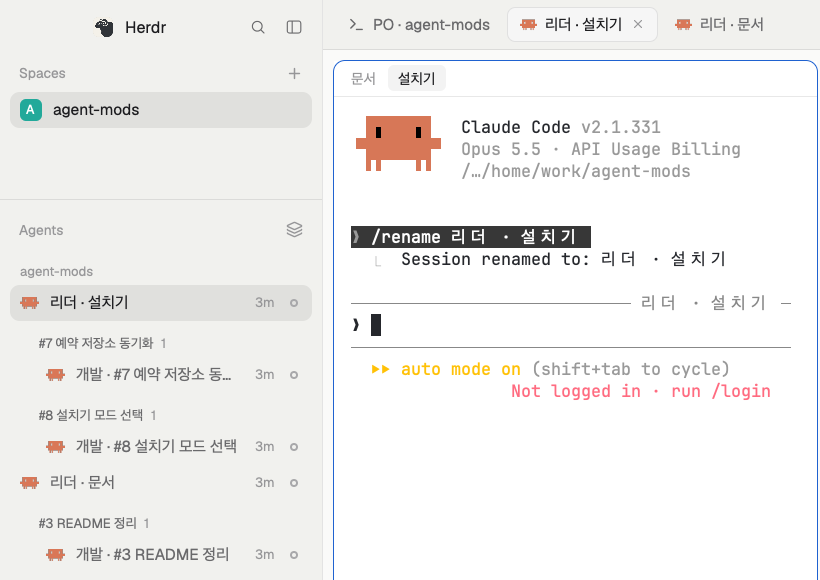

# 리더 탭 (leader-tabs)

리더 세션이 둘 이상이면 칸 머리줄에 리더 탭을 띄워, 리더 사이를 바로 옮겨 다닙니다.



*칸 머리줄의 `문서`·`설치기`가 리더 탭입니다.*

## 사용법

- **위치**: 칸 머리줄
- **맞는 사람**: 한 PO(총괄 세션) 아래에 리더 세션을 둘 이상 띄워 쓰는 사람

### 탭이 생기는 때

- 한 PO 아래 살아 있는 리더가 둘 이상일 때 생깁니다.
- 리더가 하나뿐이면 원래 칸 머리줄과 같습니다.

### 탭 이름

- 리더의 세션 이름입니다. 순서: 터미널 제목(`리더 · `는 뺌) → `session` 라벨 → 마지막으로 본 이름 → 내부 이름(`lead-po-inbox` → `po inbox`).
- 예: `리더 · 문서` → `문서`

### 탭 누르기

- 탭을 누르면 그 리더를 이 칸에 보여 주고 초점을 옮깁니다.

### 리더 칸 정리

리더 칸을 가진 리더가 끝나면 그 칸도 닫힙니다.
그때 남은 리더 하나를 다시 칸으로 띄웁니다.

- 개인 도우미 `~/.claude/skills/leader/herdr-team.sh`가 **있으면** 그것으로 정리합니다.
- 없으면(대부분) 남은 첫 리더를 PO 오른쪽에 직접 둡니다.

### 기본 머리줄과의 차이

- Herdr 기본 칸 머리줄 모드를 복제해 탭을 더한 것입니다.

## 필요한 것

- 함께 설치되는 모드: 없음
- 터미널 이름표(라벨): PO 터미널에 `role=po`, 리더 터미널에 `role=leader`(또는 `lead-`로 시작하는 이름). 이것이 **기본 이름**이고, 이름을 바꿔 쓰는 프로필은 아직 이 모드가 읽지 않습니다([이름 규칙과 프로필](inbox.md#이름-규칙과-프로필)).
- 리더 칸 정리 도우미 `~/.claude/skills/leader/herdr-team.sh`: **선택**입니다. 쓰는 사람의 개인 스크립트라 이 저장소에 없고, 없어도 됩니다(없으면 아래처럼 직접 둡니다).

## 설치

추가 모드라 기본 설치에는 들어가지 않습니다.

```sh
curl -fsSL https://raw.githubusercontent.com/xowjd913/agent-mods/main/herdr/install.sh | sh -s -- --add leader-tabs
```

```powershell
& ([scriptblock]::Create((irm https://raw.githubusercontent.com/xowjd913/agent-mods/main/herdr/install.ps1))) -Add leader-tabs
```

빼는 방법과 다른 옵션은 [모드 골라 설치](../../herdr/README.md#모드-골라-설치)에 있습니다.

---

[← 모드 목록으로](../../herdr/README.md#모드)
