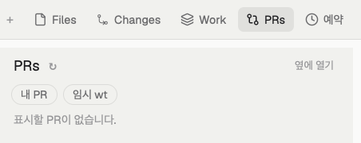

# PRs (prs)

저장소별로 열린 PR과 리뷰 상태, 정리할 워크트리를 모아 봅니다.



*데모 저장소의 PRs 패널. PR이 없어 빈 목록이 보입니다.*

## 사용법

### PR 줄

줄마다 다음을 보여 줍니다.

- CI 점
- 리뷰 상태: `승인`, `수정 요청`, `리뷰 대기`, `리뷰 요청`
- 초안 여부, 작성자, 갱신 시각

14일 넘게 갱신되지 않은 PR에는 `오래됨`이 붙습니다.

### 워크트리

- PR이 아직 없는 워크트리도 함께 보입니다.
- 이미 병합되거나 닫힌 PR의 워크트리는 `정리 후보`로 모입니다.
- PR이나 워크트리 줄에서 [워크트리 메뉴](wt-menu.md)를 열 수 있습니다.

### 위쪽 토글

- `내 PR`: 내가 작성한 PR만 봅니다.
- `임시 wt`: 이슈 번호가 없는 워크트리도 보입니다.

### 옆에 열기

- `옆에 열기`를 누르면 이 목록을 터미널 옆 칸에 띄웁니다.
- 작업하면서 PR 목록을 같이 볼 수 있습니다.

### GitHub

- GitHub에는 읽기만 하고 아무것도 쓰지 않습니다.
- 데이터는 [Work](work.md)와 같은 `mods/work/collect.cjs`가 모읍니다.

## 필요한 것

- Node.js
- GitHub CLI(`gh`) 로그인
- 함께 설치되는 모드: [Work](work.md), [패널 버튼](tabs-mine.md), [워크트리 메뉴](wt-menu.md)

## 설치

```sh
curl -fsSL https://raw.githubusercontent.com/xowjd913/agent-mods/main/herdr/install.sh | sh -s -- --add prs
```

```powershell
& ([scriptblock]::Create((irm https://raw.githubusercontent.com/xowjd913/agent-mods/main/herdr/install.ps1))) -Add prs
```

빼는 방법과 다른 옵션은 [모드 골라 설치](../../herdr/README.md#모드-골라-설치)에 있습니다.

---

[← 모드 목록으로](../../herdr/README.md#모드)
