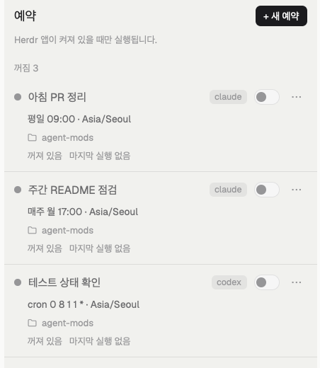

# 예약 (schedules)

정해진 시각에 Herdr가 Claude나 Codex 세션을 띄우고 프롬프트를 보냅니다.



## 사용법

### 예약 예

- "평일 아침 9시에 열린 이슈 정리"
- "금요일 17시에 주간 보고 초안"

### 예약마다 정하는 것

| 항목 | 고를 수 있는 값 |
| --- | --- |
| 일정 | `매시간`, `매일`, `평일`, `매주`, 사용자 지정 cron(5칸), 사용자 지정 RRULE |
| 프로그램 | Claude 또는 Codex. 모델과 에포트도 고릅니다. |
| 계정 | `자동 (매핑 따름)`(기본) 또는 gh 에 로그인된 GitHub 계정 하나. 아래 [GitHub 계정](#github-계정) |
| 폴더 | 기존 폴더, 또는 실행마다 새 워크트리(`auto/<이름>-<시각>` 브랜치) |
| 세션 | 매번 새로 시작하거나, 지난 실행 세션이 살아 있으면 거기에 다시 보냅니다. |
| 사전 확인 | 실행 전에 돌릴 명령. 종료 코드가 0이 아니면 `검사로 건너뜀`으로 기록합니다. |
| 유예 시간 | 놓친 실행을 얼마나 늦게까지 따라잡을지 |
| 알림 | `끄기`, `문제만`(기본: 실패·입력 대기·놓침), `모두`(완료 포함) |

일정은 시간대와 서머타임을 처리합니다.

### 실행과 기록

- **Herdr 앱이 켜져 있을 때만 돌아갑니다.**
- 앱이 꺼져 있었거나 PC가 잠들어 놓친 실행은, 앱이 다시 켜졌을 때 가장 최근 한 번만 봅니다.
  - 유예 시간 안이면 `놓친 실행`으로 돌립니다.
  - 아니면 `놓침`으로 기록합니다.
- 실행 기록 상태: `실행 중`, `완료`, `입력 대기`, `실패`, `검사로 건너뜀`, `놓침`
- `지금 실행`으로 바로 돌려 볼 수 있습니다.

### 알림

- Herdr 안의 알림과 OS 알림으로 함께 갑니다.
- OS 알림: macOS 알림 센터, Windows 토스트, Linux `notify-send`

### 권한

- Claude는 `--permission-mode auto`, Codex는 `--approve-for-me`로 띄웁니다.
- `--dangerously-*` 옵션은 쓰지 않습니다.
- 에이전트가 권한·질문 화면에서 멈추면 키를 대신 누르지 않습니다.
  - 그 실행은 `입력 대기`로 기록합니다.

### GitHub 계정

예약 세션이 `gh`·`git push`·커밋에 쓸 GitHub 계정입니다. [gh-account](../gh-account.md)가 설치돼 있어야 합니다(계정 패널에서 설치).

- **자동 (매핑 따름)**: 저장소 owner 마다 정한 공용 매핑을 따릅니다. gh-account 가 설치돼 있으면 예약 세션도 래퍼를 지나므로, Herdr 가 GUI 로 떠서 PATH 가 짧아도 gh 활성 계정이 아니라 매핑 계정을 씁니다.
- **계정을 고르면**: 그 예약의 규칙·기본 계정 대신 그 계정을 씁니다. 다만 로그인된 다른 계정의 개인 저장소에는 쓰지 않고 그 저장소 주인 계정을 씁니다(매핑의 기본 계정과 같은 안전 장치).
- 고를 수 있는 것은 gh 에 로그인된 계정뿐입니다. 저장할 때와 실행할 때 다시 확인합니다. 로그인이 풀렸거나 gh-account 가 없으면 다른 계정으로 돌지 않고 `실패`로 기록합니다. 자동은 gh-account 가 없거나 깨져도 막지 않습니다.
- 예약에는 계정 **이름만** 저장합니다. 토큰은 저장하지 않고, 실행 인자·`runs.json`·알림에도 넣지 않습니다. 세션에는 `GH_ACCOUNT=<이름>`, 래퍼 폴더를 앞에 둔 `PATH`, 커밋 신원 파일(그 계정 신원이 있고 이 폴더 저장소가 그 계정을 쓸 때만)만 넘기고, 토큰은 세션 안의 래퍼·자격 증명 도우미가 그때그때 받습니다.
- 세션 재사용으로 살아 있는 세션에 보낼 때는 그 세션이 처음 뜰 때의 계정 설정을 그대로 씁니다. 계정을 바꿨다면 새로 시작하세요.
- 기록 저장소 파일에는 계정을 적지 않습니다. 다른 PC 에서 가져오면 자동으로 시작합니다.

### 실행 방식

- [패널 버튼](tabs-mine.md)의 탭 줄이 30초마다 `mods/schedules/schedules.cjs`를 불러 때가 된 예약을 실행합니다.
- 실행은 `hc run --bg`로 세션을 띄운 뒤 `hc send`로 프롬프트를 보냅니다.
- 예약과 실행 기록은 `<설정 폴더>/schedules/`에 남습니다([데이터가 저장되는 곳](../../herdr/README.md#데이터가-저장되는-곳)).

## 필요한 것

- Node.js
- 실행할 에이전트 CLI(`claude` 또는 `codex`)
- 함께 설치되는 모드: [패널 버튼](tabs-mine.md)

## 설치

```sh
curl -fsSL https://raw.githubusercontent.com/xowjd913/agent-mods/main/herdr/install.sh | sh -s -- --add schedules
```

```powershell
& ([scriptblock]::Create((irm https://raw.githubusercontent.com/xowjd913/agent-mods/main/herdr/install.ps1))) -Add schedules
```

빼는 방법과 다른 옵션은 [모드 골라 설치](../../herdr/README.md#모드-골라-설치)에 있습니다.

---

[← 모드 목록으로](../../herdr/README.md#모드)
