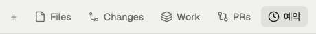

# 패널 버튼 (tabs-mine)

탭 줄 오른쪽에 `Work`·`PRs`·`예약` 패널 버튼을 더하고, 손봐야 할 PR 수를 띄웁니다.



## 사용법

### 버튼

Herdr 탭 줄 오른쪽에는 원래 `Files`와 `Changes` 버튼이 있습니다.
설치하면 그 옆에 버튼 세 개가 더 붙습니다.

| 버튼 | 패널 | 출처 |
| --- | --- | --- |
| `Files` | 파일 트리 | Herdr 기본 |
| `Changes` | git 변경 사항 | Herdr 기본 |
| `Work` | 작업 현황 | [Work](work.md) |
| `PRs` | PR 목록. 숫자는 내가 손봐야 할 PR 수 | [PRs](prs.md) |
| `예약` | 예약 실행 | [예약](schedules.md) |

- 버튼을 누르면 오른쪽 패널이 그 화면으로 바뀝니다.
- 공간(space)마다 마지막으로 고른 패널을 기억합니다.
- 레이아웃에 있는 패널의 버튼만 보입니다.

### `PRs` 숫자

다음 두 가지를 더한 값입니다.

- CI가 실패했거나 수정 요청을 받은 내 PR
- 내 리뷰를 기다리는 PR

### 예약 실행

- 예약 패널이 아니라 이 탭 줄이 30초마다 예약을 확인해 실행합니다.
  - 탭 줄은 늘 화면에 있기 때문입니다.
- 예약으로 뜬 세션은 탭으로 붙여 보여 줍니다.

### 원래 탭과의 차이

- Herdr 기본 `tabs` 모드를 복제해 버튼만 더한 것입니다.
- 탭 동작은 원래와 같습니다.

## 필요한 것

- 함께 설치되는 모드: 없음
- `PRs` 숫자: Node.js, GitHub CLI(`gh`) 로그인, [Work](work.md) 모드
  - 없으면 숫자만 보이지 않습니다.
- 예약 실행: [예약](schedules.md) 모드
  - 없으면 그 동작만 건너뜁니다.

## 설치

```sh
curl -fsSL https://raw.githubusercontent.com/xowjd913/agent-mods/main/herdr/install.sh | sh -s -- --add tabs-mine
```

```powershell
& ([scriptblock]::Create((irm https://raw.githubusercontent.com/xowjd913/agent-mods/main/herdr/install.ps1))) -Add tabs-mine
```

빼는 방법과 다른 옵션은 [모드 골라 설치](../../herdr/README.md#모드-골라-설치)에 있습니다.

---

[← 모드 목록으로](../../herdr/README.md#모드)
