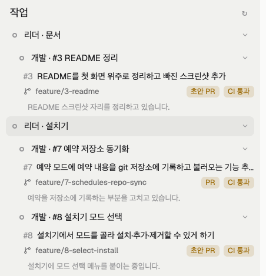

# Work (work)

Herdr에서 돌고 있는 에이전트 세션과 그 세션이 맡은 이슈, 워크트리, PR, CI를 한 트리로 봅니다.



## 사용법

### 트리 구조

- 맨 위는 세션입니다.
- 세션 아래에는 그 세션이 다루는 이슈가 있습니다.
- 이슈 아래에는 그 이슈의 워크트리가 있습니다.

### 누르기

- 세션 줄: 그 터미널로 이동합니다. `⌄`로 접고 펼 수 있습니다.
- 이슈 줄: GitHub 이슈가 브라우저에서 열립니다.
- 워크트리 줄: [워크트리 메뉴](wt-menu.md)가 뜹니다.
- `↻`: 캐시를 건너뛰고 바로 다시 읽습니다.

### 보이는 정보

- **이슈**: 제목과 GitHub Projects의 `Status` 값
  - 상위 이슈(에픽)가 있으면 하위 이슈 진행률도 보여 줍니다.
- **워크트리**: 브랜치, PR 상태, CI
  - PR 상태: `PR`, `초안 PR`, `병합됨`, `닫힘`, `PR 없음`
  - CI: `CI 통과`, `CI 실패`, `CI 진행`
- **마지막 작업 줄**: 세션이 마지막으로 남긴 한 줄

### 세션과 이슈를 잇는 방법

- 브랜치·폴더 이름에 든 이슈 번호(`feature/42-...`, `review-42`)
- 세션이 다룬 폴더

### 데이터

- `mods/work/collect.cjs`가 로컬과 GitHub에서 모은 정보를 씁니다.
  - [PRs](prs.md) 패널과 [패널 버튼](tabs-mine.md)의 `PRs` 숫자도 같은 정보를 씁니다.
- 캐시는 로컬 30초, GitHub 3분입니다.
- 처음 읽을 때는 5~15초쯤 걸립니다.
- 자세한 방식은 [패널이 데이터를 얻는 방법](../../herdr/README.md#패널이-데이터를-얻는-방법)에 있습니다.

## 필요한 것

- Node.js
- GitHub CLI(`gh`) 로그인
  - `gh`가 없으면 GitHub 쪽 정보만 비고, 로컬 세션·워크트리는 보입니다.
- 함께 설치되는 모드: [패널 버튼](tabs-mine.md), [워크트리 메뉴](wt-menu.md)

## 설치

```sh
curl -fsSL https://raw.githubusercontent.com/xowjd913/agent-mods/main/herdr/install.sh | sh -s -- --add work
```

```powershell
& ([scriptblock]::Create((irm https://raw.githubusercontent.com/xowjd913/agent-mods/main/herdr/install.ps1))) -Add work
```

빼는 방법과 다른 옵션은 [모드 골라 설치](../../herdr/README.md#모드-골라-설치)에 있습니다.

---

[← 모드 목록으로](../../herdr/README.md#모드)
