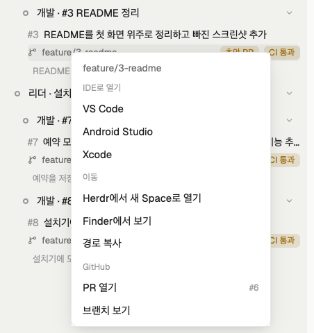

# 워크트리 메뉴 (wt-menu)

Work나 PRs에서 워크트리 줄을 누르면 뜨는 팝업으로, 워크트리를 IDE, Herdr 공간, Finder·탐색기, GitHub로 바로 엽니다.



## 사용법

무언가를 바꾸지 않고 여는 일만 합니다.

### IDE로 열기

- 이 PC에 설치된 IDE만 찾아서 보여 줍니다.
- VS Code, Cursor, JetBrains 계열, Zed 등입니다.

### 이동

- **Herdr Space로 이동**: 그 워크트리를 연 공간으로 갑니다.
  - 열린 공간이 없으면 `Herdr에서 새 Space로 열기`가 대신 나옵니다.
- **Finder·탐색기에서 보기**
- **경로 복사**

### GitHub

저장소를 알 때만 나옵니다.

- PR이 있으면 `PR 열기`가 나옵니다.
- PR이 없으면 `PR 만들기`가 나옵니다.
  - GitHub 비교 페이지를 열기만 합니다.
- 브랜치가 있으면 `브랜치 보기`가 나옵니다.

## 필요한 것

- 함께 설치되는 모드: 없음
- 이 메뉴를 여는 [Work](work.md)나 [PRs](prs.md)가 있어야 쓸 수 있습니다.

## 설치

```sh
curl -fsSL https://raw.githubusercontent.com/xowjd913/agent-mods/main/herdr/install.sh | sh -s -- --add wt-menu
```

```powershell
& ([scriptblock]::Create((irm https://raw.githubusercontent.com/xowjd913/agent-mods/main/herdr/install.ps1))) -Add wt-menu
```

빼는 방법과 다른 옵션은 [모드 골라 설치](../../herdr/README.md#모드-골라-설치)에 있습니다.

---

[← 모드 목록으로](../../herdr/README.md#모드)
