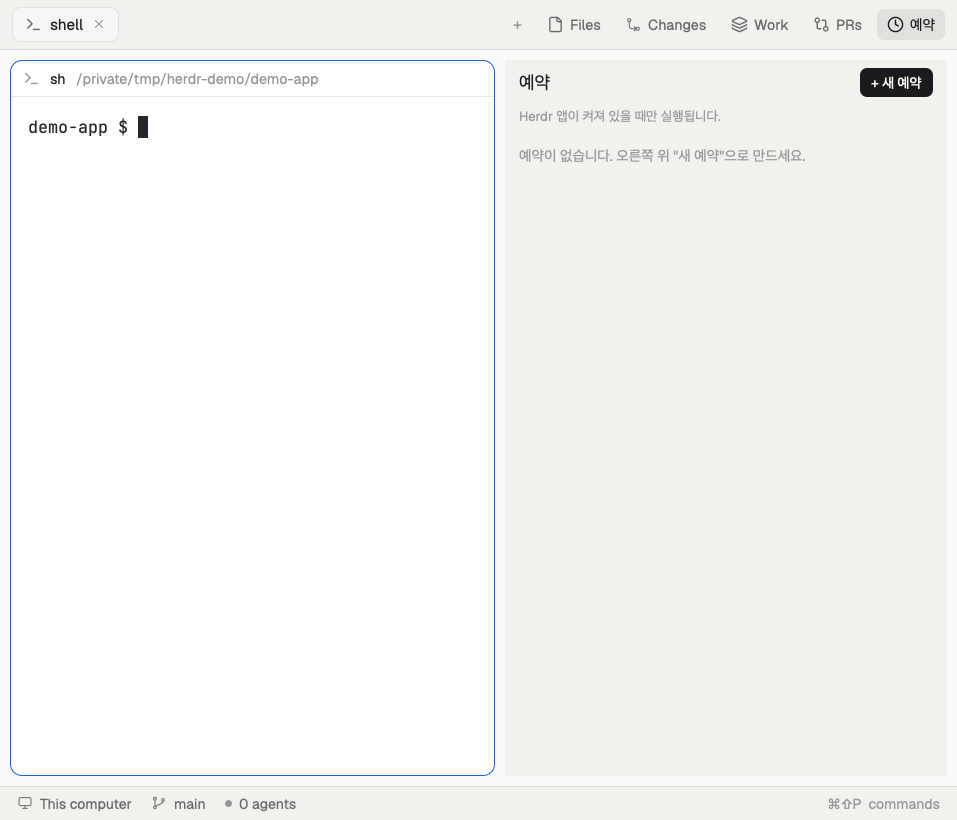
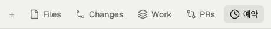
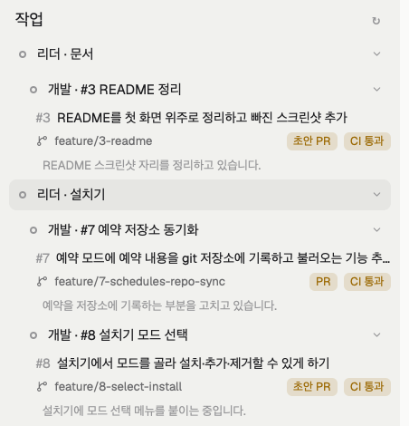
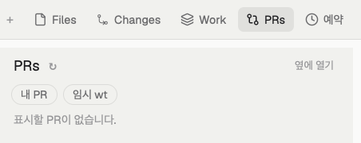
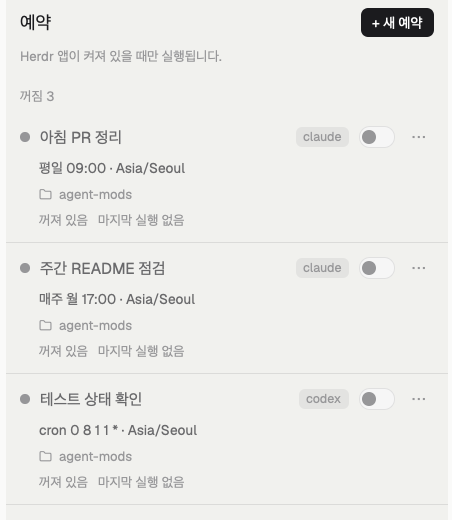
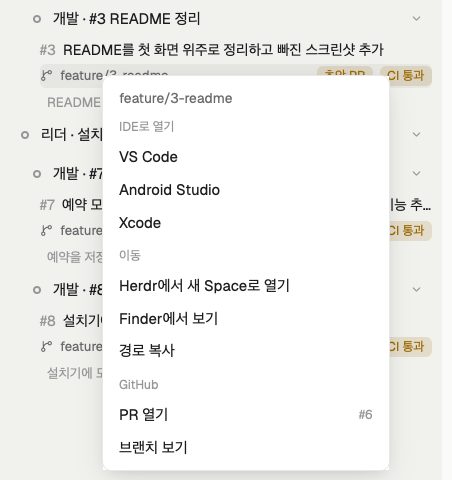
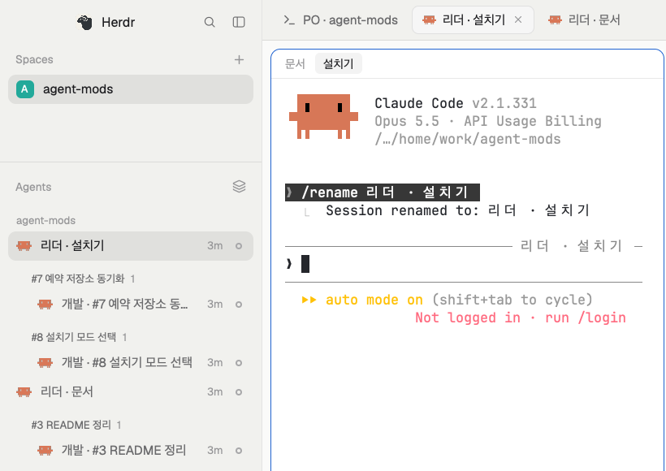

# Herdr 모드

터미널 작업 공간 앱 [Herdr](https://github.com/herdrdev/herdr)용 모드의 자세한 설명입니다.
소개와 빠른 설치는 [저장소 첫 화면](../README.md)에 있습니다.

## 목차

- [둘러보기](#둘러보기)
  - [오른쪽 패널 버튼 (tabs-mine)](#오른쪽-패널-버튼-tabs-mine)
  - [Work: 누가 무엇을 하고 있나](#work-누가-무엇을-하고-있나)
  - [PRs: 무엇을 손봐야 하나](#prs-무엇을-손봐야-하나)
  - [예약: 정해진 시각에 에이전트 돌리기](#예약-정해진-시각에-에이전트-돌리기)
  - [워크트리 메뉴 (wt-menu)](#워크트리-메뉴-wt-menu)
  - [추가 모드](#추가-모드)
    - [usage-status: Claude 사용률](#usage-status-claude-사용률)
    - [agent-groups: 작업별 묶음](#agent-groups-작업별-묶음)
    - [leader-tabs: 리더 탭](#leader-tabs-리더-탭)
- [설치](#설치)
  - [모드 골라 설치](#모드-골라-설치)
- [업데이트와 제거](#업데이트와-제거)
- [동작 방식](#동작-방식)
- [데이터가 저장되는 곳](#데이터가-저장되는-곳)

---

## 둘러보기

- 스크린샷은 설명용 빈 데모 저장소(`demo-app`)를 열어 실제로 찍은 화면입니다.
- 데모에는 GitHub 데이터가 없어서, 목록이 차 있는 모습은 글자 스케치로 보여 줍니다.
- 스케치의 저장소 이름, 이슈, 브랜치는 모두 설명용으로 지어낸 것입니다.

### 오른쪽 패널 버튼 (tabs-mine)

Herdr 탭 줄 오른쪽에는 원래 `Files`와 `Changes` 패널 버튼이 있습니다.
설치하면 그 옆에 버튼 세 개가 더 붙습니다.



*설치 직후 데모 저장소에서 `예약` 패널을 연 화면*



| 버튼 | 패널 | 출처 |
| --- | --- | --- |
| `Files` | 파일 트리 | Herdr 기본 |
| `Changes` | git 변경 사항 | Herdr 기본 |
| `Work` | 작업 현황 | 이 저장소 (`work`) |
| `PRs` | PR 목록. 숫자는 내가 손봐야 할 PR 수 | 이 저장소 (`prs`) |
| `예약` | 예약 실행 | 이 저장소 (`schedules`) |

- 버튼을 누르면 오른쪽 패널이 그 화면으로 바뀝니다.
- 공간(space)마다 마지막으로 고른 패널을 기억합니다.
- `PRs` 숫자는 두 가지를 더한 값입니다.
  - CI가 실패했거나 수정 요청을 받은 내 PR
  - 내 리뷰를 기다리는 PR
- 탭 줄 자체는 Herdr 기본 `tabs` 모드를 복제해 버튼만 더한 것이라, 탭 동작은 원래와 같습니다.

### Work: 누가 무엇을 하고 있나

Herdr에서 돌고 있는 에이전트 세션을 트리로 보여 줍니다.

- 세션 아래에는 그 세션이 다루는 이슈가 있습니다.
- 이슈 아래에는 그 이슈의 워크트리가 있습니다.



할 수 있는 것:

- 세션 줄을 누르면 그 터미널로 이동합니다. `⌄`로 접고 펼 수 있습니다.
- 이슈 줄을 누르면 GitHub 이슈가 브라우저에서 열립니다.
- 워크트리 줄을 누르면 [워크트리 메뉴](#워크트리-메뉴-wt-menu)가 뜹니다.
- `↻`는 캐시를 건너뛰고 바로 다시 읽습니다.

보이는 정보:

- **이슈**: 제목과 GitHub Projects의 `Status` 값을 보여 줍니다.
  - 상위 이슈(에픽)가 있으면 하위 이슈 진행률도 보여 줍니다.
- **워크트리**: 브랜치, PR 상태, CI를 보여 줍니다.
  - PR 상태: `PR`, `초안 PR`, `병합됨`, `닫힘`, `PR 없음`
  - CI: `CI 통과`, `CI 실패`, `CI 진행`
- **마지막 작업 줄**: 세션이 마지막으로 남긴 한 줄입니다.

세션과 이슈는 두 가지로 이어 붙입니다.

- 브랜치·폴더 이름에 든 이슈 번호(`feature/42-...`, `review-42`)
- 세션이 다룬 폴더

필요한 것: Node.js, GitHub CLI(`gh`) 로그인.
`gh`가 없으면 GitHub 쪽 정보만 비고, 로컬 세션·워크트리는 보입니다.

### PRs: 무엇을 손봐야 하나

저장소별로 열린 PR을 모아 봅니다.



*데모 저장소의 PRs 패널. PR이 없어 빈 목록이 보입니다.*

- 줄마다 다음을 보여 줍니다.
  - CI 점
  - 리뷰 상태(`승인`, `수정 요청`, `리뷰 대기`, `리뷰 요청`)
  - 초안 여부, 작성자, 갱신 시각
- 14일 넘게 갱신되지 않은 PR에는 `오래됨`이 붙습니다.
- PR이 아직 없는 워크트리도 함께 보입니다.
- 이미 병합되거나 닫힌 PR의 워크트리는 `정리 후보`로 모입니다.
- 위쪽 토글:
  - `내 PR`: 내가 작성한 PR만 봅니다.
  - `임시 wt`: 이슈 번호가 없는 워크트리도 보입니다.
- `옆에 열기`를 누르면 이 목록을 터미널 옆 칸에 띄워 두고, 작업하면서 볼 수 있습니다.
- PR이나 워크트리 줄에서 [워크트리 메뉴](#워크트리-메뉴-wt-menu)를 열 수 있습니다.

필요한 것: Work와 같습니다.
GitHub에는 읽기만 하고 아무것도 쓰지 않습니다.

### 예약: 정해진 시각에 에이전트 돌리기

이런 일을 예약해 두면, 그 시각에 Herdr가 Claude나 Codex 세션을 띄우고 프롬프트를 보냅니다.

- "평일 아침 9시에 열린 이슈 정리"
- "금요일 17시에 주간 보고 초안"



예약마다 정하는 것:

| 항목 | 고를 수 있는 값 |
| --- | --- |
| 일정 | `매시간`, `매일`, `평일`, `매주`, 사용자 지정 cron(5칸), 사용자 지정 RRULE. 시간대와 서머타임을 처리합니다. |
| 프로그램 | Claude 또는 Codex. 모델과 에포트도 고를 수 있습니다. |
| 폴더 | 기존 폴더, 또는 실행마다 새 워크트리(`auto/<이름>-<시각>` 브랜치) |
| 세션 | 매번 새로 시작하거나, 지난 실행 세션이 살아 있으면 거기에 다시 보냅니다. |
| 사전 확인 | 예약 실행 전에 돌릴 명령입니다. 종료 코드가 0이 아니면 `검사로 건너뜀`으로 기록합니다. |
| 유예 시간 | 놓친 실행을 얼마나 늦게까지 따라잡을지 정합니다. |
| 알림 | `끄기`, `문제만`(기본: 실패·입력 대기·놓침), `모두`(완료 포함) |

알아 둘 점:

- **Herdr 앱이 켜져 있을 때만 돌아갑니다.**
  - 앱이 꺼져 있었거나 PC가 잠들어 실행을 놓쳤다면, 앱이 다시 켜졌을 때 가장 최근 한 번만 봅니다.
  - 유예 시간 안이면 `놓친 실행`으로 돌리고, 아니면 `놓침`으로 기록합니다.
- 실행 기록에는 `실행 중`, `완료`, `입력 대기`, `실패`, `검사로 건너뜀`, `놓침`이 남습니다.
- `지금 실행`으로 바로 돌려 볼 수도 있습니다.
- 알림은 Herdr 안의 알림과 OS 알림으로 함께 갑니다.
  - OS 알림: macOS 알림 센터, Windows 토스트, Linux `notify-send`
- **권한:**
  - Claude는 `--permission-mode auto`, Codex는 `--approve-for-me`로 띄웁니다.
  - `--dangerously-*` 옵션은 쓰지 않습니다.
  - 에이전트가 권한·질문 화면에서 멈추면 키를 대신 누르지 않고 `입력 대기`로 기록합니다.

필요한 것: Node.js.
실행할 에이전트 CLI(`claude` 또는 `codex`)가 설치돼 있어야 합니다.

### 워크트리 메뉴 (wt-menu)

Work나 PRs에서 워크트리 줄을 누르면 뜨는 작은 팝업입니다.
무언가를 바꾸지 않고 여는 일만 합니다.



- **IDE로 열기**: 이 PC에 설치된 IDE만 찾아서 보여 줍니다. VS Code, Cursor, JetBrains 계열, Zed 등입니다.
- **Herdr Space로 이동**: 그 워크트리를 연 공간으로 갑니다.
  - 열린 공간이 없으면 `Herdr에서 새 Space로 열기`가 대신 나옵니다.
- **Finder·탐색기에서 보기**, **경로 복사**.
- **PR**:
  - PR이 있으면 `PR 열기`를 보여 줍니다.
  - 없으면 `PR 만들기`가 나옵니다. GitHub 비교 페이지를 열기만 합니다.
  - 기본 브랜치에서는 `브랜치 보기`가 나옵니다.

### 추가 모드

필요한 사람만 `--extras`(Windows는 `-Extras`)로 설치합니다.
하나씩 넣으려면 [모드 골라 설치](#모드-골라-설치)의 `--add`를 씁니다.

셋 다 Herdr 기본 모드를 복제해 기능을 더한 것입니다.
해당 정보가 없으면 기본 모드와 거의 같게 보입니다.

#### usage-status: Claude 사용률

- **위치**: 아래 상태 줄
- **맞는 사람**: Claude 요금제 한도를 자주 확인하는 사람
- **하는 일**: 상태 줄 오른쪽에 5시간·7일 사용률을 막대로 보여 줍니다. 80% 이상이면 경고 색으로 바뀝니다.


- `~/.claude/usage-limits.json`을 1분마다 읽기만 하고, 네트워크 호출은 하지 않습니다.
- 이 파일은 Claude Code 상태 줄(statusline) 스크립트 등이 따로 써 줘야 합니다.
- 파일이 없거나 10분 넘게 갱신되지 않으면 `Claude Unknown`을 보여 줍니다.
- 파일 형식은 다음과 같습니다.

  ```json
  { "updatedAt": "2026-01-01T09:00:00Z", "limits": [ { "kind": "five_hour", "percentUsed": 42 }, { "kind": "seven_day", "percentUsed": 16 } ] }
  ```

#### agent-groups: 작업별 묶음

- **위치**: 왼쪽 사이드바
- **맞는 사람**: 에이전트를 역할별로 나눠 여러 이슈를 동시에 돌리는 사람
- **하는 일**: 사이드바 에이전트 목록에 `작업별 묶음` 보기가 생깁니다.
  - 터미널을 이슈 번호별로 묶고, 리더를 맨 위에 둡니다.
  - Herdr 기본 보기(우선순위순, 공간별)도 그대로 고를 수 있습니다.



묶음은 두 가지로 정합니다.

- 터미널 라벨: `role=po`, `role=leader`, `group-issue`, `session`
- `hc` 이름: `dev-<이슈>`, `review-<이슈>`, `integration-<이슈>`

#### leader-tabs: 리더 탭

- **위치**: 칸 머리줄
- **맞는 사람**: 한 PO(총괄 세션) 아래에 리더 세션을 둘 이상 띄워 쓰는 사람
- **하는 일**: 살아 있는 리더가 둘 이상이면 칸 머리줄에 리더 탭이 생겨, 리더 사이를 바로 옮겨 다닐 수 있습니다.

알아 둘 점:

- 탭 이름은 리더 세션 제목에서 `리더 · `를 뺀 것입니다. [작업별 묶음 그림](#agent-groups-작업별-묶음)의 `문서`·`설치기`가 그 예입니다.
- `~/.claude/skills/leader/herdr-team.sh`가 있으면 리더 칸 정리에 그것을 부릅니다. 없으면 그 동작만 하지 않습니다.

---

## 설치

### 필요한 것

| 항목 | 용도 |
| --- | --- |
| Herdr 앱 | 한 번 실행해 설정 폴더가 있어야 합니다.<br>처음 설치할 때는 앱이 켜져 있어야 레이아웃을 만듭니다.<br>`hc` 명령은 Herdr에 들어 있습니다. |
| Node.js | 설치기와 Work·PRs·예약 패널이 씁니다. 꼭 있어야 합니다. |
| GitHub CLI(`gh`) | Work·PRs 패널이 GitHub 데이터를 읽습니다. `gh auth login`으로 로그인해 두세요. |

- macOS에서 확인했습니다.
- Windows 설치기와 Windows 경로 처리는 작성돼 있지만, 실제 Windows PC에서는 아직 확인하지 않았습니다.
- Windows에서 Herdr 설정 폴더가 다르면 `HERDR_APP_HOME`을 지정하세요.

### 설치 명령

Herdr 앱을 켠 상태에서 한 줄로 설치합니다.

macOS·Linux:

```sh
# 기본 모드
curl -fsSL https://raw.githubusercontent.com/xowjd913/agent-mods/main/herdr/install.sh | sh
# 추가 모드까지
curl -fsSL https://raw.githubusercontent.com/xowjd913/agent-mods/main/herdr/install.sh | sh -s -- --extras
```

Windows(PowerShell):

```powershell
# 기본 모드
& ([scriptblock]::Create((irm https://raw.githubusercontent.com/xowjd913/agent-mods/main/herdr/install.ps1)))
# 추가 모드까지
& ([scriptblock]::Create((irm https://raw.githubusercontent.com/xowjd913/agent-mods/main/herdr/install.ps1))) -Extras
```

저장소를 받아서 실행해도 됩니다.

```sh
git clone https://github.com/xowjd913/agent-mods
sh agent-mods/herdr/install.sh            # Windows: .\agent-mods\herdr\install.ps1
sh agent-mods/herdr/install.sh --extras   # Windows: .\agent-mods\herdr\install.ps1 -Extras
```

설치가 끝나면:

- Herdr가 `dashboard` 레이아웃으로 바뀌고, 탭 줄에 `Work`·`PRs`·`예약` 버튼이 보입니다.
- 원래 쓰던 `main` 레이아웃은 그대로이며, `ctrl-shift-l`로 언제든 오갈 수 있습니다.

잘 안 될 때:

- 앱이 꺼져 있었다면 모드만 복사됩니다. 앱을 켜고 같은 명령을 한 번 더 실행하세요.
- 문제가 생겨도 설치기는 안내만 출력하고 끝나며, Herdr 설정을 망가뜨리지 않습니다.

### 모드 골라 설치

기본 모드나 추가 모드를 통째로 넣지 않고, 필요한 모드만 골라 넣거나 뺄 수 있습니다.

| macOS·Linux | Windows | 하는 일 |
| --- | --- | --- |
| (옵션 없음) | (옵션 없음) | 설치된 모드만 갱신합니다. 처음이면 기본 모드 5개를 설치합니다. |
| `--extras` | `-Extras` | 모드 8개를 모두 설치합니다. |
| `--only <모드>` | `-Only <모드>` | 고른 모드만 설치·갱신합니다. 이미 설치된 다른 모드는 그대로 둡니다. |
| `--add <모드>` | `-Add <모드>` | 설치된 모드에 고른 모드를 더합니다. |
| `--remove <모드>` | `-Remove <모드>` | 고른 모드를 지우고, 그 모드가 바꾼 레이아웃 블록을 되돌립니다. |
| `--list` | `-List` | 모드마다 설명과 설치 상태를 보여 줍니다. |

- `<모드>`는 [모드 표](../README.md#모드)의 괄호 안 이름입니다(`work`, `usage-status` 등).
- 여러 개는 쉼표로 잇습니다(`--only work,prs`).

macOS·Linux 예:

```sh
# Claude 사용률(usage-status)만 설치
curl -fsSL https://raw.githubusercontent.com/xowjd913/agent-mods/main/herdr/install.sh | sh -s -- --only usage-status

# PRs 패널 더하기 (work, tabs-mine, wt-menu도 함께 들어감)
curl -fsSL https://raw.githubusercontent.com/xowjd913/agent-mods/main/herdr/install.sh | sh -s -- --add prs

# 리더 탭 빼기
curl -fsSL https://raw.githubusercontent.com/xowjd913/agent-mods/main/herdr/install.sh | sh -s -- --remove leader-tabs

# 설치 상태 보기
curl -fsSL https://raw.githubusercontent.com/xowjd913/agent-mods/main/herdr/install.sh | sh -s -- --list
```

Windows(PowerShell) 예:

```powershell
# Claude 사용률(usage-status)만 설치
& ([scriptblock]::Create((irm https://raw.githubusercontent.com/xowjd913/agent-mods/main/herdr/install.ps1))) -Only usage-status

# 설치 상태 보기
& ([scriptblock]::Create((irm https://raw.githubusercontent.com/xowjd913/agent-mods/main/herdr/install.ps1))) -List
```

저장소를 받았다면 `sh agent-mods/herdr/install.sh --only usage-status`처럼 씁니다.
Windows는 `.\agent-mods\herdr\install.ps1 -Only usage-status`입니다.

알아 둘 점:

- 옵션은 한 번에 하나만 씁니다. 둘을 함께 주면 아무것도 하지 않고 안내만 출력합니다.
- 모르는 모드 이름을 주면 쓸 수 있는 이름을 보여 주고 끝납니다.
- 필요한 모드는 자동으로 함께 설치합니다.
  - `work`: `tabs-mine`, `wt-menu`
  - `prs`: `work`, `tabs-mine`, `wt-menu`
  - `schedules`: `tabs-mine`
- 남은 모드가 쓰는 모드는 지우지 않습니다.
  - 예: `work`가 설치돼 있으면 `--remove wt-menu`는 아무것도 지우지 않고, 함께 지울 이름을 알려 줍니다.
- `--remove`(Windows는 `-Remove`)는 고른 모드 폴더를 지우고, 그 모드가 바꾼 레이아웃 블록을 되돌립니다.
  - 모드 폴더 밖의 예약 기록, PRs `옆에 열기` 기록, 캐시는 남습니다([데이터가 저장되는 곳](#데이터가-저장되는-곳)).

---

## 업데이트와 제거

### 업데이트

설치 명령을 옵션 없이 다시 실행합니다. 몇 번을 실행해도 결과가 같습니다.

- 설치돼 있는 모드만 갱신합니다.
  - 추가 모드를 한 번 설치했다면 `--extras` 없이 실행해도 추가 모드가 함께 갱신됩니다.
- 화면이 바로 바뀌지 않으면 `ctrl-shift-l`로 다른 레이아웃에 갔다가 돌아오세요.
- 레이아웃에서 직접 되돌린 블록은 다시 바꾸지 않습니다.
  - 원하는 대로 고쳐 쓴 화면이 업데이트로 덮이지 않습니다.

### 제거

모드 하나만 빼려면 [모드 골라 설치](#모드-골라-설치)의 `--remove`를 씁니다.
모두 지울 때는 다음 순서를 따릅니다.

1. `ctrl-shift-l`로 `main` 등 다른 레이아웃으로 바꿉니다.
2. `<설정 폴더>/layouts/dashboard.json`을 지웁니다.
3. `<설정 폴더>/mods/` 아래에서 `.installed-by-herdr-installer` 표시 파일이 있는 폴더를 지웁니다.
   - 각 단계의 기록 파일(`.tabs-swapped` 등)도 이 폴더 안에 있어 함께 지워집니다.
4. 필요하면 남은 기록도 지웁니다.
   - 예약과 실행 기록: `<설정 폴더>/schedules/`
   - 캐시: `<설정 폴더>/cache/collect.json`
   - PRs의 `옆에 열기` 기록: `<설정 폴더>/data/prs/`

`<설정 폴더>`는 `HERDR_APP_HOME`이고, 지정하지 않았다면 `~/.config/herdr-app`입니다.

macOS·Linux:

```sh
H="${HERDR_APP_HOME:-$HOME/.config/herdr-app}"
rm -f "$H/layouts/dashboard.json"
for d in "$H"/mods/*/; do [ -f "$d.installed-by-herdr-installer" ] && rm -rf "$d"; done
```

Windows(PowerShell):

```powershell
$H = if ($env:HERDR_APP_HOME) { $env:HERDR_APP_HOME } else { Join-Path $HOME '.config\herdr-app' }
Remove-Item -Force -ErrorAction SilentlyContinue (Join-Path $H 'layouts\dashboard.json')
Get-ChildItem (Join-Path $H 'mods') -Directory |
  Where-Object { Test-Path (Join-Path $_.FullName '.installed-by-herdr-installer') } |
  Remove-Item -Recurse -Force
```

**예전 설치 스크립트로 설치했던 경우**에는 다음도 남아 있을 수 있습니다. 위 명령은 이것들을 지우지 않습니다.

- `<설정 폴더>/layouts/agent-groups.json`: 예전 설치가 만든 레이아웃입니다.
  - 새 설치기는 이 레이아웃이 있으면 `dashboard`를 새로 만들지 않고 이것을 계속 씁니다.
- `.installed-by-agent-playbook` 표시 파일만 있는 모드 폴더.
  - 새 설치기로 한 번 다시 설치하면 새 표시 파일도 생깁니다.

---

## 동작 방식

### 설치기가 하는 일

설치 스크립트(`install.sh`, `install.ps1`)는 환경을 확인한 뒤 공통 도우미 `install.cjs`를 부릅니다.

1. **모드 복사**: `herdr/mods/<모드>/`를 `<설정 폴더>/mods/<모드>/`에 복사합니다.
   - `.installed-by-herdr-installer` 표시 파일을 남깁니다.
   - 표시가 없는 같은 이름 폴더는 직접 만든 모드로 보고 덮어쓰지 않습니다.
2. **레이아웃 만들기**: `dashboard` 레이아웃이 없으면 실행 중인 앱에 `herdr-app do layout.clone`을 보냅니다.
   - `main`을 복제하고, 그 레이아웃으로 바꿉니다.
3. **블록 넣기**: `dashboard`에 설치된 모드의 블록을 넣습니다.
   - `tabs-mine`: 탭 줄 `tabs`를 `tabs-mine`으로 바꿉니다.
   - `work`·`prs`·`schedules`: 오른쪽 패널에 `work-board`, `pr-board`, `schedules-board`를 더합니다.
   - `agent-groups`: `agents`를 `agent-groups`로 바꿉니다.
   - `usage-status`: `workspace-status`를 `usage-status`로 바꿉니다.
   - `leader-tabs`: 칸 머리줄 `pane`을 `leader-tabs`로 바꿉니다.
4. **기록 남기기**: 단계마다 모드 폴더 안에 기록 파일을 남깁니다.
   - 예: `.tabs-swapped`, `.work-board-added`, `.pr-board-added`, `.board-added`, `.agents-swapped`, `.status-swapped`, `.header-swapped`
   - 다음 설치는 기록이 있는 단계를 건너뛰므로, 사용자가 되돌린 블록은 그대로 둡니다.

같은 이름이지만 이 설치기의 모드를 쓰지 않는 `dashboard` 레이아웃이 이미 있으면, 그 레이아웃은 건드리지 않습니다.

### 패널이 데이터를 얻는 방법

- Work·PRs·`PRs` 버튼 숫자는 모두 `mods/work/collect.cjs` 하나가 모은 JSON을 씁니다.
  - collect.cjs는 Herdr 터미널 목록, 각 저장소의 git 워크트리, Claude Code 세션 기록(`~/.claude`)을 로컬에서 읽습니다.
  - GitHub 이슈·PR·리뷰·CI는 `gh`로 GraphQL 한 번에 읽습니다. 쓰기는 하지 않습니다.
  - 캐시는 로컬 30초, GitHub 3분입니다. 처음 읽을 때는 5~15초쯤 걸립니다.
- 예약 패널은 `mods/schedules/schedules.cjs`를 30초마다 불러 때가 된 예약을 실행합니다.
  - 실행은 `hc run --bg`로 세션을 띄운 뒤 `hc send`로 프롬프트를 보내는 방식입니다.

---

## 데이터가 저장되는 곳

| 위치 | 내용 | 지워도 되나 |
| --- | --- | --- |
| `<설정 폴더>/mods/<모드>/` | 설치된 모드와 단계 기록 파일 | 제거할 때 지웁니다 |
| `<설정 폴더>/layouts/dashboard.json` | 설치기가 만든 레이아웃 | 제거할 때 지웁니다 |
| `<설정 폴더>/cache/collect.json` | Work·PRs 캐시 | 언제든. 다시 만들어집니다 |
| `<설정 폴더>/schedules/` | 예약(`automations.json`)과 실행 기록(`runs.json`) | 지우면 예약이 사라집니다 |
| `<설정 폴더>/data/prs/` | PRs `옆에 열기` 상태 | 언제든 |
| `~/.claude/usage-limits.json` | usage-status가 읽는 파일(다른 도구가 씀) | 이 저장소가 만들지 않습니다 |

패널 선택이나 토글 같은 화면 설정은 Herdr가 모드마다 따로 보관합니다.
